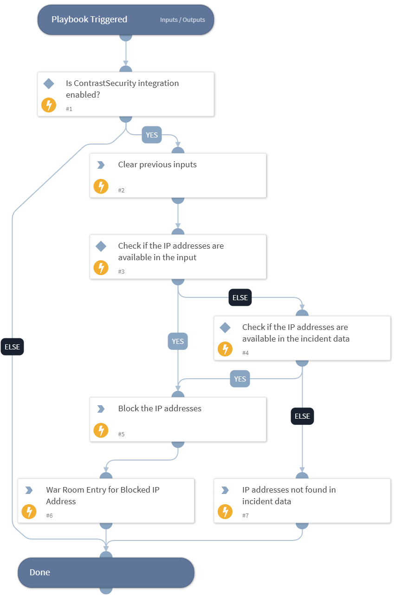

This playbook blocks IP addresses related to a Contrast Security incident by creating organization-level IP policies based on the provided expiration time.

## Dependencies

This playbook uses the following sub-playbooks, integrations, and scripts.

### Sub-playbooks

This playbook does not use any sub-playbooks.

### Integrations

This playbook does not use any integrations.

### Scripts

* DeleteContext
* Print

### Commands

* contrastsecurity-ip-block

## Playbook Inputs

---

| **Name** | **Description** | **Default Value** | **Required** |
| --- | --- | --- | --- |
| ip_addresses | Specify the IP addresses to block. Supports comma-separated values. If not provided, the IP addresses are retrieved from the Contrast Security Source IP field of the incident. |  | Optional |
| incident_id | Specify the ID of the incident. The incident ID is used as the prefix of the IP policy name, followed by a timestamp so that repeated runs do not collide on the policy name. |  | Optional |
| expiration_date | Specify the expiration duration for the blocked IP addresses. If not provided, the IP addresses are blocked permanently. |  | Optional |

## Playbook Outputs

---
There are no outputs for this playbook.

## Playbook Image

---

