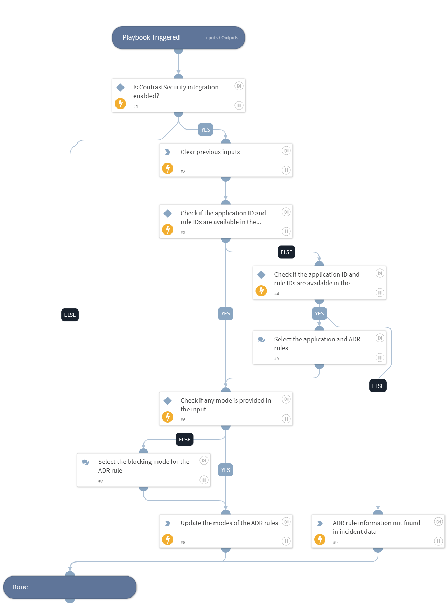

This playbook updates the blocking mode of ADR rules for an application associated with a Contrast Security incident.

## Dependencies

This playbook uses the following sub-playbooks, integrations, and scripts.

### Sub-playbooks

This playbook does not use any sub-playbooks.

### Integrations

This playbook does not use any integrations.

### Scripts

* DeleteContext
* Print

### Commands

* contrastsecurity-adr-rule-update

## Playbook Inputs

---

| **Name** | **Description** | **Default Value** | **Required** |
| --- | --- | --- | --- |
| application_id | Specify the ID of the application. If not provided, the application ID is retrieved from the Contrast Security Applications field of the incident. |  | Optional |
| rule_ids | Specify the IDs of the ADR rules to update. Supports comma-separated values. If not provided, the rule IDs are retrieved from the Contrast Security Rules field of the incident. |  | Optional |
| dev_mode | Specify the mode for the development environment. Possible values are: Off, Monitor, Block, Block at perimeter, Monitor at perimeter. If not provided, the current mode of the development environment is retained. |  | Optional |
| qa_mode | Specify the mode for the QA environment. Possible values are: Off, Monitor, Block, Block at perimeter, Monitor at perimeter. If not provided, the current mode of the QA environment is retained. |  | Optional |
| prod_mode | Specify the mode for the production environment. Possible values are: Off, Monitor, Block, Block at perimeter, Monitor at perimeter. If not provided, the current mode of the production environment is retained. |  | Optional |

## Playbook Outputs

---
There are no outputs for this playbook.

## Playbook Image

---

