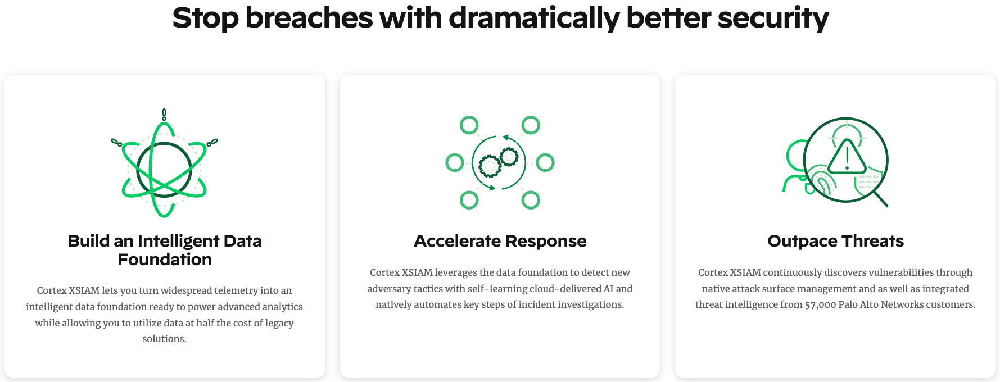
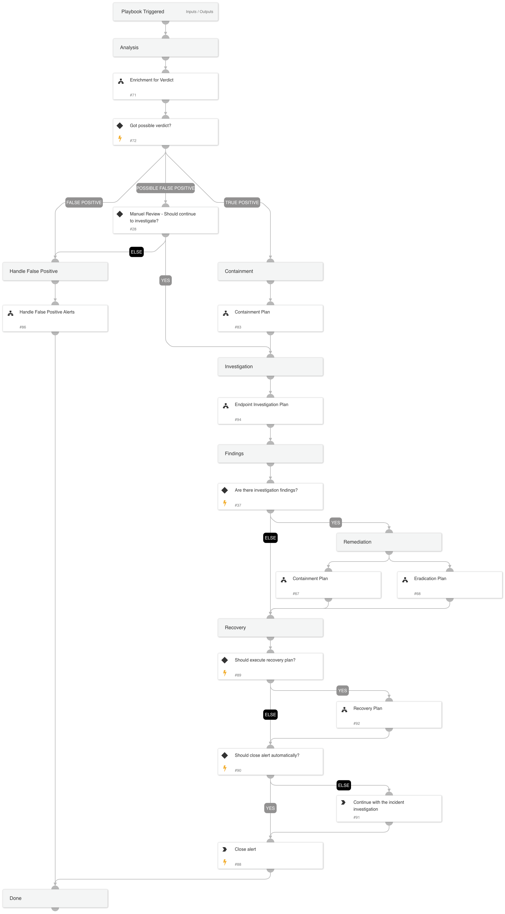

# Deprecation Notice

As part of our ongoing commitment to platform performance, reliability, and standardization, the four integrations and commands within the "Core" pack listed below will be officially deprecated in mid-January 2027:

- Indicators detection (Cortex Core - IOC)
- Investigation & Response (Cortex Core - IR)
- XQL Query Engine
- Cortex Platform - Core

## What this means for you

- **Existing custom playbooks:** Automations and playbooks currently using commands from these integrations will continue to function as expected. No existing workflows will abruptly break upon deprecation. We recommend migrating them to the native Cortex built-in commands, which offer higher execution performance and unified platform syntax.
- **Out-of-the-box Cortex playbooks:** All out-of-the-box playbooks shipped with the platform will be updated by Palo Alto Networks to use built-in commands natively. No action is required on your part for uncustomized, standard playbooks.
- **Maintenance and support:** Following the deprecation date, these integrations will no longer receive feature updates, enhancements, or bug fixes.

For detailed command-by-command replacement mappings and usage examples, please refer to the [Cortex Built-In Commands Guide](https://cortex-docs.paloaltonetworks.com/cortex-commands-guide).

[Cortex XSIAM](https://www.paloaltonetworks.com/cortex/cortex-xsiam) is an intelligent data foundation, where high-quality telemetry across the security infrastructure, threat intelligence, external attack surface data and user response actions are ingested and integrated automatically. Unlike SIEM, Cortex XSIAM ingests granular data – not just alerts and logs – to fuel many layers of machine learning that automate critical threat detection and remediation steps downstream.

## What does this pack do?

The playbooks included in this pack help you respond to Cortex XSIAM alerts in a timely manner. They also help automate repetitive tasks associated with Cortex XSIAM alerts:

- Syncs and updates Cortex XSIAM alerts.
- Triggers a sub-playbook to handle each alert by type.
- Extracts and enriches all relevant indicators from the source alert.
- Hunts for related IOCs.
- Calculates the severity of the alert.
- Interacts with the analyst to choose a remediation path or close the incident as a false positive based on the gathered information and incident severity.
- Remediates the incident by blocking malicious indicators and isolating infected endpoints.
- Run XQL Queries as part of an automation, or in a playbook (consumes compute units).

