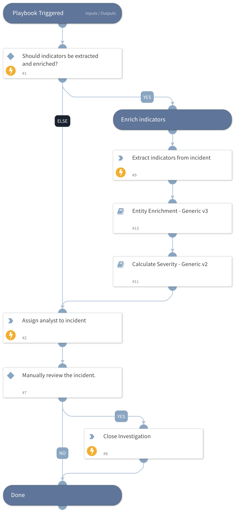

Default playbook for the Intel 471 Leaked Credential incident type.

Extracts and enriches the indicators the Intel471 Credentials integration attached to the incident - the leaked login, the detection and credential domains, and the infected host's IP addresses and PC name - then calculates the incident severity from the enrichment results, assigns an analyst, and holds the incident for manual review before closing it.

## Dependencies

This playbook uses the following sub-playbooks, integrations, and scripts.

### Sub-playbooks

* Calculate Severity - Generic v2
* Entity Enrichment - Generic v3

### Integrations

This playbook does not use any integrations.

### Scripts

* AssignAnalystToIncident

### Commands

* closeInvestigation
* extractIndicators

## Playbook Inputs

---

| **Name** | **Description** | **Default Value** | **Required** |
| --- | --- | --- | --- |
| Enrich | Determines whether to enrich all indicators in the incident. | True | Optional |
| OnCall | Set to true to assign only user that is currently on shift. Requires Cortex XSOAR v5.5 or later. | false | Optional |

## Playbook Outputs

---
There are no outputs for this playbook.

## Playbook Image

---

