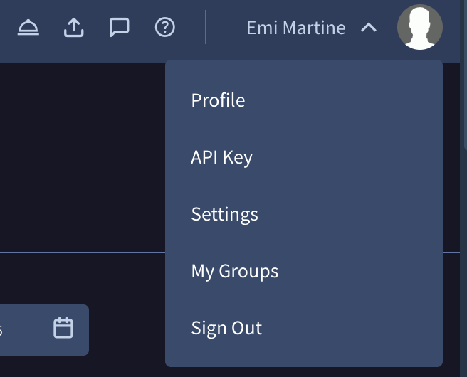

# Google Threat Intelligence - Agentic

This integration allows the security teams to automate and interact with the Google Threat Intelligence Agentic capabilities from Cortex XSOAR. It provides the ability to manage the GTI Agentic Flows and their executions, and to run investigations through the GTI Agentic Sessions.

This integration was integrated and tested with the Google Threat Intelligence Agentic API.

## Prerequisites

### Acquiring your API key

Your API key can be found in your GoogleThreatIntelligence account user menu, clicking on your avatar:



Your API key carries all your privileges, so keep it secure and don't share it with anyone.

## Configure Google Threat Intelligence - Agentic in Cortex

| **Parameter** | **Description** | **Required** |
| --- | --- | --- |
| API Key | Provide the API key of the Google Threat Intelligence platform for the authentication. Leave the username field empty and fill in the API key in the password field. | True |
| Group ID | Specify the ID of the group to which the API quota of the requests should be charged. If not provided, the quota is charged to the user that owns the API key. | False |
| Trust any certificate (not secure) | | False |
| Use system proxy settings | | False |

### Testing the connection

Click **Test** to validate the configured parameters. The test connectivity sends a `GET` request to the list flows endpoint with the minimum page size and returns `ok` when the credentials are valid.

The integration retries the request three times when the Google Threat Intelligence API responds with a `429` or a `5XX` status code.

## Commands

You can execute these commands from the CLI, as part of an automation, or in a playbook.
After you successfully execute a command, a DBot message appears in the War Room with the command details.

### gti-agentic-flow-list

***
Retrieves a list of the GTI Agentic Flows that are accessible to the configured API key, based on the provided filter arguments.

#### Base Command

`gti-agentic-flow-list`

#### Input

| **Argument Name** | **Description** | **Required** |
| --- | --- | --- |
| name | The name of the Flow. The value supports a partial match. | Optional |
| enabled | Whether the Flow is enabled. Possible values are: True, False. | Optional |
| filter | The filter search modifier expression.<br/><br/>Example: 'enabled:true name:digest'.<br/><br/>Note: The 'name' and the 'enabled' arguments are combined with an OR operator, and this argument is combined with that group using an AND operator. | Optional |
| sort_field | The sort field. Possible values are: Name, Creation Date, Last Modification Date, Last Run At. Default is Last Run At. | Optional |
| sort_order | The sort order. Possible values are: Asc, Desc. Default is Desc. | Optional |
| limit | The maximum number of Flows to return in a single command run. The maximum allowed value is 40. Default is 10. | Optional |
| cursor | The cursor of the page of results to retrieve.<br/><br/>Note: Use the cursor returned by the previous run of the 'gti-agentic-flow-list' command to retrieve the next page. | Optional |

#### Context Output

| **Path** | **Type** | **Description** |
| --- | --- | --- |
| GoogleThreatIntelligenceAgentic.Flow.id | String | The unique identifier of the Flow. |
| GoogleThreatIntelligenceAgentic.Flow.type | String | The type of the object. The value is always 'flow'. |
| GoogleThreatIntelligenceAgentic.Flow.name | String | The name of the Flow. |
| GoogleThreatIntelligenceAgentic.Flow.enabled | Boolean | Whether the Flow is enabled and eligible to be triggered by its schedule. |
| GoogleThreatIntelligenceAgentic.Flow.private | Boolean | Whether the Flow is private to the user that owns it. |
| GoogleThreatIntelligenceAgentic.Flow.nodes.id | String | The unique identifier of the node inside the Flow graph. |
| GoogleThreatIntelligenceAgentic.Flow.nodes.type | String | The type of the node. Possible values are: NODE_TYPE_SCHEDULE_TIME, NODE_TYPE_RUN_PROMPT, NODE_TYPE_SEND_EMAIL. |
| GoogleThreatIntelligenceAgentic.Flow.nodes.name | String | The display name of the node. |
| GoogleThreatIntelligenceAgentic.Flow.nodes.schedule_node.cron_expression | String | The cron expression that defines when the Flow is triggered. |
| GoogleThreatIntelligenceAgentic.Flow.nodes.schedule_node.timezone | String | The timezone in which the cron expression is evaluated. |
| GoogleThreatIntelligenceAgentic.Flow.nodes.run_prompt_node.prompt | String | The prompt that is sent to the Google Threat Intelligence agent when the node runs. |
| GoogleThreatIntelligenceAgentic.Flow.nodes.run_prompt_node.reuse_session | Boolean | Whether the node reuses the existing agentic session instead of creating a new one. |
| GoogleThreatIntelligenceAgentic.Flow.nodes.send_email_node.notification_emails | Unknown | The list of the email addresses that receive the notification. |
| GoogleThreatIntelligenceAgentic.Flow.nodes.send_email_node.email_subject | String | The subject of the notification email. |
| GoogleThreatIntelligenceAgentic.Flow.nodes.send_email_node.message | String | The body of the notification email. |
| GoogleThreatIntelligenceAgentic.Flow.connections.source_node_id | String | The unique identifier of the node the connection starts from. |
| GoogleThreatIntelligenceAgentic.Flow.connections.target_node_id | String | The unique identifier of the node the connection points to. |
| GoogleThreatIntelligenceAgentic.Flow.connections.source_handle | String | The handle of the source node the connection is attached to. |
| GoogleThreatIntelligenceAgentic.Flow.trigger_state.last_run_at | Date | The date and time \(UTC\) when the Flow was last triggered. |
| GoogleThreatIntelligenceAgentic.Flow.creation_date | Date | The date and time \(UTC\) when the Flow was created. |
| GoogleThreatIntelligenceAgentic.Flow.last_modification_date | Date | The date and time \(UTC\) when the Flow was last modified. |
| GoogleThreatIntelligenceAgentic.Flow.links.self | String | The link of the Flow object on the Google Threat Intelligence platform. |
| GoogleThreatIntelligenceAgentic.Flow.relationships.group.data.type | String | The type of the group object that is related to the Flow. |
| GoogleThreatIntelligenceAgentic.Flow.relationships.group.data.id | String | The unique identifier of the group that owns the Flow. |
| GoogleThreatIntelligenceAgentic.PageToken.Flow.next_cursor | String | The cursor to be used in the 'cursor' argument of the next command runs to retrieve the next page of results. |
| GoogleThreatIntelligenceAgentic.PageToken.Flow.total_count | Number | The total number of the records that match the given argument\(s\). |

#### Command example

```!gti-agentic-flow-list limit=2 sort_field="Creation Date" sort_order=Desc```

#### Context Example

```json
{
    "GoogleThreatIntelligenceAgentic": {
        "Flow": [
            {
                "id": "11111111-1111-1111-1111-111111111111",
                "type": "flow",
                "links": {
                    "self": "https://www.virustotal.com/api/v3/flows/11111111-1111-1111-1111-111111111111"
                },
                "relationships": {
                    "group": {
                        "data": {
                            "type": "group",
                            "id": "acmecorp"
                        }
                    }
                },
                "enabled": true,
                "last_modification_date": "2026-09-10T07:52:49Z",
                "nodes": [
                    {
                        "id": "n1",
                        "type": "NODE_TYPE_SCHEDULE_TIME",
                        "name": "Every morning",
                        "schedule_node": {
                            "cron_expression": "0 9 * * *",
                            "timezone": "UTC"
                        }
                    },
                    {
                        "id": "n2",
                        "type": "NODE_TYPE_RUN_PROMPT",
                        "name": "Summarise new detections",
                        "run_prompt_node": {
                            "prompt": "Summarise URLs first seen in the last 24h that are flagged malicious by 5+ engines.",
                            "reuse_session": false
                        }
                    },
                    {
                        "id": "n3",
                        "type": "NODE_TYPE_SEND_EMAIL",
                        "name": "Email the SOC",
                        "send_email_node": {
                            "notification_emails": [
                                "soc@example.com"
                            ],
                            "email_subject": "Daily malicious-URL digest",
                            "message": "See attached summary."
                        }
                    }
                ],
                "trigger_state": {
                    "last_run_at": "2026-09-15T09:04:24Z"
                },
                "connections": [
                    {
                        "source_node_id": "n1",
                        "target_node_id": "n2"
                    },
                    {
                        "source_node_id": "n2",
                        "target_node_id": "n3"
                    }
                ],
                "creation_date": "2026-09-10T07:52:49Z",
                "name": "Daily malicious-URL digest",
                "private": true
            },
            {
                "id": "22222222-2222-2222-2222-222222222222",
                "type": "flow",
                "enabled": false,
                "name": "Weekly infrastructure review",
                "creation_date": "2026-09-09T07:52:49Z",
                "last_modification_date": "2026-09-10T07:52:49Z"
            }
        ],
        "PageToken": {
            "Flow": {
                "next_cursor": "eyJvZmZzZXQiOjEwfQ==",
                "total_count": 2
            }
        }
    }
}
```

#### Human Readable Output

>### GTI Agentic Flow List
>
>|Flow ID|Name|Enabled|Nodes|Last Run At|Creation Date|Last Modification Date|
>|---|---|---|---|---|---|---|
>| [11111111-1111-1111-1111-111111111111](https://www.virustotal.com/gui/agentic/flows/11111111-1111-1111-1111-111111111111) | Daily malicious-URL digest | true | 3 | 2026-09-15T09:04:24Z | 2026-09-10T07:52:49Z | 2026-09-10T07:52:49Z |
>| [22222222-2222-2222-2222-222222222222](https://www.virustotal.com/gui/agentic/flows/22222222-2222-2222-2222-222222222222) | Weekly infrastructure review | false | 0 |  | 2026-09-09T07:52:49Z | 2026-09-10T07:52:49Z |
>
>Run the command with the 'cursor' argument set to `eyJvZmZzZXQiOjEwfQ==` to retrieve the next page of results.

### gti-agentic-flow-get

***
Retrieves the details of a specific GTI Agentic Flow by its ID.

#### Base Command

`gti-agentic-flow-get`

#### Input

| **Argument Name** | **Description** | **Required** |
| --- | --- | --- |
| flow_id | The ID of the Flow.<br/><br/>Note: Use the 'gti-agentic-flow-list' command to retrieve the Flow ID. | Required |

#### Context Output

| **Path** | **Type** | **Description** |
| --- | --- | --- |
| GoogleThreatIntelligenceAgentic.Flow.id | String | The unique identifier of the Flow. |
| GoogleThreatIntelligenceAgentic.Flow.type | String | The type of the object. The value is always 'flow'. |
| GoogleThreatIntelligenceAgentic.Flow.name | String | The name of the Flow. |
| GoogleThreatIntelligenceAgentic.Flow.enabled | Boolean | Whether the Flow is enabled and eligible to be triggered by its schedule. |
| GoogleThreatIntelligenceAgentic.Flow.private | Boolean | Whether the Flow is private to the user that owns it. |
| GoogleThreatIntelligenceAgentic.Flow.nodes.id | String | The unique identifier of the node inside the Flow graph. |
| GoogleThreatIntelligenceAgentic.Flow.nodes.type | String | The type of the node. Possible values are: NODE_TYPE_SCHEDULE_TIME, NODE_TYPE_RUN_PROMPT, NODE_TYPE_SEND_EMAIL. |
| GoogleThreatIntelligenceAgentic.Flow.nodes.name | String | The display name of the node. |
| GoogleThreatIntelligenceAgentic.Flow.nodes.schedule_node.cron_expression | String | The cron expression that defines when the Flow is triggered. |
| GoogleThreatIntelligenceAgentic.Flow.nodes.schedule_node.timezone | String | The timezone in which the cron expression is evaluated. |
| GoogleThreatIntelligenceAgentic.Flow.nodes.run_prompt_node.prompt | String | The prompt that is sent to the Google Threat Intelligence agent when the node runs. |
| GoogleThreatIntelligenceAgentic.Flow.nodes.run_prompt_node.reuse_session | Boolean | Whether the node reuses the existing agentic session instead of creating a new one. |
| GoogleThreatIntelligenceAgentic.Flow.nodes.send_email_node.notification_emails | Unknown | The list of the email addresses that receive the notification. |
| GoogleThreatIntelligenceAgentic.Flow.nodes.send_email_node.email_subject | String | The subject of the notification email. |
| GoogleThreatIntelligenceAgentic.Flow.nodes.send_email_node.message | String | The body of the notification email. |
| GoogleThreatIntelligenceAgentic.Flow.connections.source_node_id | String | The unique identifier of the node the connection starts from. |
| GoogleThreatIntelligenceAgentic.Flow.connections.target_node_id | String | The unique identifier of the node the connection points to. |
| GoogleThreatIntelligenceAgentic.Flow.connections.source_handle | String | The handle of the source node the connection is attached to. |
| GoogleThreatIntelligenceAgentic.Flow.trigger_state.last_run_at | Date | The date and time \(UTC\) when the Flow was last triggered. |
| GoogleThreatIntelligenceAgentic.Flow.creation_date | Date | The date and time \(UTC\) when the Flow was created. |
| GoogleThreatIntelligenceAgentic.Flow.last_modification_date | Date | The date and time \(UTC\) when the Flow was last modified. |
| GoogleThreatIntelligenceAgentic.Flow.links.self | String | The link of the Flow object on the Google Threat Intelligence platform. |
| GoogleThreatIntelligenceAgentic.Flow.relationships.group.data.type | String | The type of the group object that is related to the Flow. |
| GoogleThreatIntelligenceAgentic.Flow.relationships.group.data.id | String | The unique identifier of the group that owns the Flow. |

#### Command example

```!gti-agentic-flow-get flow_id=11111111-1111-1111-1111-111111111111```

#### Context Example

```json
{
    "GoogleThreatIntelligenceAgentic": {
        "Flow": {
            "id": "11111111-1111-1111-1111-111111111111",
            "type": "flow",
            "links": {
                "self": "https://www.virustotal.com/api/v3/flows/11111111-1111-1111-1111-111111111111"
            },
            "relationships": {
                "group": {
                    "data": {
                        "type": "group",
                        "id": "acmecorp"
                    }
                }
            },
            "name": "Daily malicious-URL digest",
            "enabled": true,
            "nodes": [
                {
                    "id": "n1",
                    "type": "NODE_TYPE_SCHEDULE_TIME",
                    "name": "Every morning",
                    "schedule_node": {
                        "cron_expression": "0 9 * * *",
                        "timezone": "UTC"
                    }
                },
                {
                    "id": "n2",
                    "type": "NODE_TYPE_RUN_PROMPT",
                    "name": "Summarise new detections",
                    "run_prompt_node": {
                        "prompt": "Summarise URLs first seen in the last 24h that are flagged malicious by 5+ engines.",
                        "reuse_session": false
                    }
                },
                {
                    "id": "n3",
                    "type": "NODE_TYPE_SEND_EMAIL",
                    "name": "Email the SOC",
                    "send_email_node": {
                        "notification_emails": [
                            "soc@example.com"
                        ],
                        "email_subject": "Daily malicious-URL digest",
                        "message": "See attached summary."
                    }
                }
            ],
            "private": true,
            "last_modification_date": "2026-09-10T07:52:49Z",
            "connections": [
                {
                    "source_node_id": "n1",
                    "target_node_id": "n2"
                },
                {
                    "source_node_id": "n2",
                    "target_node_id": "n3"
                }
            ],
            "creation_date": "2026-09-10T07:52:49Z",
            "trigger_state": {
                "last_run_at": "2026-09-15T09:04:24Z"
            }
        }
    }
}
```

#### Human Readable Output

>### GTI Agentic Flow Information
>
>|Flow ID|Name|Enabled|Nodes|Last Run At|Creation Date|Last Modification Date|
>|---|---|---|---|---|---|---|
>| [11111111-1111-1111-1111-111111111111](https://www.virustotal.com/gui/agentic/flows/11111111-1111-1111-1111-111111111111) | Daily malicious-URL digest | true | 3 | 2026-09-15T09:04:24Z | 2026-09-10T07:52:49Z | 2026-09-10T07:52:49Z |
>
>### Nodes
>
>|Node ID|Type|Name|Cron Expression|Timezone|Prompt|Reuse Session|Notification Emails|Email Subject|Email Message|
>|---|---|---|---|---|---|---|---|---|---|
>| n1 | NODE_TYPE_SCHEDULE_TIME | Every morning | 0 9 \* \* \* | UTC |  |  |  |  |  |
>| n2 | NODE_TYPE_RUN_PROMPT | Summarise new detections |  |  | Summarise URLs first seen in the last 24h that are flagged malicious by 5+ engines. | false |  |  |  |
>| n3 | NODE_TYPE_SEND_EMAIL | Email the SOC |  |  |  |  | <soc@example.com> | Daily malicious-URL digest | See attached summary. |
>
>### Connections
>
>|Source Node ID|Target Node ID|
>|---|---|
>| n1 | n2 |
>| n2 | n3 |

### gti-agentic-flow-create

***
Creates a new GTI Agentic Flow with the provided node and connection graph.

#### Base Command

`gti-agentic-flow-create`

#### Input

| **Argument Name** | **Description** | **Required** |
| --- | --- | --- |
| name | The name of the Flow to create. | Required |
| enabled | Whether the Flow should be enabled on creation. Possible values are: True, False. Default is True. | Optional |
| nodes | The nodes of the Flow graph as a JSON formatted list.<br/><br/>Example: [{"id": "n1", "type": "NODE_TYPE_SCHEDULE_TIME", "name": "Every morning", "schedule_node": {"cron_expression": "0 9 \* \* \*", "timezone": "UTC"}}, {"id": "n2", "type": "NODE_TYPE_RUN_PROMPT", "name": "Summarise new detections", "run_prompt_node": {"prompt": "Summarise URLs first seen in the last 24h that are flagged malicious by 5+ engines.", "reuse_session": false}}, {"id": "n3", "type": "NODE_TYPE_SEND_EMAIL", "name": "Email the SOC", "send_email_node": {"notification_emails": ["soc@example.com"], "email_subject": "Daily malicious-URL digest", "message": "See attached summary."}}].<br/><br/>Note: The graph requires a node of the 'NODE_TYPE_SCHEDULE_TIME' type and a node of the 'NODE_TYPE_RUN_PROMPT' type, and every node requires the 'id', the 'type' and the field that its type requires, which is the 'cron_expression', the 'prompt' and the 'notification_emails' field respectively.<br/><br/>Note: When this argument is provided, the 'schedule_time', the 'schedule_frequency', the 'prompt', the 'reuse_session', the 'notification_emails', the 'email_subject' and the 'email_message' arguments are ignored.<br/><br/>For more information about the node types and their fields, see <https://gtidocs.virustotal.com/reference/create-flow>. | Optional |
| connections | The connections between the Flow nodes as a JSON formatted list.<br/><br/>Example: [{"source_node_id": "n1", "target_node_id": "n2", "source_handle": ""}, {"source_node_id": "n2", "target_node_id": "n3", "source_handle": ""}].<br/><br/>Note: Every connection requires the 'source_node_id' and the 'target_node_id' fields, and both of them are required to refer to a node of the 'nodes' argument.<br/><br/>Note: The connections are required to connect the node of the 'NODE_TYPE_SCHEDULE_TIME' type to a node of the 'NODE_TYPE_RUN_PROMPT' type, directly or through other nodes.<br/><br/>Note: This argument is required when the 'nodes' argument is provided, and it is ignored otherwise.<br/><br/>For more information about the connection fields, see <https://gtidocs.virustotal.com/reference/create-flow>. | Optional |
| schedule_time | The date or the time at which the Flow runs, which builds the cron expression of the schedule node along with the 'schedule_frequency' argument.<br/><br/>Format: An ISO 8601 date and time (YYYY-MM-DDTHH:MM:SSZ or YYYY-MM-DDTHH:MM:SS+HH:MM), a date and time (YYYY-MM-DD HH:MM), a time (HH:MM or H:MMam/pm), a relative time (tomorrow 9am) or an epoch timestamp in seconds.<br/><br/>Example: '2026-09-25T09:00:00Z', '2026-09-25T14:30:00+05:30', '2026-09-25 09:00', '09:00', '9:30pm', 'tomorrow 9am', '1789026769'.<br/><br/>Note: The value is converted into UTC, a value without a timezone is considered to be in UTC, and the seconds are ignored.<br/><br/>Note: A time without a date is considered to be of today, hence the 'Weekly' and the 'Monthly' frequencies run on the weekday and the day of today.<br/><br/>Note: This argument is required when the 'nodes' argument is not provided, and it is ignored otherwise. | Optional |
| schedule_frequency | How often the Flow runs at the 'schedule_time' argument. 'Daily' runs at its time every day, 'Weekdays' every weekday from Monday to Friday, 'Weekends' every Saturday and Sunday, 'Weekly' on its weekday every week and 'Monthly' on its day every month.<br/><br/>Note: A 'Monthly' Flow on the 29th, the 30th or the 31st day does not run in the months without that day.<br/><br/>Note: This argument is only used along with the 'schedule_time' argument. Possible values are: Daily, Weekdays, Weekends, Weekly, Monthly. Default is Daily. | Optional |
| prompt | The prompt that the Flow sends to the Google Threat Intelligence agent.<br/><br/>Note: This argument is required when the 'nodes' argument is not provided, and it is ignored otherwise. | Optional |
| reuse_session | Whether the prompt node reuses the existing agentic session instead of creating a new one.<br/><br/>Note: This argument is only used when the 'nodes' argument is not provided. Possible values are: True, False. Default is False. | Optional |
| notification_emails | A comma-separated list of the email addresses that receive the result of the Flow.<br/><br/>Note: This argument is only used when the 'nodes' argument is not provided. | Optional |
| email_subject | The subject of the notification email.<br/><br/>Note: This argument is only used when the 'nodes' argument is not provided, and it requires the 'notification_emails' argument. | Optional |
| email_message | The body of the notification email.<br/><br/>Note: When this argument is not provided, the body of the email is the content that the GTI agent generates for the prompt.<br/><br/>Note: This argument is only used when the 'nodes' argument is not provided, and it requires the 'notification_emails' argument. | Optional |

#### Context Output

| **Path** | **Type** | **Description** |
| --- | --- | --- |
| GoogleThreatIntelligenceAgentic.Flow.id | String | The unique identifier of the Flow. |
| GoogleThreatIntelligenceAgentic.Flow.type | String | The type of the object. The value is always 'flow'. |
| GoogleThreatIntelligenceAgentic.Flow.name | String | The name of the Flow. |
| GoogleThreatIntelligenceAgentic.Flow.enabled | Boolean | Whether the Flow is enabled and eligible to be triggered by its schedule. |
| GoogleThreatIntelligenceAgentic.Flow.private | Boolean | Whether the Flow is private to the user that owns it. |
| GoogleThreatIntelligenceAgentic.Flow.nodes.id | String | The unique identifier of the node inside the Flow graph. |
| GoogleThreatIntelligenceAgentic.Flow.nodes.type | String | The type of the node. Possible values are: NODE_TYPE_SCHEDULE_TIME, NODE_TYPE_RUN_PROMPT, NODE_TYPE_SEND_EMAIL. |
| GoogleThreatIntelligenceAgentic.Flow.nodes.name | String | The display name of the node. |
| GoogleThreatIntelligenceAgentic.Flow.nodes.schedule_node.cron_expression | String | The cron expression that defines when the Flow is triggered. |
| GoogleThreatIntelligenceAgentic.Flow.nodes.schedule_node.timezone | String | The timezone in which the cron expression is evaluated. |
| GoogleThreatIntelligenceAgentic.Flow.nodes.run_prompt_node.prompt | String | The prompt that is sent to the Google Threat Intelligence agent when the node runs. |
| GoogleThreatIntelligenceAgentic.Flow.nodes.run_prompt_node.reuse_session | Boolean | Whether the node reuses the existing agentic session instead of creating a new one. |
| GoogleThreatIntelligenceAgentic.Flow.nodes.send_email_node.notification_emails | Unknown | The list of the email addresses that receive the notification. |
| GoogleThreatIntelligenceAgentic.Flow.nodes.send_email_node.email_subject | String | The subject of the notification email. |
| GoogleThreatIntelligenceAgentic.Flow.nodes.send_email_node.message | String | The body of the notification email. |
| GoogleThreatIntelligenceAgentic.Flow.connections.source_node_id | String | The unique identifier of the node the connection starts from. |
| GoogleThreatIntelligenceAgentic.Flow.connections.target_node_id | String | The unique identifier of the node the connection points to. |
| GoogleThreatIntelligenceAgentic.Flow.connections.source_handle | String | The handle of the source node the connection is attached to. |
| GoogleThreatIntelligenceAgentic.Flow.trigger_state.last_run_at | Date | The date and time \(UTC\) when the Flow was last triggered. |
| GoogleThreatIntelligenceAgentic.Flow.creation_date | Date | The date and time \(UTC\) when the Flow was created. |
| GoogleThreatIntelligenceAgentic.Flow.last_modification_date | Date | The date and time \(UTC\) when the Flow was last modified. |
| GoogleThreatIntelligenceAgentic.Flow.links.self | String | The link of the Flow object on the Google Threat Intelligence platform. |
| GoogleThreatIntelligenceAgentic.Flow.relationships.group.data.type | String | The type of the group object that is related to the Flow. |
| GoogleThreatIntelligenceAgentic.Flow.relationships.group.data.id | String | The unique identifier of the group that owns the Flow. |

#### Command example

```!gti-agentic-flow-create name="Daily malicious-URL digest" prompt="Summarise the new detections." schedule_time="09:00" notification_emails=soc@example.com email_subject="Daily malicious-URL digest" email_message="See attached summary."```

#### Context Example

```json
{
    "GoogleThreatIntelligenceAgentic": {
        "Flow": {
            "id": "11111111-1111-1111-1111-111111111111",
            "type": "flow",
            "links": {
                "self": "https://www.virustotal.com/api/v3/flows/11111111-1111-1111-1111-111111111111"
            },
            "creation_date": "2026-09-10T07:52:49Z",
            "enabled": true,
            "name": "Daily malicious-URL digest",
            "connections": [
                {
                    "source_node_id": "n1",
                    "target_node_id": "n2"
                },
                {
                    "source_node_id": "n2",
                    "target_node_id": "n3"
                }
            ],
            "private": true,
            "nodes": [
                {
                    "id": "n1",
                    "type": "NODE_TYPE_SCHEDULE_TIME",
                    "name": "Every morning",
                    "schedule_node": {
                        "cron_expression": "0 9 * * *",
                        "timezone": "UTC"
                    }
                },
                {
                    "id": "n2",
                    "type": "NODE_TYPE_RUN_PROMPT",
                    "name": "Summarise new detections",
                    "run_prompt_node": {
                        "prompt": "Summarise URLs first seen in the last 24h that are flagged malicious by 5+ engines.",
                        "reuse_session": false
                    }
                },
                {
                    "id": "n3",
                    "type": "NODE_TYPE_SEND_EMAIL",
                    "name": "Email the SOC",
                    "send_email_node": {
                        "notification_emails": [
                            "soc@example.com"
                        ],
                        "email_subject": "Daily malicious-URL digest",
                        "message": "See attached summary."
                    }
                }
            ],
            "last_modification_date": "2026-09-10T07:52:49Z"
        }
    }
}
```

#### Human Readable Output

>### Flow created successfully
>
>|Flow ID|Name|Enabled|Nodes|Creation Date|Last Modification Date|
>|---|---|---|---|---|---|
>| [11111111-1111-1111-1111-111111111111](https://www.virustotal.com/gui/agentic/flows/11111111-1111-1111-1111-111111111111) | Daily malicious-URL digest | true | 3 | 2026-09-10T07:52:49Z | 2026-09-10T07:52:49Z |
>
>### Nodes
>
>|Node ID|Type|Name|Cron Expression|Timezone|Prompt|Reuse Session|Notification Emails|Email Subject|Email Message|
>|---|---|---|---|---|---|---|---|---|---|
>| n1 | NODE_TYPE_SCHEDULE_TIME | Every morning | 0 9 \* \* \* | UTC |  |  |  |  |  |
>| n2 | NODE_TYPE_RUN_PROMPT | Summarise new detections |  |  | Summarise URLs first seen in the last 24h that are flagged malicious by 5+ engines. | false |  |  |  |
>| n3 | NODE_TYPE_SEND_EMAIL | Email the SOC |  |  |  |  | <soc@example.com> | Daily malicious-URL digest | See attached summary. |
>
>### Connections
>
>|Source Node ID|Target Node ID|
>|---|---|
>| n1 | n2 |
>| n2 | n3 |

### gti-agentic-flow-update

***
Partially updates the name, the enabled state, the nodes or the connections of a GTI Agentic Flow. The 'nodes' and the 'connections' arguments replace the graph of the Flow, while the schedule, the prompt and the email arguments only change the provided fields of its existing nodes. Note: The schedule, the prompt and the email arguments retrieve the Flow first and send its complete list of nodes, hence the changes made to the Flow in the meantime are overwritten.

#### Base Command

`gti-agentic-flow-update`

#### Input

| **Argument Name** | **Description** | **Required** |
| --- | --- | --- |
| flow_id | The ID of the Flow.<br/><br/>Note: Use the 'gti-agentic-flow-list' command to retrieve the Flow ID. | Required |
| name | The new name of the Flow. | Optional |
| enabled | Whether the Flow should be enabled. Possible values are: True, False. | Optional |
| nodes | The new nodes of the Flow graph as a JSON formatted list.<br/><br/>Example: [{"id": "n1", "type": "NODE_TYPE_SCHEDULE_TIME", "name": "Every morning", "schedule_node": {"cron_expression": "0 9 \* \* \*", "timezone": "UTC"}}, {"id": "n2", "type": "NODE_TYPE_RUN_PROMPT", "name": "Summarise new detections", "run_prompt_node": {"prompt": "Summarise URLs first seen in the last 24h that are flagged malicious by 5+ engines.", "reuse_session": false}}, {"id": "n3", "type": "NODE_TYPE_SEND_EMAIL", "name": "Email the SOC", "send_email_node": {"notification_emails": ["soc@example.com"], "email_subject": "Daily malicious-URL digest", "message": "See attached summary."}}].<br/><br/>Note: The provided list replaces the existing nodes of the Flow, hence it requires a node of the 'NODE_TYPE_SCHEDULE_TIME' type and a node of the 'NODE_TYPE_RUN_PROMPT' type, and every node requires the 'id', the 'type' and the field that its type requires, which is the 'cron_expression', the 'prompt' and the 'notification_emails' field respectively.<br/><br/>Note: When this argument is provided without the 'connections' argument, the existing connections of the Flow are kept, hence they are required to refer to the provided nodes.<br/><br/>Note: When this argument is provided, the 'schedule_time', the 'schedule_frequency', the 'prompt', the 'reuse_session', the 'notification_emails', the 'email_subject' and the 'email_message' arguments are ignored.<br/><br/>For more information about the node types and their fields, see <https://gtidocs.virustotal.com/reference/update-flow>. | Optional |
| connections | The new connections between the Flow nodes as a JSON formatted list.<br/><br/>Example: [{"source_node_id": "n1", "target_node_id": "n2", "source_handle": ""}, {"source_node_id": "n2", "target_node_id": "n3", "source_handle": ""}].<br/><br/>Note: The provided list replaces the existing connections of the Flow. Every connection requires the 'source_node_id' and the 'target_node_id' fields, and both of them are required to refer to a node of the 'nodes' argument when it is provided, or to an existing node of the Flow otherwise.<br/><br/>Note: The connections are required to connect the node of the 'NODE_TYPE_SCHEDULE_TIME' type to a node of the 'NODE_TYPE_RUN_PROMPT' type, directly or through other nodes.<br/><br/>For more information about the connection fields, see <https://gtidocs.virustotal.com/reference/update-flow>. | Optional |
| schedule_time | The new date or time at which the Flow runs, which builds the cron expression of the schedule node along with the 'schedule_frequency' argument.<br/><br/>Format: An ISO 8601 date and time (YYYY-MM-DDTHH:MM:SSZ or YYYY-MM-DDTHH:MM:SS+HH:MM), a date and time (YYYY-MM-DD HH:MM), a time (HH:MM or H:MMam/pm), a relative time (tomorrow 9am) or an epoch timestamp in seconds.<br/><br/>Example: '2026-09-25T09:00:00Z', '2026-09-25T14:30:00+05:30', '2026-09-25 09:00', '09:00', '9:30pm', 'tomorrow 9am', '1789026769'.<br/><br/>Note: The value is converted into UTC, a value without a timezone is considered to be in UTC, and the seconds are ignored.<br/><br/>Note: A time without a date is considered to be of today, hence the 'Weekly' and the 'Monthly' frequencies run on the weekday and the day of today.<br/><br/>Note: This argument requires the 'schedule_frequency' argument, as the cron expression is built from both of them.<br/><br/>Note: This argument is only used when the 'nodes' argument is not provided. The Flow is retrieved first, and only the cron expression of its existing schedule node is changed, along with its timezone, which is set to UTC. | Optional |
| schedule_frequency | How often the Flow runs at the 'schedule_time' argument. 'Daily' runs at its time every day, 'Weekdays' every weekday from Monday to Friday, 'Weekends' every Saturday and Sunday, 'Weekly' on its weekday every week and 'Monthly' on its day every month.<br/><br/>Note: A 'Monthly' Flow on the 29th, the 30th or the 31st day does not run in the months without that day.<br/><br/>Note: This argument requires the 'schedule_time' argument, as the cron expression is built from both of them. Possible values are: Daily, Weekdays, Weekends, Weekly, Monthly. | Optional |
| prompt | The new prompt that the Flow sends to the Google Threat Intelligence agent.<br/><br/>Note: This argument is only used when the 'nodes' argument is not provided. The Flow is retrieved first, and only this field of its existing prompt node is changed. | Optional |
| reuse_session | Whether the prompt node reuses the existing agentic session instead of creating a new one.<br/><br/>Note: This argument is only used when the 'nodes' argument is not provided. The Flow is retrieved first, and only this field of its existing prompt node is changed. Possible values are: True, False. | Optional |
| notification_emails | A comma-separated list of the email addresses that receive the result of the Flow.<br/><br/>Note: This argument is only used when the 'nodes' argument is not provided. The Flow is retrieved first, and only this field of its existing email node is changed. When the Flow has no email node, a new one is added after the prompt node. | Optional |
| email_subject | The new subject of the notification email.<br/><br/>Note: This argument is only used when the 'nodes' argument is not provided. The Flow is retrieved first, and only this field of its existing email node is changed. When the Flow has no email node, the 'notification_emails' argument is required. | Optional |
| email_message | The new body of the notification email.<br/><br/>Note: This argument is only used when the 'nodes' argument is not provided. The Flow is retrieved first, and only this field of its existing email node is changed. When the Flow has no email node, the 'notification_emails' argument is required. | Optional |

#### Context Output

| **Path** | **Type** | **Description** |
| --- | --- | --- |
| GoogleThreatIntelligenceAgentic.Flow.id | String | The unique identifier of the Flow. |
| GoogleThreatIntelligenceAgentic.Flow.type | String | The type of the object. The value is always 'flow'. |
| GoogleThreatIntelligenceAgentic.Flow.name | String | The name of the Flow. |
| GoogleThreatIntelligenceAgentic.Flow.enabled | Boolean | Whether the Flow is enabled and eligible to be triggered by its schedule. |
| GoogleThreatIntelligenceAgentic.Flow.private | Boolean | Whether the Flow is private to the user that owns it. |
| GoogleThreatIntelligenceAgentic.Flow.nodes.id | String | The unique identifier of the node inside the Flow graph. |
| GoogleThreatIntelligenceAgentic.Flow.nodes.type | String | The type of the node. Possible values are: NODE_TYPE_SCHEDULE_TIME, NODE_TYPE_RUN_PROMPT, NODE_TYPE_SEND_EMAIL. |
| GoogleThreatIntelligenceAgentic.Flow.nodes.name | String | The display name of the node. |
| GoogleThreatIntelligenceAgentic.Flow.nodes.schedule_node.cron_expression | String | The cron expression that defines when the Flow is triggered. |
| GoogleThreatIntelligenceAgentic.Flow.nodes.schedule_node.timezone | String | The timezone in which the cron expression is evaluated. |
| GoogleThreatIntelligenceAgentic.Flow.nodes.run_prompt_node.prompt | String | The prompt that is sent to the Google Threat Intelligence agent when the node runs. |
| GoogleThreatIntelligenceAgentic.Flow.nodes.run_prompt_node.reuse_session | Boolean | Whether the node reuses the existing agentic session instead of creating a new one. |
| GoogleThreatIntelligenceAgentic.Flow.nodes.send_email_node.notification_emails | Unknown | The list of the email addresses that receive the notification. |
| GoogleThreatIntelligenceAgentic.Flow.nodes.send_email_node.email_subject | String | The subject of the notification email. |
| GoogleThreatIntelligenceAgentic.Flow.nodes.send_email_node.message | String | The body of the notification email. |
| GoogleThreatIntelligenceAgentic.Flow.connections.source_node_id | String | The unique identifier of the node the connection starts from. |
| GoogleThreatIntelligenceAgentic.Flow.connections.target_node_id | String | The unique identifier of the node the connection points to. |
| GoogleThreatIntelligenceAgentic.Flow.connections.source_handle | String | The handle of the source node the connection is attached to. |
| GoogleThreatIntelligenceAgentic.Flow.trigger_state.last_run_at | Date | The date and time \(UTC\) when the Flow was last triggered. |
| GoogleThreatIntelligenceAgentic.Flow.creation_date | Date | The date and time \(UTC\) when the Flow was created. |
| GoogleThreatIntelligenceAgentic.Flow.last_modification_date | Date | The date and time \(UTC\) when the Flow was last modified. |
| GoogleThreatIntelligenceAgentic.Flow.links.self | String | The link of the Flow object on the Google Threat Intelligence platform. |
| GoogleThreatIntelligenceAgentic.Flow.relationships.group.data.type | String | The type of the group object that is related to the Flow. |
| GoogleThreatIntelligenceAgentic.Flow.relationships.group.data.id | String | The unique identifier of the group that owns the Flow. |

#### Command example

```!gti-agentic-flow-update flow_id=11111111-1111-1111-1111-111111111111 enabled=False```

#### Context Example

```json
{
    "GoogleThreatIntelligenceAgentic": {
        "Flow": {
            "id": "11111111-1111-1111-1111-111111111111",
            "type": "flow",
            "links": {
                "self": "https://www.virustotal.com/api/v3/flows/11111111-1111-1111-1111-111111111111"
            },
            "relationships": {
                "group": {
                    "data": {
                        "type": "group",
                        "id": "acmecorp"
                    }
                }
            },
            "name": "Daily malicious-URL digest",
            "enabled": false,
            "nodes": [
                {
                    "id": "n1",
                    "type": "NODE_TYPE_SCHEDULE_TIME",
                    "name": "Every morning",
                    "schedule_node": {
                        "cron_expression": "0 9 * * *",
                        "timezone": "UTC"
                    }
                },
                {
                    "id": "n2",
                    "type": "NODE_TYPE_RUN_PROMPT",
                    "name": "Summarise new detections",
                    "run_prompt_node": {
                        "prompt": "Summarise URLs first seen in the last 24h that are flagged malicious by 5+ engines.",
                        "reuse_session": false
                    }
                },
                {
                    "id": "n3",
                    "type": "NODE_TYPE_SEND_EMAIL",
                    "name": "Email the SOC",
                    "send_email_node": {
                        "notification_emails": [
                            "soc@example.com"
                        ],
                        "email_subject": "Daily malicious-URL digest",
                        "message": "See attached summary."
                    }
                }
            ],
            "private": true,
            "last_modification_date": "2026-09-16T09:00:00Z",
            "connections": [
                {
                    "source_node_id": "n1",
                    "target_node_id": "n2"
                },
                {
                    "source_node_id": "n2",
                    "target_node_id": "n3"
                }
            ],
            "creation_date": "2026-09-10T07:52:49Z",
            "trigger_state": {
                "last_run_at": "2026-09-15T09:04:24Z"
            }
        }
    }
}
```

#### Human Readable Output

>### Flow updated successfully
>
>|Flow ID|Name|Enabled|Nodes|Last Run At|Creation Date|Last Modification Date|
>|---|---|---|---|---|---|---|
>| [11111111-1111-1111-1111-111111111111](https://www.virustotal.com/gui/agentic/flows/11111111-1111-1111-1111-111111111111) | Daily malicious-URL digest | false | 3 | 2026-09-15T09:04:24Z | 2026-09-10T07:52:49Z | 2026-09-16T09:00:00Z |
>
>### Nodes
>
>|Node ID|Type|Name|Cron Expression|Timezone|Prompt|Reuse Session|Notification Emails|Email Subject|Email Message|
>|---|---|---|---|---|---|---|---|---|---|
>| n1 | NODE_TYPE_SCHEDULE_TIME | Every morning | 0 9 \* \* \* | UTC |  |  |  |  |  |
>| n2 | NODE_TYPE_RUN_PROMPT | Summarise new detections |  |  | Summarise URLs first seen in the last 24h that are flagged malicious by 5+ engines. | false |  |  |  |
>| n3 | NODE_TYPE_SEND_EMAIL | Email the SOC |  |  |  |  | <soc@example.com> | Daily malicious-URL digest | See attached summary. |
>
>### Connections
>
>|Source Node ID|Target Node ID|
>|---|---|
>| n1 | n2 |
>| n2 | n3 |

### gti-agentic-flow-delete

***
Permanently deletes a GTI Agentic Flow. Note: The deletion cannot be undone.

#### Base Command

`gti-agentic-flow-delete`

#### Input

| **Argument Name** | **Description** | **Required** |
| --- | --- | --- |
| flow_id | The ID of the Flow.<br/><br/>Note: Use the 'gti-agentic-flow-list' command to retrieve the Flow ID. | Required |

#### Context Output

There is no context output for this command.

#### Command example

```!gti-agentic-flow-delete flow_id=11111111-1111-1111-1111-111111111111```

#### Human Readable Output

>The Flow with ID 11111111-1111-1111-1111-111111111111 is deleted successfully.

### gti-agentic-flow-execute

***
Manually triggers an immediate run of a GTI Agentic Flow, bypassing the schedule of the Flow.

#### Base Command

`gti-agentic-flow-execute`

#### Input

| **Argument Name** | **Description** | **Required** |
| --- | --- | --- |
| flow_id | The ID of the Flow.<br/><br/>Note: Use the 'gti-agentic-flow-list' command to retrieve the Flow ID. | Required |

#### Context Output

| **Path** | **Type** | **Description** |
| --- | --- | --- |
| GoogleThreatIntelligenceAgentic.FlowExecution.id | String | The unique identifier of the Flow Execution. |
| GoogleThreatIntelligenceAgentic.FlowExecution.type | String | The type of the object. The value is always 'flow_execution'. |
| GoogleThreatIntelligenceAgentic.FlowExecution.flow_id | String | The unique identifier of the Flow that the execution belongs to. |
| GoogleThreatIntelligenceAgentic.FlowExecution.status | String | The status of the Flow Execution. Possible values are: EXECUTION_STATUS_PENDING, EXECUTION_STATUS_RUNNING, EXECUTION_STATUS_COMPLETED, EXECUTION_STATUS_FAILED, EXECUTION_STATUS_CANCELLED. |
| GoogleThreatIntelligenceAgentic.FlowExecution.duration_seconds | Number | The total duration of the Flow Execution, in seconds. |
| GoogleThreatIntelligenceAgentic.FlowExecution.steps.step_id | String | The unique identifier of the step inside the Flow Execution. |
| GoogleThreatIntelligenceAgentic.FlowExecution.steps.node_id | String | The unique identifier of the Flow node that the step executed. |
| GoogleThreatIntelligenceAgentic.FlowExecution.steps.node_type | String | The type of the Flow node that the step executed. |
| GoogleThreatIntelligenceAgentic.FlowExecution.steps.status | String | The status of the step. Possible values are: STEP_STATUS_PENDING, STEP_STATUS_RUNNING, STEP_STATUS_SUCCESS, STEP_STATUS_FAILED, STEP_STATUS_SKIPPED. |
| GoogleThreatIntelligenceAgentic.FlowExecution.steps.started_at | Date | The date and time \(UTC\) when the step started. |
| GoogleThreatIntelligenceAgentic.FlowExecution.steps.ended_at | Date | The date and time \(UTC\) when the step ended. |
| GoogleThreatIntelligenceAgentic.FlowExecution.steps.duration_seconds | Number | The duration of the step, in seconds. |
| GoogleThreatIntelligenceAgentic.FlowExecution.steps.run_prompt_output.session_id | String | The unique identifier of the agentic session that the prompt step created or reused. |
| GoogleThreatIntelligenceAgentic.FlowExecution.steps.run_prompt_output.gti_agentic_response | String | The response returned by the Google Threat Intelligence agent for the prompt step. |
| GoogleThreatIntelligenceAgentic.FlowExecution.steps.send_email_output.dispatched | Boolean | Whether the notification email of the step was dispatched. |
| GoogleThreatIntelligenceAgentic.FlowExecution.creation_date | Date | The date and time \(UTC\) when the Flow Execution was created. |
| GoogleThreatIntelligenceAgentic.FlowExecution.last_modification_date | Date | The date and time \(UTC\) when the Flow Execution was last modified. |
| GoogleThreatIntelligenceAgentic.FlowExecution.links.self | String | The link of the Flow Execution object on the Google Threat Intelligence platform. |

#### Command example

```!gti-agentic-flow-execute flow_id=11111111-1111-1111-1111-111111111111```

#### Context Example

```json
{
    "GoogleThreatIntelligenceAgentic": {
        "FlowExecution": {
            "type": "flow_execution",
            "id": "22222222-2222-2222-2222-222222222222",
            "links": {
                "self": "https://www.virustotal.com/api/v3/flow_executions/22222222-2222-2222-2222-222222222222"
            },
            "flow_id": "11111111-1111-1111-1111-111111111111",
            "status": "EXECUTION_STATUS_COMPLETED",
            "duration_seconds": 42,
            "steps": [
                {
                    "step_id": "s1",
                    "node_id": "n2",
                    "node_type": "NODE_TYPE_RUN_PROMPT",
                    "status": "STEP_STATUS_SUCCESS",
                    "started_at": "2026-09-28T09:00:05Z",
                    "ended_at": "2026-09-28T09:00:40Z",
                    "duration_seconds": 35,
                    "run_prompt_output": {
                        "session_id": "1234567890123456789",
                        "gti_agentic_response": "Found 12 new malicious URLs..."
                    }
                },
                {
                    "step_id": "s2",
                    "node_id": "n3",
                    "node_type": "NODE_TYPE_SEND_EMAIL",
                    "status": "STEP_STATUS_SUCCESS",
                    "started_at": "2026-09-28T09:00:40Z",
                    "ended_at": "2026-09-28T09:00:47Z",
                    "duration_seconds": 7,
                    "send_email_output": {
                        "dispatched": true
                    }
                }
            ],
            "creation_date": "2026-09-28T09:00:00Z",
            "last_modification_date": "2026-09-28T09:00:47Z"
        }
    }
}
```

#### Human Readable Output

>### GTI Agentic Flow Execution
>
>|Execution ID|Flow ID|Status|Duration (Seconds)|Creation Date|Last Modification Date|
>|---|---|---|---|---|---|
>| [22222222-2222-2222-2222-222222222222](https://www.virustotal.com/gui/agentic/flows/execution-log?filter=22222222-2222-2222-2222-222222222222) | [11111111-1111-1111-1111-111111111111](https://www.virustotal.com/gui/agentic/flows/11111111-1111-1111-1111-111111111111) | EXECUTION_STATUS_COMPLETED | 42 | 2026-09-28T09:00:00Z | 2026-09-28T09:00:47Z |
>
>### Steps
>
>|Step ID|Node Type|Status|Duration (Seconds)|
>|---|---|---|---|
>| s1 | NODE_TYPE_RUN_PROMPT | STEP_STATUS_SUCCESS | 35 |
>| s2 | NODE_TYPE_SEND_EMAIL | STEP_STATUS_SUCCESS | 7 |

### gti-agentic-flow-object-list

***
Retrieves the full objects that are related to a GTI Agentic Flow, for the supported relationships.

#### Base Command

`gti-agentic-flow-object-list`

#### Input

| **Argument Name** | **Description** | **Required** |
| --- | --- | --- |
| flow_id | The ID of the Flow.<br/><br/>Note: Use the 'gti-agentic-flow-list' command to retrieve the Flow ID. | Required |
| relationship | The relationship of the objects to retrieve. Possible values are: Group, Flow Executions. | Required |
| limit | The maximum number of related objects to return in a single command run. The maximum allowed value is 40. Default is 10. | Optional |
| cursor | The cursor of the page of results to retrieve.<br/><br/>Note: Use the cursor returned by the previous run of the 'gti-agentic-flow-object-list' command to retrieve the next page. | Optional |

#### Context Output

| **Path** | **Type** | **Description** |
| --- | --- | --- |
| GoogleThreatIntelligenceAgentic.FlowRelationship.flow_id | String | The unique identifier of the Flow whose related objects were retrieved. |
| GoogleThreatIntelligenceAgentic.FlowRelationship.type | String | The type of the related objects that were retrieved. Possible values are: flow_execution, group. |
| GoogleThreatIntelligenceAgentic.FlowRelationship.data.id | String | The unique identifier of the related object. |
| GoogleThreatIntelligenceAgentic.FlowRelationship.data.type | String | The type of the related object. Possible values are: flow_execution, group. |
| GoogleThreatIntelligenceAgentic.FlowRelationship.data.links.self | String | The link of the related object on the Google Threat Intelligence platform. |
| GoogleThreatIntelligenceAgentic.FlowRelationship.data.attributes.status | String | The status of the Flow Execution. Possible values are: EXECUTION_STATUS_PENDING, EXECUTION_STATUS_RUNNING, EXECUTION_STATUS_COMPLETED, EXECUTION_STATUS_FAILED, EXECUTION_STATUS_CANCELLED. |
| GoogleThreatIntelligenceAgentic.FlowRelationship.data.attributes.flow_id | String | The unique identifier of the Flow that the execution belongs to. |
| GoogleThreatIntelligenceAgentic.FlowRelationship.data.attributes.steps.step_id | String | The unique identifier of the step inside the Flow Execution. |
| GoogleThreatIntelligenceAgentic.FlowRelationship.data.attributes.steps.execution_id | String | The unique identifier of the Flow Execution that the step belongs to. |
| GoogleThreatIntelligenceAgentic.FlowRelationship.data.attributes.steps.node_id | String | The unique identifier of the Flow node that the step executed. |
| GoogleThreatIntelligenceAgentic.FlowRelationship.data.attributes.steps.node_type | String | The type of the Flow node that the step executed. Possible values are: NODE_TYPE_SCHEDULE_TIME, NODE_TYPE_RUN_PROMPT, NODE_TYPE_SEND_EMAIL. |
| GoogleThreatIntelligenceAgentic.FlowRelationship.data.attributes.steps.status | String | The status of the step. Possible values are: STEP_STATUS_PENDING, STEP_STATUS_RUNNING, STEP_STATUS_SUCCESS, STEP_STATUS_FAILED, STEP_STATUS_SKIPPED. |
| GoogleThreatIntelligenceAgentic.FlowRelationship.data.attributes.steps.input_json | String | The input of the step, as a JSON formatted string. |
| GoogleThreatIntelligenceAgentic.FlowRelationship.data.attributes.steps.output_json | String | The output of the step, as a JSON formatted string. |
| GoogleThreatIntelligenceAgentic.FlowRelationship.data.attributes.steps.enqueued_at | Date | The date and time \(UTC\) when the step was enqueued. |
| GoogleThreatIntelligenceAgentic.FlowRelationship.data.attributes.steps.started_at | Date | The date and time \(UTC\) when the step started. |
| GoogleThreatIntelligenceAgentic.FlowRelationship.data.attributes.steps.ended_at | Date | The date and time \(UTC\) when the step ended. |
| GoogleThreatIntelligenceAgentic.FlowRelationship.data.attributes.steps.expires_at | Date | The date and time \(UTC\) when the step expires. |
| GoogleThreatIntelligenceAgentic.FlowRelationship.data.attributes.steps.duration_seconds | String | The duration of the step, in seconds. |
| GoogleThreatIntelligenceAgentic.FlowRelationship.data.attributes.steps.run_prompt_output.session_id | String | The unique identifier of the agentic session that the prompt step created or reused. |
| GoogleThreatIntelligenceAgentic.FlowRelationship.data.attributes.steps.run_prompt_output.gti_agentic_response | String | The response returned by the Google Threat Intelligence agent for the prompt step. |
| GoogleThreatIntelligenceAgentic.FlowRelationship.data.attributes.steps.send_email_output.dispatched | Boolean | Whether the notification email of the step was dispatched. |
| GoogleThreatIntelligenceAgentic.FlowRelationship.data.attributes.creation_date | Number | The date and time when the Flow Execution was created, as an epoch timestamp in seconds. |
| GoogleThreatIntelligenceAgentic.FlowRelationship.data.attributes.last_modification_date | Number | The date and time when the Flow Execution was last modified, as an epoch timestamp in seconds. |
| GoogleThreatIntelligenceAgentic.FlowRelationship.data.attributes.duration_seconds | Number | The total duration of the Flow Execution, in seconds. |
| GoogleThreatIntelligenceAgentic.FlowRelationship.data.attributes.country_iso | String | The ISO 3166-1 alpha-2 code of the country of the group. |
| GoogleThreatIntelligenceAgentic.FlowRelationship.data.attributes.default_roles | Unknown | The roles that are assigned by default to the users of the group. |
| GoogleThreatIntelligenceAgentic.FlowRelationship.data.attributes.display_flat_rate_message | Boolean | Whether the flat rate message is displayed to the group. |
| GoogleThreatIntelligenceAgentic.FlowRelationship.data.attributes.gti_gcp_project | String | The Google Cloud project that is linked to the group. |
| GoogleThreatIntelligenceAgentic.FlowRelationship.data.attributes.notify_admin_on_autoadd_users_to_group | Boolean | Whether the administrators of the group are notified when the users are automatically added to the group. |
| GoogleThreatIntelligenceAgentic.FlowRelationship.data.attributes.legal_name | String | The legal name of the group. |
| GoogleThreatIntelligenceAgentic.FlowRelationship.data.attributes.uuid | String | The universally unique identifier of the group. |
| GoogleThreatIntelligenceAgentic.FlowRelationship.data.attributes.auto_add_users | Unknown | The users that are automatically added to the group. |
| GoogleThreatIntelligenceAgentic.FlowRelationship.data.attributes.country | String | The country of the group. |
| GoogleThreatIntelligenceAgentic.FlowRelationship.data.attributes.experiments | Unknown | The experimental features that are enabled for the group. |
| GoogleThreatIntelligenceAgentic.FlowRelationship.data.attributes.invoice_emails | Unknown | The email addresses that receive the invoices of the group. |
| GoogleThreatIntelligenceAgentic.FlowRelationship.data.attributes.workforce_identity_pool_name | String | The name of the workforce identity pool of the group. |
| GoogleThreatIntelligenceAgentic.FlowRelationship.data.attributes.contact_emails | Unknown | The contact email addresses of the group. |
| GoogleThreatIntelligenceAgentic.FlowRelationship.data.attributes.organization | String | The organization of the group. |
| GoogleThreatIntelligenceAgentic.FlowRelationship.data.attributes.workforce_identity_pool_provider_name | String | The name of the workforce identity pool provider of the group. |
| GoogleThreatIntelligenceAgentic.FlowRelationship.data.attributes.domain_name | String | The domain name of the group. |
| GoogleThreatIntelligenceAgentic.FlowRelationship.data.attributes.force_users_saml_login | Boolean | Whether the users of the group are forced to log in with SAML. |
| GoogleThreatIntelligenceAgentic.FlowRelationship.data.attributes.billing_emails | Unknown | The email addresses that receive the billing notifications of the group. |
| GoogleThreatIntelligenceAgentic.FlowRelationship.data.attributes.force_users_oidc_login | Boolean | Whether the users of the group are forced to log in with OIDC. |
| GoogleThreatIntelligenceAgentic.FlowRelationship.data.attributes.lock_users_api_quota_group | Boolean | Whether the API quota of the users is locked to the group. |
| GoogleThreatIntelligenceAgentic.FlowRelationship.data.attributes.privileges | Unknown | The privileges that are granted to the group. |
| GoogleThreatIntelligenceAgentic.FlowRelationship.data.attributes.preferences | Unknown | The preferences of the group. |
| GoogleThreatIntelligenceAgentic.FlowRelationship.data.attributes.organization_legal_name | String | The legal name of the organization of the group. |
| GoogleThreatIntelligenceAgentic.FlowRelationship.data.attributes.industry | String | The industry of the group. |
| GoogleThreatIntelligenceAgentic.FlowRelationship.data.attributes.quotas | Unknown | The quotas of the group, along with their allowed and used values. |
| GoogleThreatIntelligenceAgentic.FlowRelationship.data.context_attributes.role | String | The role of the user of the configured API key in the group. |
| GoogleThreatIntelligenceAgentic.PageToken.FlowRelationship.next_cursor | String | The cursor to be used in the 'cursor' argument of the next command runs to retrieve the next page of results. |
| GoogleThreatIntelligenceAgentic.PageToken.FlowRelationship.total_count | Number | The total number of the records that match the given argument\(s\). |

#### Command example

```!gti-agentic-flow-object-list flow_id=11111111-1111-1111-1111-111111111111 relationship="Flow Executions" limit=1```

#### Context Example

```json
{
    "GoogleThreatIntelligenceAgentic": {
        "FlowRelationship": {
            "flow_id": "11111111-1111-1111-1111-111111111111",
            "type": "flow_execution",
            "data": [
                {
                    "id": "22222222-2222-2222-2222-222222222222",
                    "type": "flow_execution",
                    "links": {
                        "self": "https://www.virustotal.com/api/v3/flow_executions/22222222-2222-2222-2222-222222222222"
                    },
                    "attributes": {
                        "status": "EXECUTION_STATUS_COMPLETED",
                        "flow_id": "11111111-1111-1111-1111-111111111111",
                        "steps": [
                            {
                                "step_id": "33333333-3333-3333-3333-000000000001",
                                "execution_id": "22222222-2222-2222-2222-222222222222",
                                "node_id": "n1",
                                "node_type": "NODE_TYPE_SCHEDULE_TIME",
                                "status": "STEP_STATUS_SUCCESS",
                                "ended_at": "2026-09-28T09:00:00.396297845Z"
                            },
                            {
                                "step_id": "33333333-3333-3333-3333-000000000002",
                                "execution_id": "22222222-2222-2222-2222-222222222222",
                                "node_id": "n2",
                                "node_type": "NODE_TYPE_RUN_PROMPT",
                                "status": "STEP_STATUS_SUCCESS",
                                "input_json": "{\"prompt\":\"Brief about GTI\"}",
                                "output_json": "{\"session_id\":\"44444444-4444-4444-4444-444444444444\",\"gti_agentic_response\":\"### Overview of Google Threat Intelligence\\n\\nGoogle Threat Intelligence combines the intelligence of Mandiant, VirusTotal and Google.\"}",
                                "started_at": "2026-09-28T09:00:00.414575744Z",
                                "ended_at": "2026-09-28T09:00:33.261625963Z",
                                "enqueued_at": "2026-09-28T09:00:00.336720448Z",
                                "duration_seconds": "33",
                                "run_prompt_output": {
                                    "session_id": "44444444-4444-4444-4444-444444444444",
                                    "gti_agentic_response": "### Overview of Google Threat Intelligence\n\nGoogle Threat Intelligence combines the intelligence of Mandiant, VirusTotal and Google."
                                },
                                "expires_at": "2026-09-28T09:15:00.414575744Z"
                            },
                            {
                                "step_id": "33333333-3333-3333-3333-000000000003",
                                "execution_id": "22222222-2222-2222-2222-222222222222",
                                "node_id": "n3",
                                "node_type": "NODE_TYPE_SEND_EMAIL",
                                "status": "STEP_STATUS_SUCCESS",
                                "input_json": "{\"emails\":[\"soc@example.com\"],\"flow_name\":\"Daily malicious-URL digest\",\"source_node_id\":\"n2\",\"subject\":\"Daily malicious-URL digest\"}",
                                "output_json": "{\"dispatched\":true}",
                                "started_at": "2026-09-28T09:00:33.327145100Z",
                                "ended_at": "2026-09-28T09:00:34.754639311Z",
                                "duration_seconds": "1",
                                "send_email_output": {
                                    "dispatched": true
                                },
                                "expires_at": "2026-09-28T09:03:33.327145100Z"
                            }
                        ],
                        "creation_date": 1790586000,
                        "last_modification_date": 1790586035,
                        "duration_seconds": 0
                    }
                }
            ]
        },
        "PageToken": {
            "FlowRelationship": {
                "next_cursor": "eyJvZmZzZXQiOjF9",
                "total_count": 1
            }
        }
    }
}
```

#### Human Readable Output

>### Flow Executions of the GTI Agentic Flow [11111111-1111-1111-1111-111111111111](https://www.virustotal.com/gui/agentic/flows/11111111-1111-1111-1111-111111111111)
>
>|Object ID|Type|Status|Duration (Seconds)|Creation Date|Last Modification Date|
>|---|---|---|---|---|---|
>| [22222222-2222-2222-2222-222222222222](https://www.virustotal.com/gui/agentic/flows/execution-log?filter=22222222-2222-2222-2222-222222222222) | flow_execution | EXECUTION_STATUS_COMPLETED | 0 | 2026-09-28T09:00:00Z | 2026-09-28T09:00:35Z |
>
>Run the command with the 'cursor' argument set to `eyJvZmZzZXQiOjF9` to retrieve the next page of results.

#### Command example

```!gti-agentic-flow-object-list flow_id=11111111-1111-1111-1111-111111111111 relationship=Group```

#### Context Example

```json
{
    "GoogleThreatIntelligenceAgentic": {
        "FlowRelationship": {
            "flow_id": "11111111-1111-1111-1111-111111111111",
            "type": "group",
            "data": [
                {
                    "id": "acmecorp",
                    "type": "group",
                    "links": {
                        "self": "https://www.virustotal.com/api/v3/groups/acmecorp"
                    },
                    "attributes": {
                        "country_iso": "US",
                        "default_roles": [
                            "USER_ROLE_FILE_DOWNLOADS",
                            "USER_ROLE_GROUP_ADMIN"
                        ],
                        "display_flat_rate_message": false,
                        "gti_gcp_project": "gti-00000000-0000-0000-0000-00",
                        "notify_admin_on_autoadd_users_to_group": false,
                        "legal_name": "Acme Corp",
                        "uuid": "00000000-0000-4000-8000-000000000000",
                        "auto_add_users": [],
                        "country": "United States",
                        "experiments": [
                            "atd_alerts_redirect"
                        ],
                        "invoice_emails": [],
                        "workforce_identity_pool_name": "gti-workforce-pool-000000000000",
                        "contact_emails": [
                            "admin@example.com"
                        ],
                        "organization": "Acme Corp",
                        "workforce_identity_pool_provider_name": "wfpp-000000000000",
                        "domain_name": "example.com",
                        "force_users_saml_login": true,
                        "billing_emails": [],
                        "force_users_oidc_login": false,
                        "lock_users_api_quota_group": true,
                        "privileges": {
                            "agentic-platform": {
                                "granted": true,
                                "inherited_from": "gti-enterprise-plus",
                                "inherited_via": "privilege"
                            },
                            "asm": {
                                "granted": true
                            }
                        },
                        "preferences": {
                            "collection": {
                                "default_visibility": "public",
                                "block_public_collections": false
                            },
                            "alerts": {
                                "lookup_period_days": 90
                            }
                        },
                        "organization_legal_name": "Acme Corp",
                        "industry": "Tech",
                        "quotas": {
                            "api_requests_daily": {
                                "allowed": 100000000,
                                "used": 103
                            },
                            "active_flows": {
                                "allowed": 25,
                                "used": 7
                            }
                        }
                    },
                    "context_attributes": {
                        "role": "admin"
                    }
                }
            ]
        },
        "PageToken": {
            "FlowRelationship": {
                "total_count": 1
            }
        }
    }
}
```

#### Human Readable Output

>### Group of the GTI Agentic Flow [11111111-1111-1111-1111-111111111111](https://www.virustotal.com/gui/agentic/flows/11111111-1111-1111-1111-111111111111)
>
>|Group ID|Organization|Domain Name|Country|Industry|GTI GCP Project|Role|Active Flows (Used/Allowed)|
>|---|---|---|---|---|---|---|---|
>| acmecorp | Acme Corp | example.com | United States | Tech | gti-00000000-0000-0000-0000-00 | admin | 7/25 |

### gti-agentic-flow-object-descriptor-list

***
Retrieves the descriptors, which contain the type and the ID only, of the objects that are related to a GTI Agentic Flow.

#### Base Command

`gti-agentic-flow-object-descriptor-list`

#### Input

| **Argument Name** | **Description** | **Required** |
| --- | --- | --- |
| flow_id | The ID of the Flow.<br/><br/>Note: Use the 'gti-agentic-flow-list' command to retrieve the Flow ID. | Required |
| relationship | The relationship of the object descriptors to retrieve. Possible values are: Group, Flow Executions. | Required |
| limit | The maximum number of related object descriptors to return in a single command run. The maximum allowed value is 40. Default is 10. | Optional |
| cursor | The cursor of the page of results to retrieve.<br/><br/>Note: Use the cursor returned by the previous run of the 'gti-agentic-flow-object-descriptor-list' command to retrieve the next page. | Optional |

#### Context Output

| **Path** | **Type** | **Description** |
| --- | --- | --- |
| GoogleThreatIntelligenceAgentic.FlowRelationshipDescriptor.flow_id | String | The unique identifier of the Flow whose related object descriptors were retrieved. |
| GoogleThreatIntelligenceAgentic.FlowRelationshipDescriptor.type | String | The type of the related objects whose descriptors were retrieved. Possible values are: flow_execution, group. |
| GoogleThreatIntelligenceAgentic.FlowRelationshipDescriptor.data.type | String | The type of the related object. Possible values are: flow_execution, group. |
| GoogleThreatIntelligenceAgentic.FlowRelationshipDescriptor.data.id | String | The unique identifier of the related object. |
| GoogleThreatIntelligenceAgentic.PageToken.FlowRelationshipDescriptor.next_cursor | String | The cursor to be used in the 'cursor' argument of the next command runs to retrieve the next page of results. |
| GoogleThreatIntelligenceAgentic.PageToken.FlowRelationshipDescriptor.total_count | Number | The total number of the records that match the given argument\(s\). |

#### Command example

```!gti-agentic-flow-object-descriptor-list flow_id=11111111-1111-1111-1111-111111111111 relationship="Flow Executions" limit=1```

#### Context Example

```json
{
    "GoogleThreatIntelligenceAgentic": {
        "FlowRelationshipDescriptor": {
            "flow_id": "11111111-1111-1111-1111-111111111111",
            "type": "flow_execution",
            "data": [
                {
                    "type": "flow_execution",
                    "id": "8975c8a7-d574-42c0-8a85-3b3f2e07b53e"
                }
            ]
        },
        "PageToken": {
            "FlowRelationshipDescriptor": {
                "next_cursor": "eyJvZmZzZXQiOjF9",
                "total_count": 1
            }
        }
    }
}
```

#### Human Readable Output

>### Flow Execution Descriptors of the GTI Agentic Flow [11111111-1111-1111-1111-111111111111](https://www.virustotal.com/gui/agentic/flows/11111111-1111-1111-1111-111111111111)
>
>|Object ID|Type|
>|---|---|
>| [8975c8a7-d574-42c0-8a85-3b3f2e07b53e](https://www.virustotal.com/gui/agentic/flows/execution-log?filter=8975c8a7-d574-42c0-8a85-3b3f2e07b53e) | flow_execution |
>
>Run the command with the 'cursor' argument set to `eyJvZmZzZXQiOjF9` to retrieve the next page of results.

### gti-agentic-flow-execution-list

***
Retrieves a list of the GTI Agentic Flow Executions that are owned by the configured API key, based on the provided filter arguments.

#### Base Command

`gti-agentic-flow-execution-list`

#### Input

| **Argument Name** | **Description** | **Required** |
| --- | --- | --- |
| flow_id | Filter the Flow Executions by the ID of the Flow they belong to.<br/><br/>Note: Use the 'gti-agentic-flow-list' command to retrieve the Flow ID. | Optional |
| status | Filter the Flow Executions by the status of the execution. Possible values are: Running, Completed, Failed, Cancelled. | Optional |
| filter | Filter the Flow Executions by the provided search modifier expression, for example 'status:completed duration:10+'.<br/><br/>Note: When this argument is provided along with the 'flow_id' or the 'status' argument, the expression is wrapped in parentheses and combined with them using an AND operator. Hence, a 'flow_id' or a 'status' modifier in the expression that conflicts with the argument returns no results. | Optional |
| sort_field | The field to sort the Flow Executions by. Possible values are: Creation Date, Last Modification Date. Default is Creation Date. | Optional |
| sort_order | The sort order. Possible values are: Asc, Desc. Default is Desc. | Optional |
| limit | The maximum number of Flow Executions to return in a single command run. The maximum allowed value is 40. Default is 10. | Optional |
| cursor | The cursor of the page of results to retrieve.<br/><br/>Note: Use the cursor returned by the previous run of the 'gti-agentic-flow-execution-list' command to retrieve the next page. | Optional |

#### Context Output

| **Path** | **Type** | **Description** |
| --- | --- | --- |
| GoogleThreatIntelligenceAgentic.FlowExecution.id | String | The unique identifier of the Flow Execution. |
| GoogleThreatIntelligenceAgentic.FlowExecution.type | String | The type of the object. The value is always 'flow_execution'. |
| GoogleThreatIntelligenceAgentic.FlowExecution.links.self | String | The link of the Flow Execution object on the Google Threat Intelligence platform. |
| GoogleThreatIntelligenceAgentic.FlowExecution.flow_id | String | The unique identifier of the Flow that the execution belongs to. |
| GoogleThreatIntelligenceAgentic.FlowExecution.status | String | The status of the Flow Execution. Possible values are: EXECUTION_STATUS_PENDING, EXECUTION_STATUS_RUNNING, EXECUTION_STATUS_COMPLETED, EXECUTION_STATUS_FAILED, EXECUTION_STATUS_CANCELLED. |
| GoogleThreatIntelligenceAgentic.FlowExecution.duration_seconds | Number | The total duration of the Flow Execution, in seconds. |
| GoogleThreatIntelligenceAgentic.FlowExecution.steps.step_id | String | The unique identifier of the step inside the Flow Execution. |
| GoogleThreatIntelligenceAgentic.FlowExecution.steps.execution_id | String | The unique identifier of the Flow Execution that the step belongs to. |
| GoogleThreatIntelligenceAgentic.FlowExecution.steps.node_id | String | The unique identifier of the Flow node that the step executed. |
| GoogleThreatIntelligenceAgentic.FlowExecution.steps.node_type | String | The type of the Flow node that the step executed. Possible values are: NODE_TYPE_SCHEDULE_TIME, NODE_TYPE_RUN_PROMPT, NODE_TYPE_SEND_EMAIL. |
| GoogleThreatIntelligenceAgentic.FlowExecution.steps.status | String | The status of the step. Possible values are: STEP_STATUS_PENDING, STEP_STATUS_RUNNING, STEP_STATUS_SUCCESS, STEP_STATUS_FAILED, STEP_STATUS_SKIPPED. |
| GoogleThreatIntelligenceAgentic.FlowExecution.steps.input_json | String | The input of the step, as a JSON formatted string. |
| GoogleThreatIntelligenceAgentic.FlowExecution.steps.output_json | String | The output of the step, as a JSON formatted string. |
| GoogleThreatIntelligenceAgentic.FlowExecution.steps.enqueued_at | Date | The date and time \(UTC\) when the step was enqueued. |
| GoogleThreatIntelligenceAgentic.FlowExecution.steps.started_at | Date | The date and time \(UTC\) when the step started. |
| GoogleThreatIntelligenceAgentic.FlowExecution.steps.ended_at | Date | The date and time \(UTC\) when the step ended. |
| GoogleThreatIntelligenceAgentic.FlowExecution.steps.expires_at | Date | The date and time \(UTC\) when the step expires. |
| GoogleThreatIntelligenceAgentic.FlowExecution.steps.duration_seconds | String | The duration of the step, in seconds. |
| GoogleThreatIntelligenceAgentic.FlowExecution.steps.run_prompt_output.session_id | String | The unique identifier of the agentic session that the prompt step created or reused. |
| GoogleThreatIntelligenceAgentic.FlowExecution.steps.run_prompt_output.gti_agentic_response | String | The response returned by the Google Threat Intelligence agent for the prompt step. |
| GoogleThreatIntelligenceAgentic.FlowExecution.steps.send_email_output.dispatched | Boolean | Whether the notification email of the step was dispatched. |
| GoogleThreatIntelligenceAgentic.FlowExecution.creation_date | Date | The date and time \(UTC\) when the Flow Execution was created. |
| GoogleThreatIntelligenceAgentic.FlowExecution.last_modification_date | Date | The date and time \(UTC\) when the Flow Execution was last modified. |
| GoogleThreatIntelligenceAgentic.PageToken.FlowExecution.next_cursor | String | The cursor to be used in the 'cursor' argument of the next command runs to retrieve the next page of results. |
| GoogleThreatIntelligenceAgentic.PageToken.FlowExecution.total_count | Number | The total number of the records that match the given argument\(s\). |

#### Command example

```!gti-agentic-flow-execution-list limit=2```

#### Context Example

```json
{
    "GoogleThreatIntelligenceAgentic": {
        "FlowExecution": [
            {
                "id": "8975c8a7-d574-42c0-8a85-3b3f2e07b53e",
                "type": "flow_execution",
                "links": {
                    "self": "https://www.virustotal.com/api/v3/flow_executions/8975c8a7-d574-42c0-8a85-3b3f2e07b53e"
                },
                "status": "EXECUTION_STATUS_COMPLETED",
                "flow_id": "11111111-1111-1111-1111-111111111111",
                "steps": [
                    {
                        "step_id": "8975c8a7-0000-4000-8000-000000000001",
                        "execution_id": "8975c8a7-d574-42c0-8a85-3b3f2e07b53e",
                        "node_id": "n1",
                        "node_type": "NODE_TYPE_SCHEDULE_TIME",
                        "status": "STEP_STATUS_SUCCESS",
                        "ended_at": "2026-09-28T09:00:00.396297845Z"
                    },
                    {
                        "step_id": "8975c8a7-0000-4000-8000-000000000002",
                        "execution_id": "8975c8a7-d574-42c0-8a85-3b3f2e07b53e",
                        "node_id": "n2",
                        "node_type": "NODE_TYPE_RUN_PROMPT",
                        "status": "STEP_STATUS_SUCCESS",
                        "input_json": "{\"prompt\":\"Brief about GTI\"}",
                        "output_json": "{\"session_id\":\"63bb000d-67e5-4937-844b-7c04656e7a34\",\"gti_agentic_response\":\"### Overview of Google Threat Intelligence\\n\\nGoogle Threat Intelligence combines the intelligence of Mandiant, VirusTotal and Google.\"}",
                        "started_at": "2026-09-28T09:00:00.414575744Z",
                        "ended_at": "2026-09-28T09:00:33.261625963Z",
                        "enqueued_at": "2026-09-28T09:00:00.336720448Z",
                        "duration_seconds": "33",
                        "run_prompt_output": {
                            "session_id": "63bb000d-67e5-4937-844b-7c04656e7a34",
                            "gti_agentic_response": "### Overview of Google Threat Intelligence\n\nGoogle Threat Intelligence combines the intelligence of Mandiant, VirusTotal and Google."
                        },
                        "expires_at": "2026-09-28T09:15:00.414575744Z"
                    },
                    {
                        "step_id": "8975c8a7-0000-4000-8000-000000000003",
                        "execution_id": "8975c8a7-d574-42c0-8a85-3b3f2e07b53e",
                        "node_id": "n3",
                        "node_type": "NODE_TYPE_SEND_EMAIL",
                        "status": "STEP_STATUS_SUCCESS",
                        "input_json": "{\"emails\":[\"soc@example.com\"],\"flow_name\":\"Daily malicious-URL digest\",\"source_node_id\":\"n2\",\"subject\":\"Daily malicious-URL digest\"}",
                        "output_json": "{\"dispatched\":true}",
                        "started_at": "2026-09-28T09:00:33.327145100Z",
                        "ended_at": "2026-09-28T09:00:34.754639311Z",
                        "duration_seconds": "1",
                        "send_email_output": {
                            "dispatched": true
                        },
                        "expires_at": "2026-09-28T09:03:33.327145100Z"
                    }
                ],
                "creation_date": "2026-09-28T09:00:00Z",
                "last_modification_date": "2026-09-28T09:00:35Z",
                "duration_seconds": 35
            },
            {
                "id": "6d529515-914a-489e-a613-c42818f7840a",
                "type": "flow_execution",
                "links": {
                    "self": "https://www.virustotal.com/api/v3/flow_executions/6d529515-914a-489e-a613-c42818f7840a"
                },
                "status": "EXECUTION_STATUS_FAILED",
                "flow_id": "11111111-1111-1111-1111-111111111111",
                "steps": [
                    {
                        "step_id": "b8c3b215-215b-40c7-97c2-1e9347d146e4",
                        "execution_id": "6d529515-914a-489e-a613-c42818f7840a",
                        "node_id": "n1",
                        "node_type": "NODE_TYPE_SCHEDULE_TIME",
                        "status": "STEP_STATUS_SUCCESS",
                        "ended_at": "2026-09-27T09:00:00.072371316Z"
                    },
                    {
                        "step_id": "6147434e-2c9a-495b-85c9-f467fa92d48b",
                        "execution_id": "6d529515-914a-489e-a613-c42818f7840a",
                        "node_id": "n2",
                        "node_type": "NODE_TYPE_RUN_PROMPT",
                        "status": "STEP_STATUS_FAILED",
                        "input_json": "{\"prompt\":\"Brief about GTI\"}",
                        "started_at": "2026-09-27T09:00:00.049169141Z",
                        "ended_at": "2026-09-27T09:00:12.333647201Z",
                        "enqueued_at": "2026-09-27T09:00:00.000000000Z",
                        "duration_seconds": "12",
                        "expires_at": "2026-09-27T09:15:00.049169141Z"
                    }
                ],
                "creation_date": "2026-09-27T09:00:00Z",
                "last_modification_date": "2026-09-27T09:00:12Z",
                "duration_seconds": 12
            }
        ],
        "PageToken": {
            "FlowExecution": {
                "next_cursor": "eyJvZmZzZXQiOjJ9",
                "total_count": 5
            }
        }
    }
}
```

#### Human Readable Output

>### GTI Agentic Flow Execution List
>
>|Execution ID|Flow ID|Status|Duration (Seconds)|Steps|Creation Date|Last Modification Date|
>|---|---|---|---|---|---|---|
>| [8975c8a7-d574-42c0-8a85-3b3f2e07b53e](https://www.virustotal.com/gui/agentic/flows/execution-log?filter=8975c8a7-d574-42c0-8a85-3b3f2e07b53e) | [11111111-1111-1111-1111-111111111111](https://www.virustotal.com/gui/agentic/flows/11111111-1111-1111-1111-111111111111) | EXECUTION_STATUS_COMPLETED | 35 | 3 | 2026-09-28T09:00:00Z | 2026-09-28T09:00:35Z |
>| [6d529515-914a-489e-a613-c42818f7840a](https://www.virustotal.com/gui/agentic/flows/execution-log?filter=6d529515-914a-489e-a613-c42818f7840a) | [11111111-1111-1111-1111-111111111111](https://www.virustotal.com/gui/agentic/flows/11111111-1111-1111-1111-111111111111) | EXECUTION_STATUS_FAILED | 12 | 2 | 2026-09-27T09:00:00Z | 2026-09-27T09:00:12Z |
>
>Run the command with the 'cursor' argument set to `eyJvZmZzZXQiOjJ9` to retrieve the next page of results.

### gti-agentic-flow-execution-get

***
Retrieves the details of a specific GTI Agentic Flow Execution by its ID.

#### Base Command

`gti-agentic-flow-execution-get`

#### Input

| **Argument Name** | **Description** | **Required** |
| --- | --- | --- |
| execution_id | The ID of the Flow Execution.<br/><br/>Note: Use the 'gti-agentic-flow-execution-list' command to retrieve the Flow Execution ID. | Required |

#### Context Output

| **Path** | **Type** | **Description** |
| --- | --- | --- |
| GoogleThreatIntelligenceAgentic.FlowExecution.id | String | The unique identifier of the Flow Execution. |
| GoogleThreatIntelligenceAgentic.FlowExecution.type | String | The type of the object. The value is always 'flow_execution'. |
| GoogleThreatIntelligenceAgentic.FlowExecution.links.self | String | The link of the Flow Execution object on the Google Threat Intelligence platform. |
| GoogleThreatIntelligenceAgentic.FlowExecution.flow_id | String | The unique identifier of the Flow that the execution belongs to. |
| GoogleThreatIntelligenceAgentic.FlowExecution.status | String | The status of the Flow Execution. Possible values are: EXECUTION_STATUS_PENDING, EXECUTION_STATUS_RUNNING, EXECUTION_STATUS_COMPLETED, EXECUTION_STATUS_FAILED, EXECUTION_STATUS_CANCELLED. |
| GoogleThreatIntelligenceAgentic.FlowExecution.duration_seconds | Number | The total duration of the Flow Execution, in seconds. |
| GoogleThreatIntelligenceAgentic.FlowExecution.steps.step_id | String | The unique identifier of the step inside the Flow Execution. |
| GoogleThreatIntelligenceAgentic.FlowExecution.steps.execution_id | String | The unique identifier of the Flow Execution that the step belongs to. |
| GoogleThreatIntelligenceAgentic.FlowExecution.steps.node_id | String | The unique identifier of the Flow node that the step executed. |
| GoogleThreatIntelligenceAgentic.FlowExecution.steps.node_type | String | The type of the Flow node that the step executed. Possible values are: NODE_TYPE_SCHEDULE_TIME, NODE_TYPE_RUN_PROMPT, NODE_TYPE_SEND_EMAIL. |
| GoogleThreatIntelligenceAgentic.FlowExecution.steps.status | String | The status of the step. Possible values are: STEP_STATUS_PENDING, STEP_STATUS_RUNNING, STEP_STATUS_SUCCESS, STEP_STATUS_FAILED, STEP_STATUS_SKIPPED. |
| GoogleThreatIntelligenceAgentic.FlowExecution.steps.input_json | String | The input of the step, as a JSON formatted string. |
| GoogleThreatIntelligenceAgentic.FlowExecution.steps.output_json | String | The output of the step, as a JSON formatted string. |
| GoogleThreatIntelligenceAgentic.FlowExecution.steps.enqueued_at | Date | The date and time \(UTC\) when the step was enqueued. |
| GoogleThreatIntelligenceAgentic.FlowExecution.steps.started_at | Date | The date and time \(UTC\) when the step started. |
| GoogleThreatIntelligenceAgentic.FlowExecution.steps.ended_at | Date | The date and time \(UTC\) when the step ended. |
| GoogleThreatIntelligenceAgentic.FlowExecution.steps.expires_at | Date | The date and time \(UTC\) when the step expires. |
| GoogleThreatIntelligenceAgentic.FlowExecution.steps.duration_seconds | String | The duration of the step, in seconds. |
| GoogleThreatIntelligenceAgentic.FlowExecution.steps.run_prompt_output.session_id | String | The unique identifier of the agentic session that the prompt step created or reused. |
| GoogleThreatIntelligenceAgentic.FlowExecution.steps.run_prompt_output.gti_agentic_response | String | The response returned by the Google Threat Intelligence agent for the prompt step. |
| GoogleThreatIntelligenceAgentic.FlowExecution.steps.send_email_output.dispatched | Boolean | Whether the notification email of the step was dispatched. |
| GoogleThreatIntelligenceAgentic.FlowExecution.creation_date | Date | The date and time \(UTC\) when the Flow Execution was created. |
| GoogleThreatIntelligenceAgentic.FlowExecution.last_modification_date | Date | The date and time \(UTC\) when the Flow Execution was last modified. |

#### Command example

```!gti-agentic-flow-execution-get execution_id=8975c8a7-d574-42c0-8a85-3b3f2e07b53e```

#### Context Example

```json
{
    "GoogleThreatIntelligenceAgentic": {
        "FlowExecution": {
            "id": "8975c8a7-d574-42c0-8a85-3b3f2e07b53e",
            "type": "flow_execution",
            "links": {
                "self": "https://www.virustotal.com/api/v3/flow_executions/8975c8a7-d574-42c0-8a85-3b3f2e07b53e"
            },
            "status": "EXECUTION_STATUS_COMPLETED",
            "flow_id": "11111111-1111-1111-1111-111111111111",
            "steps": [
                {
                    "step_id": "8975c8a7-0000-4000-8000-000000000001",
                    "execution_id": "8975c8a7-d574-42c0-8a85-3b3f2e07b53e",
                    "node_id": "n1",
                    "node_type": "NODE_TYPE_SCHEDULE_TIME",
                    "status": "STEP_STATUS_SUCCESS",
                    "ended_at": "2026-09-28T09:00:00.396297845Z"
                },
                {
                    "step_id": "8975c8a7-0000-4000-8000-000000000002",
                    "execution_id": "8975c8a7-d574-42c0-8a85-3b3f2e07b53e",
                    "node_id": "n2",
                    "node_type": "NODE_TYPE_RUN_PROMPT",
                    "status": "STEP_STATUS_SUCCESS",
                    "input_json": "{\"prompt\":\"Brief about GTI\"}",
                    "output_json": "{\"session_id\":\"63bb000d-67e5-4937-844b-7c04656e7a34\",\"gti_agentic_response\":\"### Overview of Google Threat Intelligence\\n\\nGoogle Threat Intelligence combines the intelligence of Mandiant, VirusTotal and Google.\"}",
                    "started_at": "2026-09-28T09:00:00.414575744Z",
                    "ended_at": "2026-09-28T09:00:33.261625963Z",
                    "enqueued_at": "2026-09-28T09:00:00.336720448Z",
                    "duration_seconds": "33",
                    "run_prompt_output": {
                        "session_id": "63bb000d-67e5-4937-844b-7c04656e7a34",
                        "gti_agentic_response": "### Overview of Google Threat Intelligence\n\nGoogle Threat Intelligence combines the intelligence of Mandiant, VirusTotal and Google."
                    },
                    "expires_at": "2026-09-28T09:15:00.414575744Z"
                },
                {
                    "step_id": "8975c8a7-0000-4000-8000-000000000003",
                    "execution_id": "8975c8a7-d574-42c0-8a85-3b3f2e07b53e",
                    "node_id": "n3",
                    "node_type": "NODE_TYPE_SEND_EMAIL",
                    "status": "STEP_STATUS_SUCCESS",
                    "input_json": "{\"emails\":[\"soc@example.com\"],\"flow_name\":\"Daily malicious-URL digest\",\"source_node_id\":\"n2\",\"subject\":\"Daily malicious-URL digest\"}",
                    "output_json": "{\"dispatched\":true}",
                    "started_at": "2026-09-28T09:00:33.327145100Z",
                    "ended_at": "2026-09-28T09:00:34.754639311Z",
                    "duration_seconds": "1",
                    "send_email_output": {
                        "dispatched": true
                    },
                    "expires_at": "2026-09-28T09:03:33.327145100Z"
                }
            ],
            "creation_date": "2026-09-28T09:00:00Z",
            "last_modification_date": "2026-09-28T09:00:35Z",
            "duration_seconds": 0
        }
    }
}
```

#### Human Readable Output

>### GTI Agentic Flow Execution Information
>
>|Execution ID|Flow ID|Status|Duration (Seconds)|Creation Date|Last Modification Date|
>|---|---|---|---|---|---|
>| [8975c8a7-d574-42c0-8a85-3b3f2e07b53e](https://www.virustotal.com/gui/agentic/flows/execution-log?filter=8975c8a7-d574-42c0-8a85-3b3f2e07b53e) | [11111111-1111-1111-1111-111111111111](https://www.virustotal.com/gui/agentic/flows/11111111-1111-1111-1111-111111111111) | EXECUTION_STATUS_COMPLETED | 0 | 2026-09-28T09:00:00Z | 2026-09-28T09:00:35Z |
>
>### Flow Execution Steps
>
>|Step ID|Node ID|Node Type|Status|Input JSON|Started At|Ended At|Duration (Seconds)|Output|
>|---|---|---|---|---|---|---|---|---|
>| 8975c8a7-0000-4000-8000-000000000001 | n1 | NODE_TYPE_SCHEDULE_TIME | STEP_STATUS_SUCCESS |  |  | 2026-09-28T09:00:00.396297845Z |  |  |
>| 8975c8a7-0000-4000-8000-000000000002 | n2 | NODE_TYPE_RUN_PROMPT | STEP_STATUS_SUCCESS | {"prompt":"Brief about GTI"} | 2026-09-28T09:00:00.414575744Z | 2026-09-28T09:00:33.261625963Z | 33 | Session ID: [63bb000d-67e5-4937-844b-7c04656e7a34](https://www.virustotal.com/gui/agentic/sessions/63bb000d-67e5-4937-844b-7c04656e7a34)<br>See the agent response below. |
>| 8975c8a7-0000-4000-8000-000000000003 | n3 | NODE_TYPE_SEND_EMAIL | STEP_STATUS_SUCCESS | {"emails":["soc@example.com"],"flow_name":"Daily malicious-URL digest","source_node_id":"n2","subject":"Daily malicious-URL digest"} | 2026-09-28T09:00:33.327145100Z | 2026-09-28T09:00:34.754639311Z | 1 | dispatched: true |
>
>### Agent Response of Step 8975c8a7-0000-4000-8000-000000000002
>
>### Overview of Google Threat Intelligence
>
>Google Threat Intelligence combines the intelligence of Mandiant, VirusTotal and Google.

### gti-agentic-flow-execution-object-list

***
Retrieves the full objects that are related to a GTI Agentic Flow Execution, for the supported relationships.

#### Base Command

`gti-agentic-flow-execution-object-list`

#### Input

| **Argument Name** | **Description** | **Required** |
| --- | --- | --- |
| execution_id | The ID of the Flow Execution.<br/><br/>Note: Use the 'gti-agentic-flow-execution-list' command to retrieve the Flow Execution ID. | Required |
| relationship | The relationship of the objects to retrieve. Possible values are: Flow, Flow Snapshot, Owner, Group. | Required |

#### Context Output

| **Path** | **Type** | **Description** |
| --- | --- | --- |
| GoogleThreatIntelligenceAgentic.FlowExecutionRelationship.execution_id | String | The unique identifier of the Flow Execution whose related object was retrieved. |
| GoogleThreatIntelligenceAgentic.FlowExecutionRelationship.relationship | String | The name of the relationship that was retrieved. Possible values are: flow, flow_snapshot, owner, group. |
| GoogleThreatIntelligenceAgentic.FlowExecutionRelationship.type | String | The type of the related object that was retrieved, for example flow or group. |
| GoogleThreatIntelligenceAgentic.FlowExecutionRelationship.data.id | String | The unique identifier of the related object. |
| GoogleThreatIntelligenceAgentic.FlowExecutionRelationship.data.type | String | The type of the related object, for example flow or group. |
| GoogleThreatIntelligenceAgentic.FlowExecutionRelationship.data.links.self | String | The link of the related object on the Google Threat Intelligence platform. |
| GoogleThreatIntelligenceAgentic.FlowExecutionRelationship.data.attributes.name | String | The name of the Flow. |
| GoogleThreatIntelligenceAgentic.FlowExecutionRelationship.data.attributes.enabled | Boolean | Whether the Flow is enabled and eligible to be triggered by its schedule. |
| GoogleThreatIntelligenceAgentic.FlowExecutionRelationship.data.attributes.private | Boolean | Whether the Flow or the user is private. |
| GoogleThreatIntelligenceAgentic.FlowExecutionRelationship.data.attributes.nodes.id | String | The unique identifier of the node inside the Flow graph. |
| GoogleThreatIntelligenceAgentic.FlowExecutionRelationship.data.attributes.nodes.type | String | The type of the node. Possible values are: NODE_TYPE_SCHEDULE_TIME, NODE_TYPE_RUN_PROMPT, NODE_TYPE_SEND_EMAIL. |
| GoogleThreatIntelligenceAgentic.FlowExecutionRelationship.data.attributes.nodes.name | String | The display name of the node. |
| GoogleThreatIntelligenceAgentic.FlowExecutionRelationship.data.attributes.nodes.schedule_node.cron_expression | String | The cron expression that defines when the Flow is triggered. |
| GoogleThreatIntelligenceAgentic.FlowExecutionRelationship.data.attributes.nodes.schedule_node.timezone | String | The timezone in which the cron expression is evaluated. |
| GoogleThreatIntelligenceAgentic.FlowExecutionRelationship.data.attributes.nodes.run_prompt_node.prompt | String | The prompt that is sent to the Google Threat Intelligence agent when the node runs. |
| GoogleThreatIntelligenceAgentic.FlowExecutionRelationship.data.attributes.nodes.run_prompt_node.reuse_session | Boolean | Whether the node reuses the existing agentic session instead of creating a new one. |
| GoogleThreatIntelligenceAgentic.FlowExecutionRelationship.data.attributes.nodes.send_email_node.notification_emails | Unknown | The list of the email addresses that receive the notification. |
| GoogleThreatIntelligenceAgentic.FlowExecutionRelationship.data.attributes.nodes.send_email_node.email_subject | String | The subject of the notification email. |
| GoogleThreatIntelligenceAgentic.FlowExecutionRelationship.data.attributes.nodes.send_email_node.message | String | The body of the notification email. |
| GoogleThreatIntelligenceAgentic.FlowExecutionRelationship.data.attributes.connections.source_node_id | String | The unique identifier of the node the connection starts from. |
| GoogleThreatIntelligenceAgentic.FlowExecutionRelationship.data.attributes.connections.target_node_id | String | The unique identifier of the node the connection points to. |
| GoogleThreatIntelligenceAgentic.FlowExecutionRelationship.data.attributes.connections.source_handle | String | The handle of the source node the connection is attached to. |
| GoogleThreatIntelligenceAgentic.FlowExecutionRelationship.data.attributes.trigger_state.last_run_at | Number | The date and time when the Flow was last triggered, as an epoch timestamp in seconds. |
| GoogleThreatIntelligenceAgentic.FlowExecutionRelationship.data.attributes.creation_date | Number | The date and time when the Flow was created, as an epoch timestamp in seconds. |
| GoogleThreatIntelligenceAgentic.FlowExecutionRelationship.data.attributes.last_modification_date | Number | The date and time when the Flow was last modified, as an epoch timestamp in seconds. |
| GoogleThreatIntelligenceAgentic.FlowExecutionRelationship.data.attributes.country_iso | String | The ISO 3166-1 alpha-2 code of the country of the group. |
| GoogleThreatIntelligenceAgentic.FlowExecutionRelationship.data.attributes.default_roles | Unknown | The roles that are assigned by default to the users of the group. |
| GoogleThreatIntelligenceAgentic.FlowExecutionRelationship.data.attributes.display_flat_rate_message | Boolean | Whether the flat rate message is displayed to the group. |
| GoogleThreatIntelligenceAgentic.FlowExecutionRelationship.data.attributes.gti_gcp_project | String | The Google Cloud project that is linked to the group. |
| GoogleThreatIntelligenceAgentic.FlowExecutionRelationship.data.attributes.notify_admin_on_autoadd_users_to_group | Boolean | Whether the administrators of the group are notified when the users are automatically added to the group. |
| GoogleThreatIntelligenceAgentic.FlowExecutionRelationship.data.attributes.legal_name | String | The legal name of the group. |
| GoogleThreatIntelligenceAgentic.FlowExecutionRelationship.data.attributes.uuid | String | The universally unique identifier of the group. |
| GoogleThreatIntelligenceAgentic.FlowExecutionRelationship.data.attributes.auto_add_users | Unknown | The users that are automatically added to the group. |
| GoogleThreatIntelligenceAgentic.FlowExecutionRelationship.data.attributes.country | String | The country of the group. |
| GoogleThreatIntelligenceAgentic.FlowExecutionRelationship.data.attributes.experiments | Unknown | The experimental features that are enabled for the group. |
| GoogleThreatIntelligenceAgentic.FlowExecutionRelationship.data.attributes.invoice_emails | Unknown | The email addresses that receive the invoices of the group. |
| GoogleThreatIntelligenceAgentic.FlowExecutionRelationship.data.attributes.workforce_identity_pool_name | String | The name of the workforce identity pool of the group. |
| GoogleThreatIntelligenceAgentic.FlowExecutionRelationship.data.attributes.contact_emails | Unknown | The contact email addresses of the group. |
| GoogleThreatIntelligenceAgentic.FlowExecutionRelationship.data.attributes.organization | String | The organization of the group. |
| GoogleThreatIntelligenceAgentic.FlowExecutionRelationship.data.attributes.workforce_identity_pool_provider_name | String | The name of the workforce identity pool provider of the group. |
| GoogleThreatIntelligenceAgentic.FlowExecutionRelationship.data.attributes.domain_name | String | The domain name of the group. |
| GoogleThreatIntelligenceAgentic.FlowExecutionRelationship.data.attributes.force_users_saml_login | Boolean | Whether the users of the group are forced to log in with SAML. |
| GoogleThreatIntelligenceAgentic.FlowExecutionRelationship.data.attributes.billing_emails | Unknown | The email addresses that receive the billing notifications of the group. |
| GoogleThreatIntelligenceAgentic.FlowExecutionRelationship.data.attributes.force_users_oidc_login | Boolean | Whether the users of the group are forced to log in with OIDC. |
| GoogleThreatIntelligenceAgentic.FlowExecutionRelationship.data.attributes.lock_users_api_quota_group | Boolean | Whether the API quota of the users is locked to the group. |
| GoogleThreatIntelligenceAgentic.FlowExecutionRelationship.data.attributes.privileges | Unknown | The privileges that are granted to the group or to the user. |
| GoogleThreatIntelligenceAgentic.FlowExecutionRelationship.data.attributes.preferences | Unknown | The preferences of the group or of the user. |
| GoogleThreatIntelligenceAgentic.FlowExecutionRelationship.data.attributes.organization_legal_name | String | The legal name of the organization of the group. |
| GoogleThreatIntelligenceAgentic.FlowExecutionRelationship.data.attributes.industry | String | The industry of the group. |
| GoogleThreatIntelligenceAgentic.FlowExecutionRelationship.data.attributes.quotas | Unknown | The quotas of the group or of the user, along with their allowed and used values. |
| GoogleThreatIntelligenceAgentic.FlowExecutionRelationship.data.attributes.is_service_account | Boolean | Whether the user is a service account. |
| GoogleThreatIntelligenceAgentic.FlowExecutionRelationship.data.attributes.reputation | Number | The reputation of the user. |
| GoogleThreatIntelligenceAgentic.FlowExecutionRelationship.data.attributes.certified | Boolean | Whether the user is certified. |
| GoogleThreatIntelligenceAgentic.FlowExecutionRelationship.data.attributes.first_name | String | The first name of the user. |
| GoogleThreatIntelligenceAgentic.FlowExecutionRelationship.data.attributes.last_name | String | The last name of the user. |
| GoogleThreatIntelligenceAgentic.FlowExecutionRelationship.data.attributes.email | String | The email address of the user. |
| GoogleThreatIntelligenceAgentic.FlowExecutionRelationship.data.attributes.status | String | The status of the user. |
| GoogleThreatIntelligenceAgentic.FlowExecutionRelationship.data.attributes.user_since | Number | The date and time when the user was created, as an epoch timestamp in seconds. |
| GoogleThreatIntelligenceAgentic.FlowExecutionRelationship.data.attributes.last_login | Number | The date and time when the user last logged in, as an epoch timestamp in seconds. |
| GoogleThreatIntelligenceAgentic.FlowExecutionRelationship.data.attributes.use_cases | Unknown | The use cases that the user selected. |
| GoogleThreatIntelligenceAgentic.FlowExecutionRelationship.data.attributes.roles | Unknown | The roles that the user selected. |
| GoogleThreatIntelligenceAgentic.FlowExecutionRelationship.data.attributes.has_2fa | Boolean | Whether the user has the two-factor authentication enabled. |
| GoogleThreatIntelligenceAgentic.FlowExecutionRelationship.data.attributes.has_offline_2fa_codes | Boolean | Whether the user has offline two-factor authentication codes. |
| GoogleThreatIntelligenceAgentic.FlowExecutionRelationship.data.attributes.offline_2fa_codes_count | Number | The number of the offline two-factor authentication codes of the user. |
| GoogleThreatIntelligenceAgentic.FlowExecutionRelationship.data.attributes.sso_enforced | Boolean | Whether the single sign-on is enforced for the user. |
| GoogleThreatIntelligenceAgentic.FlowExecutionRelationship.data.attributes.collections_count | Number | The number of the collections of the user. |
| GoogleThreatIntelligenceAgentic.FlowExecutionRelationship.data.attributes.mandiant_uuid | String | The Mandiant identifier of the user. |
| GoogleThreatIntelligenceAgentic.FlowExecutionRelationship.data.context_attributes.shared_with_me | Boolean | Whether the related Flow is shared with the user of the configured API key. |
| GoogleThreatIntelligenceAgentic.FlowExecutionRelationship.data.context_attributes.role | String | The role of the user of the configured API key in the related object, for example owner or admin. |

#### Command example

```!gti-agentic-flow-execution-object-list execution_id=22222222-2222-2222-2222-222222222222 relationship=Flow```

#### Context Example

```json
{
    "GoogleThreatIntelligenceAgentic": {
        "FlowExecutionRelationship": {
            "execution_id": "22222222-2222-2222-2222-222222222222",
            "relationship": "flow",
            "type": "flow",
            "data": [
                {
                    "id": "11111111-1111-1111-1111-111111111111",
                    "type": "flow",
                    "links": {
                        "self": "https://www.virustotal.com/api/v3/flows/11111111-1111-1111-1111-111111111111"
                    },
                    "attributes": {
                        "connections": [
                            {
                                "source_node_id": "n1",
                                "target_node_id": "n2"
                            },
                            {
                                "source_node_id": "n2",
                                "target_node_id": "n3"
                            }
                        ],
                        "private": true,
                        "creation_date": 1790058025,
                        "name": "Daily malicious-URL",
                        "trigger_state": {
                            "last_run_at": 1790586348
                        },
                        "last_modification_date": 1790058025,
                        "nodes": [
                            {
                                "id": "n1",
                                "type": "NODE_TYPE_SCHEDULE_TIME",
                                "name": "Every morning",
                                "schedule_node": {
                                    "cron_expression": "0 9 * * *",
                                    "timezone": "UTC"
                                }
                            },
                            {
                                "id": "n2",
                                "type": "NODE_TYPE_RUN_PROMPT",
                                "name": "Summarise new detections",
                                "run_prompt_node": {
                                    "prompt": "Summarise URLs first seen in the last 24h that are flagged malicious by 5+ engines."
                                }
                            },
                            {
                                "id": "n3",
                                "type": "NODE_TYPE_SEND_EMAIL",
                                "name": "Email the SOC",
                                "send_email_node": {
                                    "notification_emails": [
                                        "soc@example.com"
                                    ],
                                    "email_subject": "Daily malicious-URL",
                                    "message": "See attached summary."
                                }
                            }
                        ],
                        "enabled": true
                    },
                    "context_attributes": {
                        "shared_with_me": false,
                        "role": "owner"
                    }
                }
            ]
        }
    }
}
```

#### Human Readable Output

>### Flow Information of the GTI Agentic Flow Execution [22222222-2222-2222-2222-222222222222](https://www.virustotal.com/gui/agentic/flows/execution-log?filter=22222222-2222-2222-2222-222222222222)
>
>|Flow ID|Name|Enabled|Nodes|Last Run At|Creation Date|Last Modification Date|
>|---|---|---|---|---|---|---|
>| [11111111-1111-1111-1111-111111111111](https://www.virustotal.com/gui/agentic/flows/11111111-1111-1111-1111-111111111111) | Daily malicious-URL | true | 3 | 2026-09-28T09:05:48Z | 2026-09-22T06:20:25Z | 2026-09-22T06:20:25Z |

### gti-agentic-flow-execution-object-descriptor-list

***
Retrieves the descriptors, which contain the type and the ID only, of the objects that are related to a GTI Agentic Flow Execution.

#### Base Command

`gti-agentic-flow-execution-object-descriptor-list`

#### Input

| **Argument Name** | **Description** | **Required** |
| --- | --- | --- |
| execution_id | The ID of the Flow Execution.<br/><br/>Note: Use the 'gti-agentic-flow-execution-list' command to retrieve the Flow Execution ID. | Required |
| relationship | The relationship of the object descriptors to retrieve. Possible values are: Flow, Flow Snapshot, Owner, Group. | Required |

#### Context Output

| **Path** | **Type** | **Description** |
| --- | --- | --- |
| GoogleThreatIntelligenceAgentic.FlowExecutionRelationshipDescriptor.execution_id | String | The unique identifier of the Flow Execution whose related object descriptors were retrieved. |
| GoogleThreatIntelligenceAgentic.FlowExecutionRelationshipDescriptor.relationship | String | The name of the relationship that was retrieved. Possible values are: flow, flow_snapshot, owner, group. |
| GoogleThreatIntelligenceAgentic.FlowExecutionRelationshipDescriptor.type | String | The type of the related objects whose descriptors were retrieved, for example flow, user or group. |
| GoogleThreatIntelligenceAgentic.FlowExecutionRelationshipDescriptor.data.type | String | The type of the related object, for example flow, user or group. |
| GoogleThreatIntelligenceAgentic.FlowExecutionRelationshipDescriptor.data.id | String | The unique identifier of the related object. |
| GoogleThreatIntelligenceAgentic.FlowExecutionRelationshipDescriptor.data.context_attributes.role | String | The role of the user of the configured API key in the related Flow, for example owner. |
| GoogleThreatIntelligenceAgentic.FlowExecutionRelationshipDescriptor.data.context_attributes.shared_with_me | Boolean | Whether the related Flow is shared with the user of the configured API key. |

#### Command example

```!gti-agentic-flow-execution-object-descriptor-list execution_id=22222222-2222-2222-2222-222222222222 relationship=Flow```

#### Context Example

```json
{
    "GoogleThreatIntelligenceAgentic": {
        "FlowExecutionRelationshipDescriptor": {
            "execution_id": "22222222-2222-2222-2222-222222222222",
            "relationship": "flow",
            "type": "flow",
            "data": [
                {
                    "type": "flow",
                    "id": "11111111-1111-1111-1111-111111111111",
                    "context_attributes": {
                        "shared_with_me": false,
                        "role": "owner"
                    }
                }
            ]
        }
    }
}
```

#### Human Readable Output

>### Flow Descriptor of the GTI Agentic Flow Execution [22222222-2222-2222-2222-222222222222](https://www.virustotal.com/gui/agentic/flows/execution-log?filter=22222222-2222-2222-2222-222222222222)
>
>|Object ID|Type|Role|Shared With Me|
>|---|---|---|---|
>| [11111111-1111-1111-1111-111111111111](https://www.virustotal.com/gui/agentic/flows/11111111-1111-1111-1111-111111111111) | flow | owner | false |

### gti-agentic-flow-execution-cancel

***
Cancels a GTI Agentic Flow Execution that is in progress. Requires owner or editor access on the parent Flow.

#### Base Command

`gti-agentic-flow-execution-cancel`

#### Input

| **Argument Name** | **Description** | **Required** |
| --- | --- | --- |
| execution_id | The ID of the Flow Execution.<br/><br/>Note: Use the 'gti-agentic-flow-execution-list' command to retrieve the Flow Execution ID. | Required |

#### Context Output

| **Path** | **Type** | **Description** |
| --- | --- | --- |
| GoogleThreatIntelligenceAgentic.FlowExecution.id | String | The unique identifier of the Flow Execution. |
| GoogleThreatIntelligenceAgentic.FlowExecution.type | String | The type of the object. The value is always 'flow_execution'. |
| GoogleThreatIntelligenceAgentic.FlowExecution.links.self | String | The link of the Flow Execution object on the Google Threat Intelligence platform. |
| GoogleThreatIntelligenceAgentic.FlowExecution.flow_id | String | The unique identifier of the Flow that the execution belongs to. |
| GoogleThreatIntelligenceAgentic.FlowExecution.status | String | The status of the Flow Execution. Possible values are: EXECUTION_STATUS_PENDING, EXECUTION_STATUS_RUNNING, EXECUTION_STATUS_COMPLETED, EXECUTION_STATUS_FAILED, EXECUTION_STATUS_CANCELLED. |
| GoogleThreatIntelligenceAgentic.FlowExecution.duration_seconds | Number | The total duration of the Flow Execution, in seconds. |
| GoogleThreatIntelligenceAgentic.FlowExecution.steps.step_id | String | The unique identifier of the step inside the Flow Execution. |
| GoogleThreatIntelligenceAgentic.FlowExecution.steps.execution_id | String | The unique identifier of the Flow Execution that the step belongs to. |
| GoogleThreatIntelligenceAgentic.FlowExecution.steps.node_id | String | The unique identifier of the Flow node that the step executed. |
| GoogleThreatIntelligenceAgentic.FlowExecution.steps.node_type | String | The type of the Flow node that the step executed. Possible values are: NODE_TYPE_SCHEDULE_TIME, NODE_TYPE_RUN_PROMPT, NODE_TYPE_SEND_EMAIL. |
| GoogleThreatIntelligenceAgentic.FlowExecution.steps.status | String | The status of the step. Possible values are: STEP_STATUS_PENDING, STEP_STATUS_RUNNING, STEP_STATUS_SUCCESS, STEP_STATUS_FAILED, STEP_STATUS_SKIPPED. |
| GoogleThreatIntelligenceAgentic.FlowExecution.steps.input_json | String | The input of the step, as a JSON formatted string. |
| GoogleThreatIntelligenceAgentic.FlowExecution.steps.output_json | String | The output of the step, as a JSON formatted string. |
| GoogleThreatIntelligenceAgentic.FlowExecution.steps.enqueued_at | Date | The date and time \(UTC\) when the step was enqueued. |
| GoogleThreatIntelligenceAgentic.FlowExecution.steps.started_at | Date | The date and time \(UTC\) when the step started. |
| GoogleThreatIntelligenceAgentic.FlowExecution.steps.ended_at | Date | The date and time \(UTC\) when the step ended. |
| GoogleThreatIntelligenceAgentic.FlowExecution.steps.expires_at | Date | The date and time \(UTC\) when the step expires. |
| GoogleThreatIntelligenceAgentic.FlowExecution.steps.duration_seconds | String | The duration of the step, in seconds. |
| GoogleThreatIntelligenceAgentic.FlowExecution.steps.run_prompt_output.session_id | String | The unique identifier of the agentic session that the prompt step created or reused. |
| GoogleThreatIntelligenceAgentic.FlowExecution.steps.run_prompt_output.gti_agentic_response | String | The response returned by the Google Threat Intelligence agent for the prompt step. |
| GoogleThreatIntelligenceAgentic.FlowExecution.steps.send_email_output.dispatched | Boolean | Whether the notification email of the step was dispatched. |
| GoogleThreatIntelligenceAgentic.FlowExecution.creation_date | Date | The date and time \(UTC\) when the Flow Execution was created. |
| GoogleThreatIntelligenceAgentic.FlowExecution.last_modification_date | Date | The date and time \(UTC\) when the Flow Execution was last modified. |

#### Command example

```!gti-agentic-flow-execution-cancel execution_id=22222222-2222-2222-2222-222222222222```

#### Context Example

```json
{
    "GoogleThreatIntelligenceAgentic": {
        "FlowExecution": {
            "id": "22222222-2222-2222-2222-222222222222",
            "type": "flow_execution",
            "links": {
                "self": "https://www.virustotal.com/api/v3/flow_executions/22222222-2222-2222-2222-222222222222"
            },
            "status": "EXECUTION_STATUS_CANCELLED",
            "flow_id": "11111111-1111-1111-1111-111111111111",
            "steps": [
                {
                    "step_id": "33333333-3333-3333-3333-333333333331",
                    "execution_id": "22222222-2222-2222-2222-222222222222",
                    "node_id": "n1",
                    "node_type": "NODE_TYPE_SCHEDULE_TIME",
                    "status": "STEP_STATUS_SUCCESS",
                    "ended_at": "2026-09-28T09:00:00.396297845Z"
                },
                {
                    "step_id": "33333333-3333-3333-3333-333333333332",
                    "execution_id": "22222222-2222-2222-2222-222222222222",
                    "node_id": "n2",
                    "node_type": "NODE_TYPE_RUN_PROMPT",
                    "status": "STEP_STATUS_SUCCESS",
                    "input_json": "{\"prompt\":\"Brief about GTI\"}",
                    "output_json": "{\"session_id\":\"44444444-4444-4444-4444-444444444444\",\"gti_agentic_response\":\"Found 12 new malicious URLs.\"}",
                    "started_at": "2026-09-28T09:00:00.414575744Z",
                    "ended_at": "2026-09-28T09:00:33.261625963Z",
                    "enqueued_at": "2026-09-28T09:00:00.336720448Z",
                    "duration_seconds": "33",
                    "run_prompt_output": {
                        "session_id": "44444444-4444-4444-4444-444444444444",
                        "gti_agentic_response": "Found 12 new malicious URLs."
                    },
                    "expires_at": "2026-09-28T09:15:00.414575744Z"
                },
                {
                    "step_id": "33333333-3333-3333-3333-333333333333",
                    "execution_id": "22222222-2222-2222-2222-222222222222",
                    "node_id": "n3",
                    "node_type": "NODE_TYPE_SEND_EMAIL",
                    "status": "STEP_STATUS_SKIPPED",
                    "enqueued_at": "2026-09-28T09:00:33.327145100Z"
                }
            ],
            "creation_date": "2026-09-28T09:00:00Z",
            "last_modification_date": "2026-09-28T09:00:34Z",
            "duration_seconds": 0
        }
    }
}
```

#### Human Readable Output

>### Flow execution cancelled successfully
>
>|Execution ID|Flow ID|Status|Duration (Seconds)|Creation Date|Last Modification Date|
>|---|---|---|---|---|---|
>| [22222222-2222-2222-2222-222222222222](https://www.virustotal.com/gui/agentic/flows/execution-log?filter=22222222-2222-2222-2222-222222222222) | [11111111-1111-1111-1111-111111111111](https://www.virustotal.com/gui/agentic/flows/11111111-1111-1111-1111-111111111111) | EXECUTION_STATUS_CANCELLED | 0 | 2026-09-28T09:00:00Z | 2026-09-28T09:00:34Z |
>
>### Flow Execution Steps
>
>|Step ID|Node ID|Node Type|Status|Duration (Seconds)|Enqueued At|Started At|Ended At|Expires At|Output|
>|---|---|---|---|---|---|---|---|---|---|
>| 33333333-3333-3333-3333-333333333331 | n1 | NODE_TYPE_SCHEDULE_TIME | STEP_STATUS_SUCCESS |  |  |  | 2026-09-28T09:00:00.396297845Z |  |  |
>| 33333333-3333-3333-3333-333333333332 | n2 | NODE_TYPE_RUN_PROMPT | STEP_STATUS_SUCCESS | 33 | 2026-09-28T09:00:00.336720448Z | 2026-09-28T09:00:00.414575744Z | 2026-09-28T09:00:33.261625963Z | 2026-09-28T09:15:00.414575744Z | Session ID: [44444444-4444-4444-4444-444444444444](https://www.virustotal.com/gui/agentic/sessions/44444444-4444-4444-4444-444444444444)<br>See the agent response below. |
>| 33333333-3333-3333-3333-333333333333 | n3 | NODE_TYPE_SEND_EMAIL | STEP_STATUS_SKIPPED |  | 2026-09-28T09:00:33.327145100Z |  |  |  |  |

### gti-agentic-session-list

***
Retrieves a list of the GTI Agentic Sessions of the user that owns the configured API key, with cursor based pagination.

#### Base Command

`gti-agentic-session-list`

#### Input

| **Argument Name** | **Description** | **Required** |
| --- | --- | --- |
| limit | The maximum number of agentic sessions to return in a single command run. The maximum allowed value is 50. Default is 5. | Optional |
| cursor | The cursor of the page of results to retrieve.<br/><br/>Note: Use the cursor returned by the previous run of the 'gti-agentic-session-list' command to retrieve the next page. | Optional |

#### Context Output

| **Path** | **Type** | **Description** |
| --- | --- | --- |
| GoogleThreatIntelligenceAgentic.Session.id | String | The unique identifier of the agentic session. |
| GoogleThreatIntelligenceAgentic.Session.type | String | The type of the object. The value is always 'agentic_session'. |
| GoogleThreatIntelligenceAgentic.Session.title | String | The title of the agentic session. |
| GoogleThreatIntelligenceAgentic.Session.last_modification_date | Date | The date and time \(UTC\) when the agentic session was last modified. |
| GoogleThreatIntelligenceAgentic.PageToken.Session.next_cursor | String | The cursor to be used in the 'cursor' argument of the next command runs to retrieve the next page of results. |

#### Command example

```!gti-agentic-session-list limit=2```

#### Context Example

```json
{
    "GoogleThreatIntelligenceAgentic": {
        "Session": [
            {
                "id": "44444444-4444-4444-4444-000000000001",
                "type": "agentic_session",
                "title": "Daily malicious-URL digest",
                "last_modification_date": "2026-09-16T06:41:42.378515Z"
            },
            {
                "id": "44444444-4444-4444-4444-000000000002",
                "type": "agentic_session",
                "title": "Malware analysis of a suspicious file",
                "last_modification_date": "2026-09-16T06:35:00.005325Z"
            }
        ],
        "PageToken": {
            "Session": {
                "next_cursor": "eyJvZmZzZXQiOjJ9"
            }
        }
    }
}
```

#### Human Readable Output

>### GTI Agentic Session List
>
>|Session ID|Title|Last Modification Date|
>|---|---|---|
>| [44444444-4444-4444-4444-000000000001](https://www.virustotal.com/gui/agentic/sessions/44444444-4444-4444-4444-000000000001) | Daily malicious-URL digest | 2026-09-16T06:41:42.378515Z |
>| [44444444-4444-4444-4444-000000000002](https://www.virustotal.com/gui/agentic/sessions/44444444-4444-4444-4444-000000000002) | Malware analysis of a suspicious file | 2026-09-16T06:35:00.005325Z |
>
>Run the command with the 'cursor' argument set to `eyJvZmZzZXQiOjJ9` to retrieve the next page of results.

### gti-agentic-session-create

***
Creates a new GTI Agentic Session by sending the first message to the Google Threat Intelligence agent, and returns the answer of the agent synchronously.

Note: The agent can take several minutes to answer, hence the timeout of the command is set to 10 minutes. When the agent takes longer than 10 minutes to answer, the command returns a timeout error.

#### Base Command

`gti-agentic-session-create`

#### Input

| **Argument Name** | **Description** | **Required** |
| --- | --- | --- |
| message | The message to send to the Google Threat Intelligence agent. | Required |
| entry_id | A comma-separated list of the War Room entry IDs of the files to attach to the message as artifacts.<br/><br/>Note: The maximum allowed size of a file is 32 MB. | Optional |

#### Context Output

| **Path** | **Type** | **Description** |
| --- | --- | --- |
| GoogleThreatIntelligenceAgentic.Session.id | String | The unique identifier of the agentic session. |
| GoogleThreatIntelligenceAgentic.Session.type | String | The type of the object. The value is always 'agentic_session'. |
| GoogleThreatIntelligenceAgentic.Session.title | String | The title of the agentic session. |
| GoogleThreatIntelligenceAgentic.Session.creation_date | Date | The date and time \(UTC\) when the agentic session was created. |
| GoogleThreatIntelligenceAgentic.Session.last_modification_date | Date | The date and time \(UTC\) when the agentic session was last modified. |
| GoogleThreatIntelligenceAgentic.Session.events.id | String | The unique identifier of the event inside the agentic session. |
| GoogleThreatIntelligenceAgentic.Session.events.message_type | String | The type of the event message, for example USER_MESSAGE, AGENT_THOUGHT or AGENT_FINAL_RESPONSE. |
| GoogleThreatIntelligenceAgentic.Session.events.user_message.timestamp_seconds | Number | The epoch timestamp \(in seconds, UTC\) when the user message was sent. |
| GoogleThreatIntelligenceAgentic.Session.events.user_message.widgets.widget_type | String | The type of the widget that renders the user message. Possible values are: MARKDOWN_TEXT. |
| GoogleThreatIntelligenceAgentic.Session.events.user_message.widgets.markdown_text_widget.text | String | The text content of the user message widget. |
| GoogleThreatIntelligenceAgentic.Session.events.agent_final_response.agent_id | String | The unique identifier of the Google Threat Intelligence agent that produced the response. |
| GoogleThreatIntelligenceAgentic.Session.events.agent_final_response.widgets.widget_type | String | The type of the widget that renders the agent response. Possible values are: MARKDOWN_TEXT. |
| GoogleThreatIntelligenceAgentic.Session.events.agent_final_response.widgets.markdown_text_widget.text | String | The text content of the agent response widget. |

#### Command example

```!gti-agentic-session-create message="What is GTI?"```

#### Context Example

```json
{
    "GoogleThreatIntelligenceAgentic": {
        "Session": {
            "type": "agentic_session",
            "id": "44444444-4444-4444-4444-000000000003",
            "title": "Overview of Google Threat Intelligence",
            "creation_date": "2026-10-05T09:00:00.123456Z",
            "last_modification_date": "2026-10-05T09:00:42.654321Z",
            "events": [
                {
                    "id": "55555555-5555-5555-5555-000000000001",
                    "message_type": "USER_MESSAGE",
                    "user_message": {
                        "timestamp_seconds": 1791190800,
                        "widgets": [
                            {
                                "widget_type": "MARKDOWN_TEXT",
                                "markdown_text_widget": {
                                    "text": "What is GTI?"
                                }
                            }
                        ]
                    }
                },
                {
                    "id": "55555555-5555-5555-5555-000000000002",
                    "message_type": "AGENT_FINAL_RESPONSE",
                    "agent_final_response": {
                        "agent_id": "gti-assistant",
                        "widgets": [
                            {
                                "widget_type": "MARKDOWN_TEXT",
                                "markdown_text_widget": {
                                    "text": "### Overview of Google Threat Intelligence\n\nGoogle Threat Intelligence combines the intelligence of Mandiant, VirusTotal and Google.\n\n- Threat actors and campaigns\n- Malware families and indicators"
                                }
                            }
                        ]
                    }
                }
            ]
        }
    }
}
```

#### Human Readable Output

>### Session created successfully
>
>|Session ID|Title|Events|Creation Date|Last Modification Date|
>|---|---|---|---|---|
>| [44444444-4444-4444-4444-000000000003](https://www.virustotal.com/gui/agentic/sessions/44444444-4444-4444-4444-000000000003) | Overview of Google Threat Intelligence | 2 | 2026-10-05T09:00:00.123456Z | 2026-10-05T09:00:42.654321Z |
>
>### Session Conversation
>
>|Event ID|Message Type|Agent ID|Message|
>|---|---|---|---|
>| 55555555-5555-5555-5555-000000000001 | USER_MESSAGE |  | What is GTI? |
>| 55555555-5555-5555-5555-000000000002 | AGENT_FINAL_RESPONSE | gti-assistant | See the agent response below. |
>
>### Agent Response of Event 55555555-5555-5555-5555-000000000002
>
>### Overview of Google Threat Intelligence
>
>Google Threat Intelligence combines the intelligence of Mandiant, VirusTotal and Google.
>
>- Threat actors and campaigns
>- Malware families and indicators

### gti-agentic-session-get

***
Retrieves the details of a specific GTI Agentic Session, along with its complete conversation, by its ID.

#### Base Command

`gti-agentic-session-get`

#### Input

| **Argument Name** | **Description** | **Required** |
| --- | --- | --- |
| session_id | The ID of the agentic session.<br/><br/>Note: Use the 'gti-agentic-session-list' command to retrieve the session ID. | Required |

#### Context Output

| **Path** | **Type** | **Description** |
| --- | --- | --- |
| GoogleThreatIntelligenceAgentic.Session.id | String | The unique identifier of the agentic session. |
| GoogleThreatIntelligenceAgentic.Session.type | String | The type of the object. The value is always 'agentic_session'. |
| GoogleThreatIntelligenceAgentic.Session.title | String | The title of the agentic session. |
| GoogleThreatIntelligenceAgentic.Session.creation_date | Date | The date and time \(UTC\) when the agentic session was created. |
| GoogleThreatIntelligenceAgentic.Session.last_modification_date | Date | The date and time \(UTC\) when the agentic session was last modified. |
| GoogleThreatIntelligenceAgentic.Session.events.id | String | The unique identifier of the event inside the agentic session. |
| GoogleThreatIntelligenceAgentic.Session.events.message_type | String | The type of the event message, for example USER_MESSAGE, AGENT_THOUGHT or AGENT_FINAL_RESPONSE. |
| GoogleThreatIntelligenceAgentic.Session.events.user_message.timestamp_seconds | Number | The epoch timestamp \(in seconds, UTC\) when the user message was sent. |
| GoogleThreatIntelligenceAgentic.Session.events.user_message.widgets.widget_type | String | The type of the widget that renders the user message. Possible values are: MARKDOWN_TEXT. |
| GoogleThreatIntelligenceAgentic.Session.events.user_message.widgets.markdown_text_widget.text | String | The text content of the user message widget. |
| GoogleThreatIntelligenceAgentic.Session.events.agent_final_response.agent_id | String | The unique identifier of the Google Threat Intelligence agent that produced the response. |
| GoogleThreatIntelligenceAgentic.Session.events.agent_final_response.widgets.widget_type | String | The type of the widget that renders the agent response. Possible values are: MARKDOWN_TEXT. |
| GoogleThreatIntelligenceAgentic.Session.events.agent_final_response.widgets.markdown_text_widget.text | String | The text content of the agent response widget. |

#### Command example

```!gti-agentic-session-get session_id=44444444-4444-4444-4444-000000000004```

#### Context Example

```json
{
    "GoogleThreatIntelligenceAgentic": {
        "Session": {
            "type": "agentic_session",
            "id": "44444444-4444-4444-4444-000000000004",
            "title": "Malware analysis of a suspicious file",
            "creation_date": "2026-10-05T09:00:00.123456Z",
            "last_modification_date": "2026-10-05T09:05:48.654321Z",
            "events": [
                {
                    "id": "55555555-5555-5555-5555-000000000003",
                    "message_type": "USER_MESSAGE",
                    "user_message": {
                        "timestamp_seconds": 1791190800,
                        "widgets": [
                            {
                                "widget_type": "MARKDOWN_TEXT",
                                "markdown_text_widget": {
                                    "text": "Analyze this file."
                                }
                            }
                        ]
                    }
                },
                {
                    "id": "55555555-5555-5555-5555-000000000004",
                    "message_type": "AGENT_FINAL_RESPONSE",
                    "agent_final_response": {
                        "agent_id": "malware-analyst",
                        "widgets": [
                            {
                                "widget_type": "MARKDOWN_TEXT",
                                "markdown_text_widget": {
                                    "text": "### Verdict\n\nThe file is **malicious**.\n\n- Family: Emotet\n- First seen: 2026-09-30"
                                }
                            }
                        ]
                    }
                },
                {
                    "id": "55555555-5555-5555-5555-000000000005",
                    "message_type": "USER_MESSAGE",
                    "user_message": {
                        "timestamp_seconds": 1791191100,
                        "widgets": [
                            {
                                "widget_type": "MARKDOWN_TEXT",
                                "markdown_text_widget": {
                                    "text": "Which campaigns use it?"
                                }
                            }
                        ]
                    }
                },
                {
                    "id": "55555555-5555-5555-5555-000000000006",
                    "message_type": "AGENT_FINAL_RESPONSE",
                    "agent_final_response": {
                        "agent_id": "malware-analyst",
                        "widgets": [
                            {
                                "widget_type": "MARKDOWN_TEXT",
                                "markdown_text_widget": {
                                    "text": "The file is linked to the Emotet campaigns of September 2026."
                                }
                            }
                        ]
                    }
                }
            ]
        }
    }
}
```

#### Human Readable Output

>### GTI Agentic Session Information
>
>|Session ID|Title|Events|Creation Date|Last Modification Date|
>|---|---|---|---|---|
>| [44444444-4444-4444-4444-000000000004](https://www.virustotal.com/gui/agentic/sessions/44444444-4444-4444-4444-000000000004) | Malware analysis of a suspicious file | 6 | 2026-10-05T09:00:00.123456Z | 2026-10-05T09:05:48.654321Z |
>
>### Session Conversation
>
>|Event ID|Message Type|Agent ID|Message|
>|---|---|---|---|
>| 55555555-5555-5555-5555-000000000003 | USER_MESSAGE |  | Analyze this file. |
>| 55555555-5555-5555-5555-000000000004 | AGENT_FINAL_RESPONSE | malware-analyst | See the agent response below. |
>| 55555555-5555-5555-5555-000000000005 | USER_MESSAGE |  | Which campaigns use it? |
>| 55555555-5555-5555-5555-000000000007 | FUNCTION_CALL | malware-analyst | Function: search_iocs<br>Call ID: call_0000001<br>Arguments: {"query": "entity:collection name:emotet", "limit": 10} |
>| 55555555-5555-5555-5555-000000000008 | FUNCTION_RESPONSE |  | Call ID: call_0000001<br>Response: Found 2 Emotet campaigns. |
>| 55555555-5555-5555-5555-000000000006 | AGENT_FINAL_RESPONSE | malware-analyst | See the agent response below. |
>
>### Agent Response of Event 55555555-5555-5555-5555-000000000004
>
>### Verdict
>
>The file is **malicious**.
>
>- Family: Emotet
>- First seen: 2026-09-30
>
>### Agent Response of Event 55555555-5555-5555-5555-000000000006
>
>The file is linked to the Emotet campaigns of September 2026.

### gti-agentic-session-message-post

***
Continues the conversation with the Google Threat Intelligence agent in an existing GTI Agentic Session, and returns the updated state of the session synchronously.

Note: The agent can take several minutes to answer, hence the timeout of the command is set to 10 minutes. When the agent takes longer than 10 minutes to answer, the command returns a timeout error.

#### Base Command

`gti-agentic-session-message-post`

#### Input

| **Argument Name** | **Description** | **Required** |
| --- | --- | --- |
| session_id | The ID of the agentic session.<br/><br/>Note: Use the 'gti-agentic-session-list' command to retrieve the session ID. | Required |
| message | The message to send to the Google Threat Intelligence agent. | Required |
| entry_id | A comma-separated list of the War Room entry IDs of the files to attach to the message as artifacts.<br/><br/>Note: The maximum allowed size of a file is 32 MB. | Optional |

#### Context Output

| **Path** | **Type** | **Description** |
| --- | --- | --- |
| GoogleThreatIntelligenceAgentic.Session.id | String | The unique identifier of the agentic session. |
| GoogleThreatIntelligenceAgentic.Session.type | String | The type of the object. The value is always 'agentic_session'. |
| GoogleThreatIntelligenceAgentic.Session.title | String | The title of the agentic session. |
| GoogleThreatIntelligenceAgentic.Session.creation_date | Date | The date and time \(UTC\) when the agentic session was created. |
| GoogleThreatIntelligenceAgentic.Session.last_modification_date | Date | The date and time \(UTC\) when the agentic session was last modified. |
| GoogleThreatIntelligenceAgentic.Session.events.id | String | The unique identifier of the event inside the agentic session. |
| GoogleThreatIntelligenceAgentic.Session.events.message_type | String | The type of the event message, for example USER_MESSAGE, AGENT_THOUGHT or AGENT_FINAL_RESPONSE. |
| GoogleThreatIntelligenceAgentic.Session.events.user_message.timestamp_seconds | Number | The epoch timestamp \(in seconds, UTC\) when the user message was sent. |
| GoogleThreatIntelligenceAgentic.Session.events.user_message.widgets.widget_type | String | The type of the widget that renders the user message. Possible values are: MARKDOWN_TEXT. |
| GoogleThreatIntelligenceAgentic.Session.events.user_message.widgets.markdown_text_widget.text | String | The text content of the user message widget. |
| GoogleThreatIntelligenceAgentic.Session.events.agent_final_response.agent_id | String | The unique identifier of the Google Threat Intelligence agent that produced the response. |
| GoogleThreatIntelligenceAgentic.Session.events.agent_final_response.widgets.widget_type | String | The type of the widget that renders the agent response. Possible values are: MARKDOWN_TEXT. |
| GoogleThreatIntelligenceAgentic.Session.events.agent_final_response.widgets.markdown_text_widget.text | String | The text content of the agent response widget. |

#### Command example

```!gti-agentic-session-message-post session_id=44444444-4444-4444-4444-000000000005 message="Which threat actors are linked to it?"```

#### Context Example

```json
{
    "GoogleThreatIntelligenceAgentic": {
        "Session": {
            "type": "agentic_session",
            "id": "44444444-4444-4444-4444-000000000005",
            "title": "Investigation of a phishing domain",
            "creation_date": "2026-10-06T10:00:00.123456Z",
            "last_modification_date": "2026-10-06T10:07:31.654321Z",
            "events": [
                {
                    "id": "55555555-5555-5555-5555-000000000008",
                    "message_type": "USER_MESSAGE",
                    "user_message": {
                        "timestamp_seconds": 1791280800,
                        "widgets": [
                            {
                                "widget_type": "MARKDOWN_TEXT",
                                "markdown_text_widget": {
                                    "text": "Is the domain example.com malicious?"
                                }
                            }
                        ]
                    }
                },
                {
                    "id": "55555555-5555-5555-5555-000000000009",
                    "message_type": "AGENT_FINAL_RESPONSE",
                    "agent_final_response": {
                        "agent_id": "gti-assistant",
                        "widgets": [
                            {
                                "widget_type": "MARKDOWN_TEXT",
                                "markdown_text_widget": {
                                    "text": "The domain is flagged as **phishing** by 7 security vendors."
                                }
                            }
                        ]
                    }
                },
                {
                    "id": "55555555-5555-5555-5555-000000000010",
                    "message_type": "USER_MESSAGE",
                    "user_message": {
                        "timestamp_seconds": 1791281100,
                        "widgets": [
                            {
                                "widget_type": "MARKDOWN_TEXT",
                                "markdown_text_widget": {
                                    "text": "Which threat actors are linked to it?"
                                }
                            }
                        ]
                    }
                },
                {
                    "id": "55555555-5555-5555-5555-000000000011",
                    "message_type": "AGENT_FINAL_RESPONSE",
                    "agent_final_response": {
                        "agent_id": "gti-assistant",
                        "widgets": [
                            {
                                "widget_type": "MARKDOWN_TEXT",
                                "markdown_text_widget": {
                                    "text": "### Linked Threat Actors\n\n- UNC0000: credential phishing campaigns\n- APT00: initial access through lookalike domains"
                                }
                            }
                        ]
                    }
                }
            ]
        }
    }
}
```

#### Human Readable Output

>### Message posted successfully
>
>|Session ID|Title|Events|Creation Date|Last Modification Date|
>|---|---|---|---|---|
>| [44444444-4444-4444-4444-000000000005](https://www.virustotal.com/gui/agentic/sessions/44444444-4444-4444-4444-000000000005) | Investigation of a phishing domain | 4 | 2026-10-06T10:00:00.123456Z | 2026-10-06T10:07:31.654321Z |
>
>### Session Conversation
>
>|Event ID|Message Type|Agent ID|Message|
>|---|---|---|---|
>| 55555555-5555-5555-5555-000000000008 | USER_MESSAGE |  | Is the domain example.com malicious? |
>| 55555555-5555-5555-5555-000000000009 | AGENT_FINAL_RESPONSE | gti-assistant | See the agent response below. |
>| 55555555-5555-5555-5555-000000000010 | USER_MESSAGE |  | Which threat actors are linked to it? |
>| 55555555-5555-5555-5555-000000000011 | AGENT_FINAL_RESPONSE | gti-assistant | See the agent response below. |
>
>### Agent Response of Event 55555555-5555-5555-5555-000000000009
>
>The domain is flagged as **phishing** by 7 security vendors.
>
>### Agent Response of Event 55555555-5555-5555-5555-000000000011
>
>### Linked Threat Actors
>
>- UNC0000: credential phishing campaigns
>- APT00: initial access through lookalike domains

### gti-agentic-session-update

***
Updates the properties of a GTI Agentic Session.

#### Base Command

`gti-agentic-session-update`

#### Input

| **Argument Name** | **Description** | **Required** |
| --- | --- | --- |
| session_id | The ID of the agentic session.<br/><br/>Note: Use the 'gti-agentic-session-list' command to retrieve the session ID. | Required |
| seen | Whether the agentic session should be marked as seen. Possible values are: True, False. | Required |

#### Context Output

| **Path** | **Type** | **Description** |
| --- | --- | --- |
| GoogleThreatIntelligenceAgentic.Session.id | String | The unique identifier of the agentic session. |
| GoogleThreatIntelligenceAgentic.Session.type | String | The type of the object. The value is always 'agentic_session'. |
| GoogleThreatIntelligenceAgentic.Session.title | String | The title of the agentic session. |
| GoogleThreatIntelligenceAgentic.Session.creation_date | Date | The date and time \(UTC\) when the agentic session was created. |
| GoogleThreatIntelligenceAgentic.Session.last_modification_date | Date | The date and time \(UTC\) when the agentic session was last modified. |
| GoogleThreatIntelligenceAgentic.Session.events.id | String | The unique identifier of the event inside the agentic session. |
| GoogleThreatIntelligenceAgentic.Session.events.message_type | String | The type of the event message, for example USER_MESSAGE, AGENT_THOUGHT or AGENT_FINAL_RESPONSE. |
| GoogleThreatIntelligenceAgentic.Session.events.user_message.timestamp_seconds | Number | The epoch timestamp \(in seconds, UTC\) when the user message was sent. |
| GoogleThreatIntelligenceAgentic.Session.events.user_message.widgets.widget_type | String | The type of the widget that renders the user message. Possible values are: MARKDOWN_TEXT. |
| GoogleThreatIntelligenceAgentic.Session.events.user_message.widgets.markdown_text_widget.text | String | The text content of the user message widget. |
| GoogleThreatIntelligenceAgentic.Session.events.agent_final_response.agent_id | String | The unique identifier of the Google Threat Intelligence agent that produced the response. |
| GoogleThreatIntelligenceAgentic.Session.events.agent_final_response.widgets.widget_type | String | The type of the widget that renders the agent response. Possible values are: MARKDOWN_TEXT. |
| GoogleThreatIntelligenceAgentic.Session.events.agent_final_response.widgets.markdown_text_widget.text | String | The text content of the agent response widget. |

#### Command example

```!gti-agentic-session-update session_id=44444444-4444-4444-4444-000000000006 seen=True```

#### Context Example

```json
{
    "GoogleThreatIntelligenceAgentic": {
        "Session": {
            "type": "agentic_session",
            "id": "44444444-4444-4444-4444-000000000006",
            "title": "Triage of a suspicious IP address",
            "creation_date": "2026-10-07T11:00:00.123456Z",
            "last_modification_date": "2026-10-07T11:15:20.654321Z",
            "events": [
                {
                    "id": "55555555-5555-5555-5555-000000000012",
                    "message_type": "USER_MESSAGE",
                    "user_message": {
                        "timestamp_seconds": 1791370800,
                        "widgets": [
                            {
                                "widget_type": "MARKDOWN_TEXT",
                                "markdown_text_widget": {
                                    "text": "Is the IP address 192.0.2.1 malicious?"
                                }
                            }
                        ]
                    }
                },
                {
                    "id": "55555555-5555-5555-5555-000000000013",
                    "message_type": "AGENT_FINAL_RESPONSE",
                    "agent_final_response": {
                        "agent_id": "gti-assistant",
                        "widgets": [
                            {
                                "widget_type": "MARKDOWN_TEXT",
                                "markdown_text_widget": {
                                    "text": "The IP address is flagged as **malicious** by 4 security vendors."
                                }
                            }
                        ]
                    }
                }
            ]
        }
    }
}
```

#### Human Readable Output

>### Session marked as seen successfully
>
>|Session ID|Title|Events|Creation Date|Last Modification Date|
>|---|---|---|---|---|
>| [44444444-4444-4444-4444-000000000006](https://www.virustotal.com/gui/agentic/sessions/44444444-4444-4444-4444-000000000006) | Triage of a suspicious IP address | 2 | 2026-10-07T11:00:00.123456Z | 2026-10-07T11:15:20.654321Z |

### gti-agentic-session-delete

***
Permanently deletes a GTI Agentic Session. Note: The deletion cannot be undone.

#### Base Command

`gti-agentic-session-delete`

#### Input

| **Argument Name** | **Description** | **Required** |
| --- | --- | --- |
| session_id | The ID of the agentic session.<br/><br/>Note: Use the 'gti-agentic-session-list' command to retrieve the session ID. | Required |

#### Context Output

There is no context output for this command.

#### Command example

```!gti-agentic-session-delete session_id=44444444-4444-4444-4444-000000000007```

#### Human Readable Output

>The session with ID 44444444-4444-4444-4444-000000000007 is deleted successfully.

### gti-agentic-session-token-get

***
Retrieves a share token of a GTI Agentic Session, which allows the session to be imported by another user.

Note: Anyone who has the share token can import the session along with its conversation, hence share the token only with trusted users.

#### Base Command

`gti-agentic-session-token-get`

#### Input

| **Argument Name** | **Description** | **Required** |
| --- | --- | --- |
| session_id | The ID of the agentic session.<br/><br/>Note: Use the 'gti-agentic-session-list' command to retrieve the session ID. | Required |

#### Context Output

| **Path** | **Type** | **Description** |
| --- | --- | --- |
| GoogleThreatIntelligenceAgentic.SessionToken.id | String | The unique identifier of the agentic session that the share token belongs to. |
| GoogleThreatIntelligenceAgentic.SessionToken.token | String | The share token of the agentic session. |

#### Command example

```!gti-agentic-session-token-get session_id=44444444-4444-4444-4444-000000000008```

#### Context Example

```json
{
    "GoogleThreatIntelligenceAgentic": {
        "SessionToken": {
            "id": "44444444-4444-4444-4444-000000000008",
            "token": "dummy-session-share-token"
        }
    }
}
```

#### Human Readable Output

>### GTI Agentic Session Share Token
>
>|Session ID|Token|
>|---|---|
>| [44444444-4444-4444-4444-000000000008](https://www.virustotal.com/gui/agentic/sessions/44444444-4444-4444-4444-000000000008) | dummy-session-share-token |

### gti-agentic-session-from-token-create

***
Creates a new GTI Agentic Session by copying the content of the source session that is identified in the provided share token.

Note: Each execution creates a new session, hence re-running the command creates a duplicate. The source session is not changed.

#### Base Command

`gti-agentic-session-from-token-create`

#### Input

| **Argument Name** | **Description** | **Required** |
| --- | --- | --- |
| token | The share token of the source agentic session.<br/><br/>Note: Use the 'gti-agentic-session-token-get' command to retrieve the share token. | Required |

#### Context Output

| **Path** | **Type** | **Description** |
| --- | --- | --- |
| GoogleThreatIntelligenceAgentic.Session.id | String | The unique identifier of the agentic session. |
| GoogleThreatIntelligenceAgentic.Session.type | String | The type of the object. The value is always 'agentic_session'. |
| GoogleThreatIntelligenceAgentic.Session.title | String | The title of the agentic session. |
| GoogleThreatIntelligenceAgentic.Session.creation_date | Date | The date and time \(UTC\) when the agentic session was created. |
| GoogleThreatIntelligenceAgentic.Session.last_modification_date | Date | The date and time \(UTC\) when the agentic session was last modified. |
| GoogleThreatIntelligenceAgentic.Session.events.id | String | The unique identifier of the event inside the agentic session. |
| GoogleThreatIntelligenceAgentic.Session.events.message_type | String | The type of the event message, for example USER_MESSAGE, AGENT_THOUGHT or AGENT_FINAL_RESPONSE. |
| GoogleThreatIntelligenceAgentic.Session.events.user_message.timestamp_seconds | Number | The epoch timestamp \(in seconds, UTC\) when the user message was sent. |
| GoogleThreatIntelligenceAgentic.Session.events.user_message.widgets.widget_type | String | The type of the widget that renders the user message. Possible values are: MARKDOWN_TEXT. |
| GoogleThreatIntelligenceAgentic.Session.events.user_message.widgets.markdown_text_widget.text | String | The text content of the user message widget. |
| GoogleThreatIntelligenceAgentic.Session.events.agent_final_response.agent_id | String | The unique identifier of the Google Threat Intelligence agent that produced the response. |
| GoogleThreatIntelligenceAgentic.Session.events.agent_final_response.widgets.widget_type | String | The type of the widget that renders the agent response. Possible values are: MARKDOWN_TEXT. |
| GoogleThreatIntelligenceAgentic.Session.events.agent_final_response.widgets.markdown_text_widget.text | String | The text content of the agent response widget. |

#### Command example

```!gti-agentic-session-from-token-create token=dummy-session-share-token```

#### Context Example

```json
{
    "GoogleThreatIntelligenceAgentic": {
        "Session": {
            "type": "agentic_session",
            "id": "44444444-4444-4444-4444-000000000010",
            "title": "Malware analysis of a shared file",
            "creation_date": "2026-10-12T10:00:00.123456Z",
            "last_modification_date": "2026-10-12T10:00:00.123456Z",
            "events": [
                {
                    "id": "55555555-5555-5555-5555-000000000014",
                    "message_type": "USER_MESSAGE",
                    "user_message": {
                        "timestamp_seconds": 1791190800,
                        "widgets": [
                            {
                                "widget_type": "MARKDOWN_TEXT",
                                "markdown_text_widget": {
                                    "text": "Analyze this file."
                                }
                            }
                        ]
                    }
                },
                {
                    "id": "55555555-5555-5555-5555-000000000015",
                    "message_type": "AGENT_FINAL_RESPONSE",
                    "agent_final_response": {
                        "agent_id": "malware-analyst",
                        "widgets": [
                            {
                                "widget_type": "MARKDOWN_TEXT",
                                "markdown_text_widget": {
                                    "text": "### Verdict\n\nThe file is **malicious**.\n\n- Family: Emotet"
                                }
                            }
                        ]
                    }
                }
            ]
        }
    }
}
```

#### Human Readable Output

>### Session created successfully from the shared token
>
>|Session ID|Title|Events|Creation Date|Last Modification Date|
>|---|---|---|---|---|
>| [44444444-4444-4444-4444-000000000010](https://www.virustotal.com/gui/agentic/sessions/44444444-4444-4444-4444-000000000010) | Malware analysis of a shared file | 2 | 2026-10-12T10:00:00.123456Z | 2026-10-12T10:00:00.123456Z |
>
>### Session Conversation
>
>|Event ID|Message Type|Agent ID|Message|
>|---|---|---|---|
>| 55555555-5555-5555-5555-000000000014 | USER_MESSAGE |  | Analyze this file. |
>| 55555555-5555-5555-5555-000000000015 | AGENT_FINAL_RESPONSE | malware-analyst | See the agent response below. |
>
>### Agent Response of Event 55555555-5555-5555-5555-000000000015
>
>### Verdict
>
>The file is **malicious**.
>
>- Family: Emotet

## Known Limitations

- The Google Threat Intelligence Agentic API is available only for the users that have the Agentic capabilities enabled on their Google Threat Intelligence account.
- The integration does not fetch incidents, as all the use cases are executed on demand through the commands and the playbooks.
