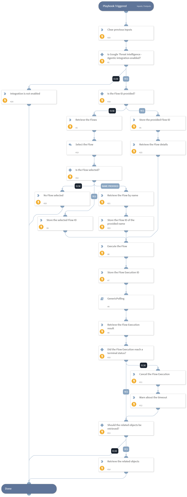

This playbook executes a GTI Agentic Flow on demand. It retrieves the details of the provided Flow ID, or retrieves up to 40 Flows and asks the analyst which Flow to execute, triggers a run of the Flow, polls the status of the Flow Execution until it reaches a terminal status, cancels the Flow Execution when the polling timeout is reached, and retrieves the related objects of the Flow Execution for further investigation.

## Dependencies

This playbook uses the following sub-playbooks, integrations, and scripts.

### Sub-playbooks

* GenericPolling

### Integrations

This playbook does not use any integrations.

### Scripts

* DeleteContext
* PrintErrorEntry
* Set

### Commands

* gti-agentic-flow-execute
* gti-agentic-flow-execution-cancel
* gti-agentic-flow-execution-get
* gti-agentic-flow-execution-object-list
* gti-agentic-flow-get
* gti-agentic-flow-list

## Playbook Inputs

---

| **Name** | **Description** | **Default Value** | **Required** |
| --- | --- | --- | --- |
| FlowID | The ID of the GTI Agentic Flow to execute.  Note: When it is not provided, the playbook retrieves up to 40 Flows and asks the analyst to select the Flow to execute, or to provide the full name of the Flow when it is not listed. |  | Optional |
| Relationship | The relationship of the related objects to retrieve for the Flow Execution. Possible values are: Flow, Flow Snapshot, Owner, Group. | Flow Snapshot | Optional |
| PollingInterval | The interval in minutes at which the status of the Flow Execution is verified. | 1 | Optional |
| PollingTimeout | The maximum time in minutes to wait for the Flow Execution to reach a terminal status. | 60 | Optional |
| RetrieveRelatedObjects | Whether the related objects of the Flow Execution should be retrieved after the execution completes. Possible values are: True, False. | True | Optional |

## Playbook Outputs

---

| **Path** | **Description** | **Type** |
| --- | --- | --- |
| GoogleThreatIntelligenceAgentic.Flow | The details of the GTI Agentic Flows that the playbook retrieved. | unknown |
| GoogleThreatIntelligenceAgentic.FlowExecution | The details of the GTI Agentic Flow Execution, including the output of each step. | unknown |
| GoogleThreatIntelligenceAgentic.FlowExecutionRelationship | The objects that are related to the GTI Agentic Flow Execution. | unknown |

## Playbook Image

---

