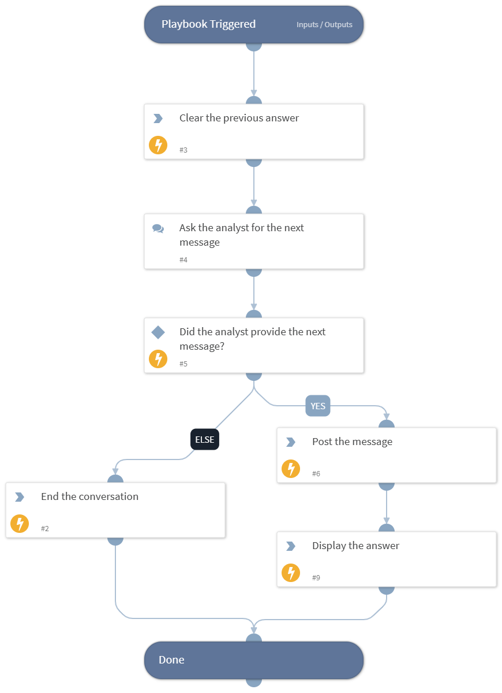

This playbook performs a single turn of the conversation with the Google Threat Intelligence agent in a GTI Agentic Session. It asks the analyst for the next message, posts the message to the session and displays the answer of the agent. When the analyst does not provide a message, it marks the conversation as ended. It is meant to run in a loop from the GTI Agentic Session Interaction - Google Threat Intelligence playbook, which runs it up to 100 times.

## Dependencies

This playbook uses the following sub-playbooks, integrations, and scripts.

### Sub-playbooks

This playbook does not use any sub-playbooks.

### Integrations

This playbook does not use any integrations.

### Scripts

* DeleteContext
* Print
* Set

### Commands

* gti-agentic-session-message-post

## Playbook Inputs

---

| **Name** | **Description** | **Default Value** | **Required** |
| --- | --- | --- | --- |
| SessionID | The ID of the GTI Agentic Session to continue the conversation in. |  | Required |

## Playbook Outputs

---
There are no outputs for this playbook.

## Playbook Image

---

