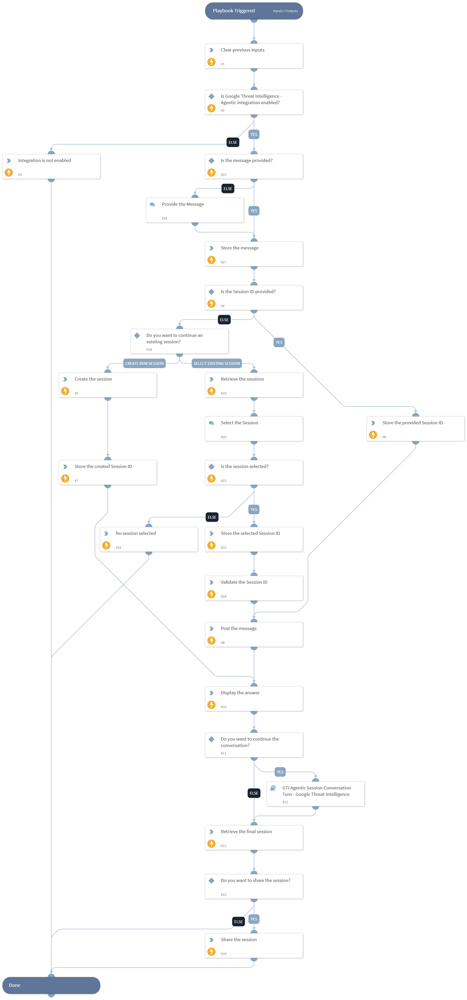

This playbook interacts with the Google Threat Intelligence agent through a GTI Agentic Session. It asks the analyst for the message when it is not provided, posts the message to the provided session, or asks the analyst whether to continue an existing session or to create a new one, and displays the answer of the agent. It then asks the analyst whether to continue the conversation and, if so, asks for the next message after every answer, until the analyst ends the conversation. Finally, it retrieves the complete conversation of the session and optionally shares the session. The playbook supports up to 100 follow-up messages after the first message.

## Dependencies

This playbook uses the following sub-playbooks, integrations, and scripts.

### Sub-playbooks

* GTI Agentic Session Conversation Turn - Google Threat Intelligence

### Integrations

This playbook does not use any integrations.

### Scripts

* DeleteContext
* Print
* PrintErrorEntry
* Set

### Commands

* gti-agentic-session-create
* gti-agentic-session-get
* gti-agentic-session-list
* gti-agentic-session-message-post
* gti-agentic-session-token-get

## Playbook Inputs

---

| **Name** | **Description** | **Default Value** | **Required** |
| --- | --- | --- | --- |
| SessionID | The ID of an existing GTI Agentic Session to continue.  Note: When it is not provided, the playbook asks the analyst whether to select an existing session from up to 50 sessions, or to create a new agentic session. |  | Optional |
| Message | The message to send to the Google Threat Intelligence agent.  Note: When it is not provided, the playbook asks the analyst for the message. |  | Optional |
| EntryID | A comma-separated list of the War Room entry IDs of the files to attach to the message as artifacts.  Note: When the message is not provided, the playbook also asks the analyst for the entry IDs, which are used only when this input is not provided. |  | Optional |

## Playbook Outputs

---

| **Path** | **Description** | **Type** |
| --- | --- | --- |
| GoogleThreatIntelligenceAgentic.Session | The details of the GTI Agentic Session, including the complete conversation. | unknown |
| GoogleThreatIntelligenceAgentic.SessionToken | The share token of the GTI Agentic Session, when the analyst chooses to share the session.  Note: The share token is displayed in the War Room and stored in the incident context, hence it is visible to everyone with access to the incident. Anyone who has the share token can import the session along with its conversation. | unknown |

## Playbook Image

---

