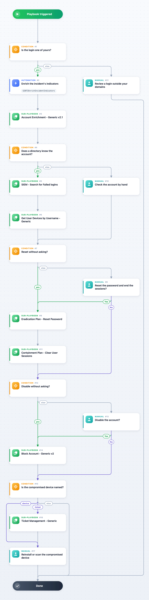

Responds to a GIB Compromised Account Group incident: a login of your organization that a stealer log or a combolist exposed. The playbook checks that the login belongs to one of your domains and enriches the incident's indicators. It looks the account up in your directory (Account Enrichment - Generic v2.1) and, when a directory knows it, searches your SIEM for failed logins and lists the user's devices. Then it resets the password, ends the sessions and disables the account, each at once or after an analyst agrees, as AutoResetPassword and AutoDisableAccount say. When CreateTicket is True and the stealer log names the device, it opens a ticket for that device. The remediation goes through the generic sub-playbooks, which use the directory, SIEM, EDR and ticketing integrations enabled on your Cortex XSOAR; a step whose integration is missing is skipped.

Containment Plan - Clear User Sessions, Eradication Plan - Reset Password and Ticket Management - Generic ship only for Cortex XSIAM and the Cortex platform; on a tenant without them, the steps that call them are skipped.

## Dependencies

This playbook uses the following sub-playbooks, integrations, and scripts.

### Sub-playbooks

* Account Enrichment - Generic v2.1
* Block Account - Generic v2
* Containment Plan - Clear User Sessions
* Eradication Plan - Reset Password
* Get User Devices by Username - Generic
* SIEM - Search for Failed logins
* Ticket Management - Generic

### Integrations

* Group-IB Threat Intelligence

### Scripts

* GIBTIEnrichIncidentIndicators

### Commands

This playbook does not use any commands.

## Playbook Inputs

---

| **Name** | **Description** | **Default Value** | **Required** |
| --- | --- | --- | --- |
| Login | The compromised login as Group-IB serves it, usually an e-mail address. | ${incident.gibcompromisedlogin} | Optional |
| LoginDomain | The domain of the login's e-mail address. | ${incident.gibparsedlogindomain} | Optional |
| CorporateDomains | Comma-separated e-mail domains of your organization. A login outside them is left to the analyst. Empty: every login counts as yours. |  | Optional |
| Username | The name your directory, SIEM and IAM know the account by; the login itself by default. | ${incident.gibcompromisedlogin} | Optional |
| IAMUserDomain | The domain suffix of the account in your IAM, with its @ (@example.com), for a Username without a domain; Account Enrichment - Generic v2.1 appends it for the IAM lookup. Leave it empty when Username is an e-mail address. |  | Optional |
| AutoResetPassword | True resets the password and ends the sessions without asking the analyst. | False | Optional |
| AutoDisableAccount | True disables the account without asking the analyst. | False | Optional |
| CreateTicket | True opens a ticket (Ticket Management - Generic) for the compromised device when the stealer log names one. | False | Optional |
| TicketAssignmentGroup | The ServiceNow assignment group of the ticket. |  | Optional |

## Playbook Outputs

---

| **Path** | **Description** | **Type** |
| --- | --- | --- |
| Account.Username | The account as the directory knows it. | unknown |
| NumOfSiemFailedLogon | Failed logins the SIEM holds for the account. | unknown |
| ServiceNow.Ticket.ID | The ticket opened for the compromised device. | string |

## Playbook Image

---

