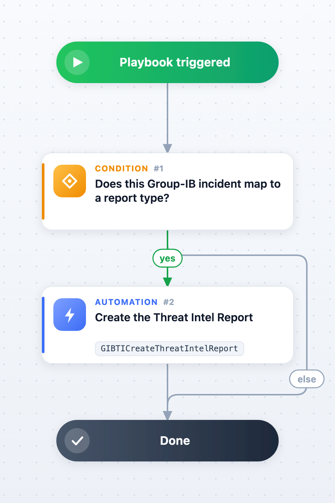

Creates a Cortex XSOAR Threat Intel Report from the Group-IB record behind an incident, through the **GIBTICreateThreatIntelReport** automation. The report type follows the collection:

| Incident type | Collection | Report type |
| --- | --- | --- |
| GIB Cybercriminal Threat, GIB Nation-State Cybercriminals Threat | hi/threat, apt/threat | Campaign |
| GIB Cybercriminal Threat Actor, GIB Nation-State Cybercriminals Threat Actor | hi/threat_actor, apt/threat_actor | Threat Actor |
| GIB Malware | malware/malware | Malware |
| GIB OSI Vulnerability | osi/vulnerability | Vulnerability |

Any other incident type finishes immediately. The main fields Group-IB sent (attribution, evaluation, dates, regions, sectors, CVSS/EPSS, description, indicators, reports, forum accounts) are rendered into the report body, so nothing depends on tenant-specific custom fields.

## How to switch it on

The playbook ships attached to no incident type. The default playbook of every Group-IB incident type is *Incident Postprocessing - Group-IB Threat Intelligence & Attribution*, so the choice is yours:

- attach this playbook to the incident types above (Cortex XSOAR 8: **Settings & Info** > **Settings** > **Object Setup** > **Incidents**, then the incident type's playbook; 6.10: the incident type's settings), or
- call it as a sub-playbook from your own playbook, or
- run `!GIBTICreateThreatIntelReport` by hand inside one of these incidents (no arguments needed).

Validate the payload first with the `DryRun` input set to `true`.

## Dependencies

This playbook uses the following sub-playbooks, integrations, and scripts.

### Sub-playbooks

This playbook does not use any sub-playbooks.

### Integrations

* Group-IB Threat Intelligence (`gibti-get-threat-info`, `gibti-get-threat-actor-info`, `gibti-get-malware-malware-info`, `gibti-get-osi-vulnerability-info`, through the automation)

### Scripts

* GIBTICreateThreatIntelReport

### Commands

* createThreatIntelReport (built-in, through the automation)
* setThreatIntelReport (built-in, through the automation)

## Playbook Inputs

---

| **Name** | **Description** | **Default Value** | **Required** |
| --- | --- | --- | --- |
| ReportType | Threat Intel Report type to create (Campaign, Threat Actor, Malware, Vulnerability, Executive Brief). Leave empty to use the type that fits the collection. |  | Optional |
| DryRun | Set to "true" to only show the payload that would be written. | false | Optional |

## Playbook Outputs

---

| **Path** | **Description** | **Type** |
| --- | --- | --- |
| GIBTI.ThreatIntelReport.id | ID of the created Threat Intel Report. | string |
| GIBTI.ThreatIntelReport.name | Name of the report. | string |
| GIBTI.ThreatIntelReport.type | Report type. | string |
| GIBTI.ThreatIntelReport.created | Whether a report was created. | boolean |

## Playbook Image

---

