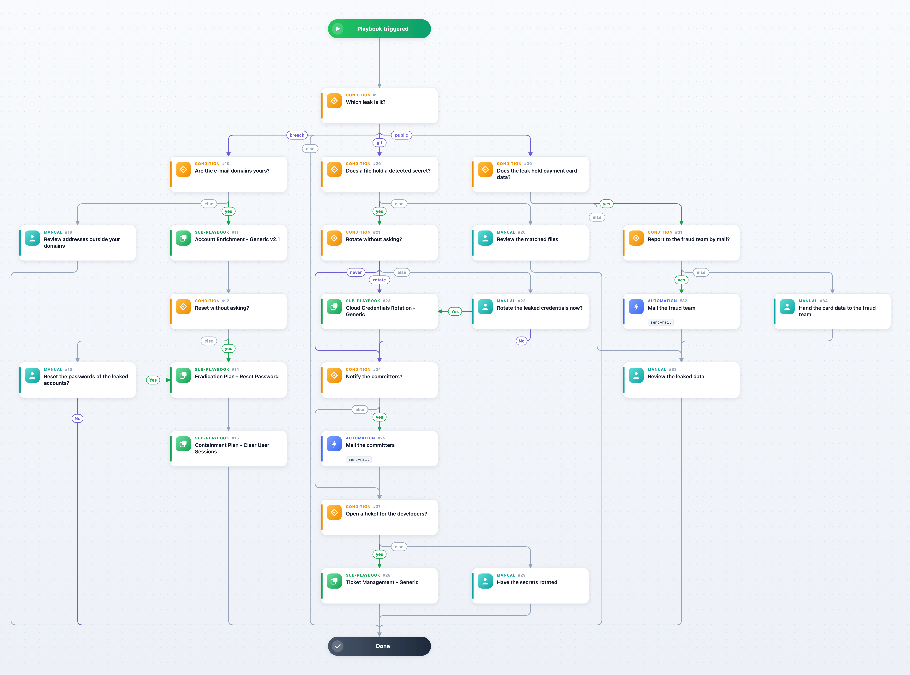

Responds to the leak incidents: GIB Data Breach (your users' credentials in a breach dump), GIB OSI Git Leak (your secrets in a public repository) and GIB OSI Public Leak (your data on a paste or code-sharing site). For a breach the playbook checks that the e-mail domains are yours and looks the accounts up in your directory, then resets their passwords and ends their sessions, with or without an analyst's decision as the inputs say. For a git leak with a detected secret it rotates the credentials (Cloud Credentials Rotation - Generic), mails the committers and opens a ticket for the developers, each as the inputs allow. For a public leak it routes payment card data to the fraud team and leaves the rest to the analyst. The sub-playbooks and the mail steps use whichever directory, IAM, cloud, mail and ticketing integrations are enabled on your Cortex XSOAR.

Containment Plan - Clear User Sessions, Eradication Plan - Reset Password and Ticket Management - Generic ship only for Cortex XSIAM and the Cortex platform; on a tenant without them, the steps that call them are skipped.

## Dependencies

This playbook uses the following sub-playbooks, integrations, and scripts.

### Sub-playbooks

* Account Enrichment - Generic v2.1
* Cloud Credentials Rotation - Generic
* Containment Plan - Clear User Sessions
* Eradication Plan - Reset Password
* Ticket Management - Generic

### Integrations

* The mail sender integration enabled on your Cortex XSOAR (send-mail)

### Scripts

This playbook does not use any scripts.

### Commands

* send-mail

## Playbook Inputs

---

| **Name** | **Description** | **Default Value** | **Required** |
| --- | --- | --- | --- |
| Emails | The leaked e-mail addresses of a breach. | ${incident.gibemails} | Optional |
| EmailDomains | The domains of the leaked e-mail addresses. | ${incident.gibemaildomains} | Optional |
| CorporateDomains | Comma-separated e-mail domains of your organization. A breach of other domains is left to the analyst. Empty: every domain counts as yours. |  | Optional |
| Username | The names your directory and IAM know the leaked accounts by; the e-mail addresses by default. | ${incident.gibemails} | Optional |
| IAMUserDomain | The domain suffix of the account in your IAM, with its @ (@example.com), for a Username without a domain; Account Enrichment - Generic v2.1 appends it for the IAM lookup. Leave it empty when Username is an e-mail address. |  | Optional |
| AutoResetPassword | True resets the passwords and ends the sessions without asking the analyst. | False | Optional |
| SecretTypes | The secret types Group-IB detected in the leaked files (password, api_key, bearer, ...). | ${incident.gibosigitrepositoryfilestable.datafound} | Optional |
| CommitterEmails | The e-mail addresses of the committers of the leaked files. | ${incident.gibosigitrepositoryfilestable.authoremail} | Optional |
| NotifyCommitters | True mails the committers through the mail sender integration. | False | Optional |
| RotateCredentials | What to do with the leaked cloud credentials: Ask (an analyst decides), True (rotate) or False (never). | Ask | Optional |
| CloudProvider | The cloud provider of the leaked credentials for Cloud Credentials Rotation - Generic: AWS, AZURE or GCP. |  | Optional |
| CloudRemediationType | The remediation Cloud Credentials Rotation - Generic applies (see its inputs). |  | Optional |
| CloudIdentityType | The identity type of the leaked credentials (IAM, SERVICE_ACCOUNT, ...). |  | Optional |
| CreateTicket | True opens a ticket for the developers of a leaked repository. | False | Optional |
| TicketAssignmentGroup | The ServiceNow assignment group of the ticket. |  | Optional |
| FraudTeamEmail | The address the card data of a public leak is reported to. Empty leaves it to the analyst. |  | Optional |

## Playbook Outputs

---

| **Path** | **Description** | **Type** |
| --- | --- | --- |
| Account.Username | The leaked accounts as the directory knows them. | unknown |
| ServiceNow.Ticket.ID | The ticket opened for the developers. | string |

## Playbook Image

---

