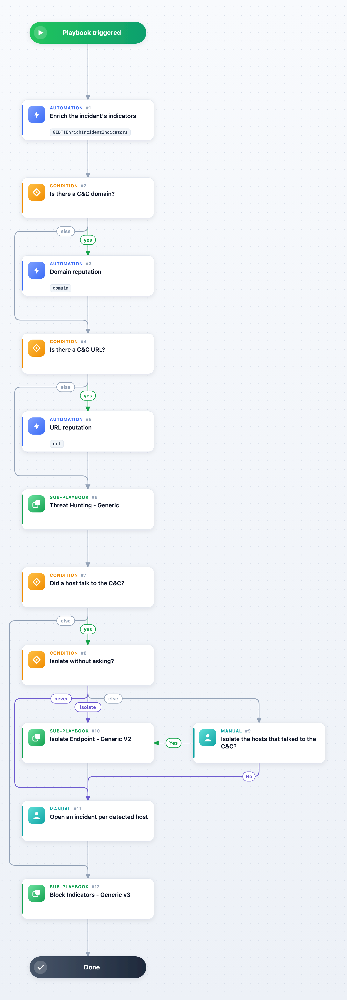

Responds to a GIB Malware CNC incident: a command-and-control server Group-IB attributes to a malware family. The playbook creates the C&C's URL, domain and IP indicators with Group-IB's verdict and asks the domain reputation command about the domain field of the C&C record and the url reputation command about the C&C as Group-IB serves it. It hunts for the indicators in your SIEM and EDR (Threat Hunting - Generic), offers to isolate the hosts that talked to the C&C (Isolate Endpoint - Generic V2), asks the analyst to open an incident per detected host or user, and blocks the indicators Group-IB scores Suspicious or Bad on your perimeter (Block Indicators - Generic v3), through whichever SIEM, EDR, firewall and proxy integrations are enabled on your Cortex XSOAR. The playbook also fits any incident whose indicators Group-IB created: the hunt and the block read the DBotScore entries of the Group-IB vendor. The domain and url steps ask the reputation integrations enabled on this Cortex XSOAR; Group-IB answers them when its instance selects the command under Enable reputation commands.

## Dependencies

This playbook uses the following sub-playbooks, integrations, and scripts.

### Sub-playbooks

* Block Indicators - Generic v3
* Isolate Endpoint - Generic V2
* Threat Hunting - Generic

### Integrations

* Group-IB Threat Intelligence

### Scripts

* GIBTIEnrichIncidentIndicators

### Commands

* domain
* url

## Playbook Inputs

---

| **Name** | **Description** | **Default Value** | **Required** |
| --- | --- | --- | --- |
| CncDomain | The domain field of the C&C record: the C&C's host name. | ${incident.gibmalwarecncdomain} | Optional |
| CncURL | The C&C as Group-IB serves it (GIB CNC URL): a URL, a domain or an IP address. | ${incident.gibcncurl} | Optional |
| InternalRange | Comma-separated CIDR ranges of your internal network, for the hunt. |  | Optional |
| InternalDomainName | Your internal domain name, so the hunt tells internal hosts from external ones. |  | Optional |
| InternalHostRegex | A regular expression of your internal host names, for the hunt. |  | Optional |
| SplunkEarliestTime | How far back the Splunk hunt looks. | -7d@d | Optional |
| QRadarTimeFrame | How far back the QRadar hunt looks. | LAST 7 DAYS | Optional |
| IsolateHosts | What to do with the hosts the hunt found talking to the C&C: Ask (an analyst decides), True (isolate) or False (never). | Ask | Optional |
| AutoBlock | True skips the prompt in which the analyst picks the indicators to block; False asks for that choice. | False | Optional |
| UserVerification | True asks the analyst to confirm the IP and URL blocks; False blocks at once. | True | Optional |

## Playbook Outputs

---

| **Path** | **Description** | **Type** |
| --- | --- | --- |
| Splunk.DetectedInternalHosts | Internal hosts Splunk saw talking to the C&C. | unknown |
| PANWHunting.DetectedInternalHosts | Internal hosts Cortex Data Lake saw talking to the C&C. | unknown |
| QRadar.DetectedInternalHosts | Internal hosts QRadar saw talking to the C&C. | unknown |
| IndicatorsToBlock | The indicators the blocking sub-playbook handled. | unknown |

## Playbook Image

---

