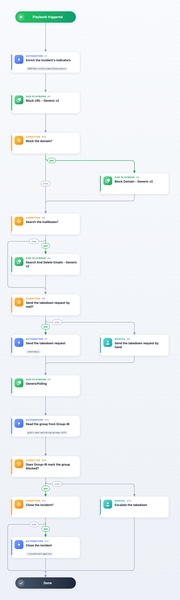

Responds to a GIB Attacks Phishing Group incident: a phishing site Group-IB confirmed. Unless Hunting Rules is on and your API user has hunting rules enabled for attacks/phishing_group, or the brands filter keeps your own brands, the collection lists phishing of every brand, so attach the playbook only to groups that impersonate yours. The playbook creates the phishing URL indicators with Group-IB's verdict and blocks the URLs on the proxy and firewall integrations enabled on your Cortex XSOAR (Block URL - Generic v2). When the inputs allow it, the playbook also blocks the domain on the proxy, mail security, EDR and network integrations and tags it for an External Dynamic List (Block Domain - Generic v2). When SearchAndDeleteIntegration is MS Graph, it searches the mailboxes the analyst picks for messages received in the last 7 days whose body names the domain and deletes them; the other mail integrations need a sender, subject, attachment name or message ID, which a phishing group does not carry. It sends the takedown request to the registrar and the hosting provider by mail, or hands it to the analyst, then polls Group-IB until the group is marked blocked and closes the incident when the inputs allow it. A phishing kit incident fills none of the phishing group fields the inputs read: this playbook is for phishing groups.

## Dependencies

This playbook uses the following sub-playbooks, integrations, and scripts.

### Sub-playbooks

* Block Domain - Generic v2
* Block URL - Generic v2
* GenericPolling
* Search And Delete Emails - Generic v2

### Integrations

* Group-IB Threat Intelligence
* The mail sender integration enabled on your Cortex XSOAR (send-mail)

### Scripts

* GIBTIEnrichIncidentIndicators

### Commands

* closeInvestigation
* gibti-get-phishing-group-info
* gibti-get-phishing-group-info (through GenericPolling)
* send-mail

## Playbook Inputs

---

| **Name** | **Description** | **Default Value** | **Required** |
| --- | --- | --- | --- |
| GroupId | The Group-IB id of the phishing group. | ${incident.gibid} | Optional |
| URLs | The phishing URLs of the group. | ${incident.gibphishingurls} | Optional |
| Domain | The phishing domain. | ${incident.gibphishingdomain} | Optional |
| Brand | The brand the site impersonates. | ${incident.gibphishingbrand} | Optional |
| Registrar | The registrar of the phishing domain. | ${incident.gibphishingregistrar} | Optional |
| HostingIPs | The addresses hosting the site. | ${incident.gibphishingiptable.ip} | Optional |
| UserVerification | True asks the analyst before the URLs are blocked; False blocks at once. | True | Optional |
| BlockDomain | True also blocks the phishing domain through Block Domain - Generic v2, which asks no one; a phishing domain is often shared hosting. False leaves the domain to the analyst. | False | Optional |
| SearchAndDeleteIntegration | The mail integration that Search And Delete Emails - Generic v2 runs on (MS Graph, Gmail, EWS or Agari Phishing Defense). Empty skips the mailbox search. With MS Graph the search looks for the phishing domain in the body of the messages received in the last 7 days, and the analyst picks the mailboxes and the delete type. The other integrations need a sender, subject, attachment name or message ID, which a phishing group does not carry. |  | Optional |
| TakedownEmail | The abuse addresses the takedown request is sent to, comma-separated (registrar, hosting provider). Empty leaves the request to the analyst. |  | Optional |
| PollIntervalMinutes | Minutes between two checks of the group's status at Group-IB. | 60 | Optional |
| PollTimeoutMinutes | Minutes after which the playbook stops waiting for Group-IB to mark the group blocked. | 1440 | Optional |
| CloseWhenBlocked | True closes the incident once Group-IB marks the group blocked. | False | Optional |

## Playbook Outputs

---

| **Path** | **Description** | **Type** |
| --- | --- | --- |
| GIBTI.PhishingGroup.blocked | When Group-IB marked the group blocked. | date |

## Playbook Image

---

