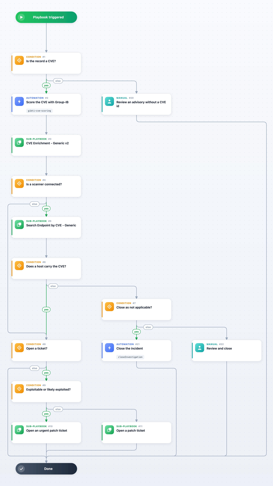

Triages a GIB OSI Vulnerability incident. For a CVE record the playbook scores the CVE with Group-IB (exploit evidence, EPSS, CVSS and Group-IB's severity), enriches it (CVE Enrichment - Generic v2), searches your vulnerability scanner for the hosts that carry it when ScannerConnected is True (Search Endpoint by CVE - Generic) and, when CreateTicket allows it, opens a patch ticket (Ticket Management - Generic) whose urgency follows the exploit evidence and the EPSS and CVSS thresholds. An incident without a vulnerable host is closed as not applicable only when CloseWhenNotApplicable allows it and ScannerConnected says a scanner is connected. Records that are not CVEs (scanner plugins, vendor advisories, Microsoft advisories of type mscve) are left to the analyst.

Ticket Management - Generic ships only for Cortex XSIAM and the Cortex platform; on a tenant without it, the steps that call it are skipped.

## Dependencies

This playbook uses the following sub-playbooks, integrations, and scripts.

### Sub-playbooks

* CVE Enrichment - Generic v2
* Search Endpoint by CVE - Generic
* Ticket Management - Generic

### Integrations

* Group-IB Threat Intelligence

### Scripts

This playbook does not use any scripts.

### Commands

* closeInvestigation
* gibti-cve-scoring

## Playbook Inputs

---

| **Name** | **Description** | **Default Value** | **Required** |
| --- | --- | --- | --- |
| CVE | The Group-IB id of the record: the CVE id for cve records. | ${incident.gibid} | Optional |
| RecordType | The record type Group-IB gives the vulnerability (cve, mscve, nessus, ...). | ${incident.gibvulnerabilitytype} | Optional |
| ScannerConnected | True once a vulnerability scanner that Search Endpoint by CVE - Generic supports is connected; until then the playbook neither searches for hosts nor closes incidents. | False | Optional |
| CloseWhenNotApplicable | True closes the incident when the scanner finds no host with the CVE. | False | Optional |
| CreateTicket | True opens a patch ticket when the CVE is found on a host, or when no scanner is connected. | False | Optional |
| TicketAssignmentGroup | The ServiceNow assignment group of the ticket. |  | Optional |
| UrgentTicketUrgency | The ServiceNow urgency of a ticket for an exploitable or likely exploited CVE, or one whose merged CVSS reaches CvssThreshold. | 1 | Optional |
| NormalTicketUrgency | The ServiceNow urgency of every other ticket. | 3 | Optional |
| EpssThreshold | The EPSS score (0-1) from which a CVE counts as likely exploited. | 0.5 | Optional |
| CvssThreshold | The merged CVSS score from which a CVE gets an urgent ticket. | 9 | Optional |

## Playbook Outputs

---

| **Path** | **Description** | **Type** |
| --- | --- | --- |
| GIBTI.CVEScoring | The Group-IB score of the CVE. | unknown |
| Endpoint.Hostname | The hosts that carry the CVE. | string |
| ServiceNow.Ticket.ID | The patch ticket. | string |

## Playbook Image

---

