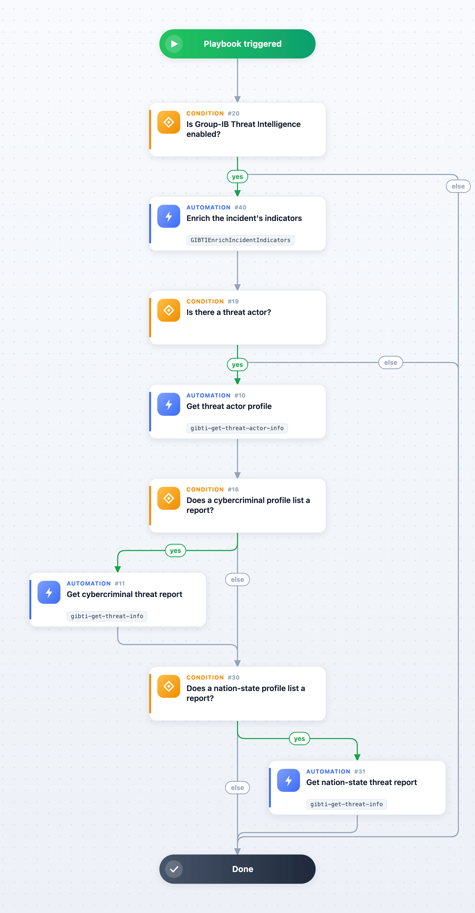

Enriches a Group-IB incident: first the **GIBTIEnrichIncidentIndicators** automation reads the record again with the matching `gibti-get-*-info` command, so every observable of the record is created with the verdict, tags, malware family, TLP, geo data, ASN, file hashes and size, CVSS score and vector, CVE dates and description, and *GIB Collection* of the record, and related to the Malware / Threat Actor objects it names (the automation creates those objects). A *Cryptocurrency Address* indicator gets no tags, malware family or TLP, and an *Email* or *CVE* indicator no malware family. The names on a *GIB Data Breach* incident (the leak's publishers) and on a defacement incident (the defacer's handle) make no object. A phishing group that Group-IB flags as a false positive or allow-listed gives no indicator and no object. In an incident of a legacy type (a renamed or removed collection), the automation returns a note and enriches nothing. Incidents that name threat actors (*GIB Threat Actor ID*; an actor profile incident names its own actor) then get every actor profile from `hi/threat_actor` or `apt/threat_actor`. The incident's APT flag picks the collection searched first, and an actor missing there is read from the other one (a malware profile lists several actors without an APT flag). An actor neither collection publishes (a defacer known from `attacks/deface` only, or a profile Group-IB has not published) is noted in the War Room. When the profiles list threat reports, the first cybercriminal report is looked up in `hi/threat` and the first nation-state report in `apt/threat`; a report missing there is read from the other one. The **GIBTIEnrichIncidentIndicators** step creates the indicators of the incident's record, and each report lookup creates the indicators of the report it fetches. The actor profiles and reports stay in the War Room and the context (see Playbook Outputs). Incidents without a threat actor finish after the indicator enrichment, so the playbook can stay attached to every Group-IB incident type, and a lookup that fails is marked in the work plan without stopping the playbook.

It is the default playbook of every Group-IB incident type, and none of them runs it automatically: start it from the incident, or turn on **Run playbook automatically** in an incident type to enrich every new incident of that type. Each run costs a few Group-IB API requests: it reads the incident's record again, then the profiles of the actors the record names and the first report each kind of profile lists.

The actor and report lookups pass the incident's source instance, the one that fetched it (`using=${incident.sourceInstance}`), so a deployment with several Group-IB Threat Intelligence instances reads each record once, on the right tenant. They pass that name even when the instance has since been disabled or deleted. The **GIBTIEnrichIncidentIndicators** step checks it: it uses the source instance while that instance is active, and otherwise the only active instance (every active instance when there are several).

To turn the fetched report into a Cortex XSOAR Threat Intel Report, run the **GIBTICreateThreatIntelReport** automation with the report's id as *gib_id* and *collection* set to `hi/threat` or `apt/threat`. The **Group-IB TI - Create Threat Intel Report** playbook reads only the record behind the incident.

## Dependencies

This playbook uses the following sub-playbooks, integrations, and scripts.

### Sub-playbooks

This playbook does not use any sub-playbooks.

### Integrations

* Group-IB Threat Intelligence

### Scripts

* GIBTIEnrichIncidentIndicators

### Commands

* gibti-get-threat-actor-info
* gibti-get-threat-info

## Playbook Inputs

---
There are no inputs for this playbook.

## Playbook Outputs

---

| **Path** | **Description** | **Type** |
| --- | --- | --- |
| GIBTI.GIBCybercriminalThreatActorProfile | Cybercriminal threat actor profile (hi/threat_actor). | unknown |
| GIBTI.Nation-StateCybercriminalsThreatActorProfile | Nation-state threat actor profile (apt/threat_actor). | unknown |
| GIBTI.GIBCybercriminalThreatReport | Cybercriminal threat report (hi/threat). | unknown |
| GIBTI.Nation-StateCybercriminalsThreatReport | Nation-state threat report (apt/threat). | unknown |

## Playbook Image

---

