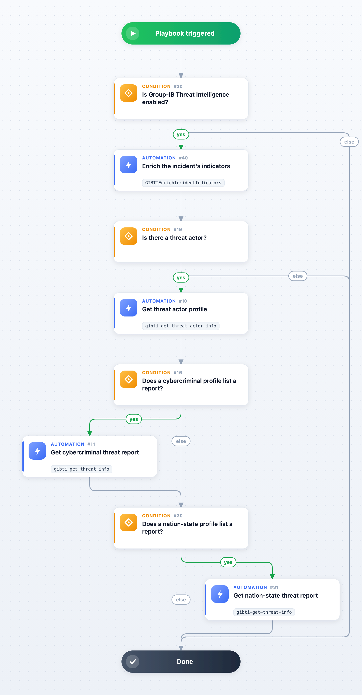

Group-IB Threat Intelligence delivers what Group-IB knows about the threats that matter to your organization: compromised accounts and cards, suspicious payment details, data breaches and leaks, phishing, defacements and DDoS attacks, malware infrastructure, suspicious IPs, vulnerabilities, threat reports and threat actor profiles, dark web marketplace listings and Telegram, Discord and forum posts, and public posts about threats. This pack brings that data into Cortex XSOAR.

## What does this pack do?

* Fetches Group-IB records as incidents, with an incident type for every collection it fetches (legacy types of renamed and removed collections included), layouts, a classifier and a mapper.
* Feeds Group-IB indicators of compromise into Threat Intel Management, with verdicts, tags, TLP and relationships to the malware families and threat actors behind them.
* Looks up, searches and scores Group-IB data from the War Room: record lookups by ID, global and per-collection search, IP, domain and CVE scoring, IP and domain WHOIS records, and the `ip` / `domain` / `file` / `url` reputation commands.
* Enriches Group-IB incidents (indicators, threat actor profile, threat report) through the **Incident Postprocessing - Group-IB Threat Intelligence & Attribution** playbook, the default playbook of every Group-IB incident type. It runs when you start it from an incident; turn on *Run playbook automatically* in an incident type to run it on every new incident of that type.
* Turns threat reports, actor profiles, malware and vulnerability records into Cortex XSOAR Threat Intel Reports through the **Group-IB TI - Create Threat Intel Report** playbook.
* Responds to the incidents through five playbooks built on generic sub-playbooks, which use the directory, SIEM, EDR, firewall, mail, vulnerability scanner, cloud and ticketing integrations you have enabled: **Group-IB TI - Compromised Account Response**, **Group-IB TI - Malware C2 Response**, **Group-IB TI - Vulnerability Triage**, **Group-IB TI - Phishing Takedown** and **Group-IB TI - Leaked Credentials and Secrets**. Attach them to the incident types or call them from your own playbooks; their inputs decide which steps run without an analyst. **Containment Plan - Clear User Sessions**, **Eradication Plan - Reset Password** and **Ticket Management - Generic** ship only for Cortex XSIAM and the Cortex platform; on a tenant without them, the steps that call them are skipped.
* Ships seven dashboards (overview, threats and actors, suspicious IPs, leaks and vulnerabilities, fraud intelligence, attacks, dark web)<~XSOAR> and the pre-processing rules that keep re-sent records from creating duplicate incidents (**GIB Rule All Types**, enabled, and the legacy **GIB Rule**, disabled)</~XSOAR>.<~XSIAM> To keep re-sent records from creating duplicate alerts, enable *Skip updated incidents (prevent duplicates)*.</~XSIAM>

