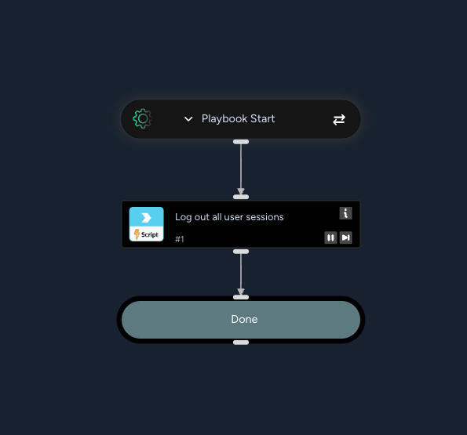

Ends all of the user's active sessions and cookies in the Idira Identity Security Platform, forcing them to sign in again.

## Dependencies

This playbook uses the following sub-playbooks, integrations, and scripts.

### Sub-playbooks

This playbook does not use any sub-playbooks.

### Integrations

* IdiraIdentityResponse

### Scripts

This playbook does not use any scripts.

### Commands

* idira-identity-response-force-logout

## Playbook Inputs

---

| **Name** | **Description** | **Default Value** | **Required** |
| --- | --- | --- | --- |
| UserID | The Idira Identity user unique ID. Defaults to the user ID of the issue. Use the idira-identity-response-get-user-by-name command to resolve a username to its unique ID. | ${issue.userid} | Required |

## Playbook Outputs

---
There are no outputs for this playbook.

## Playbook Image

---

