## Cortex XSOAR and Lumu SecOps Integration

Lumu SecOps provides capabilities to fetch, investigate, and manage Lumu incidents from Cortex XSOAR, including bidirectional incident mirroring.

For product details, visit: https://lumu.io/

#### Diagram

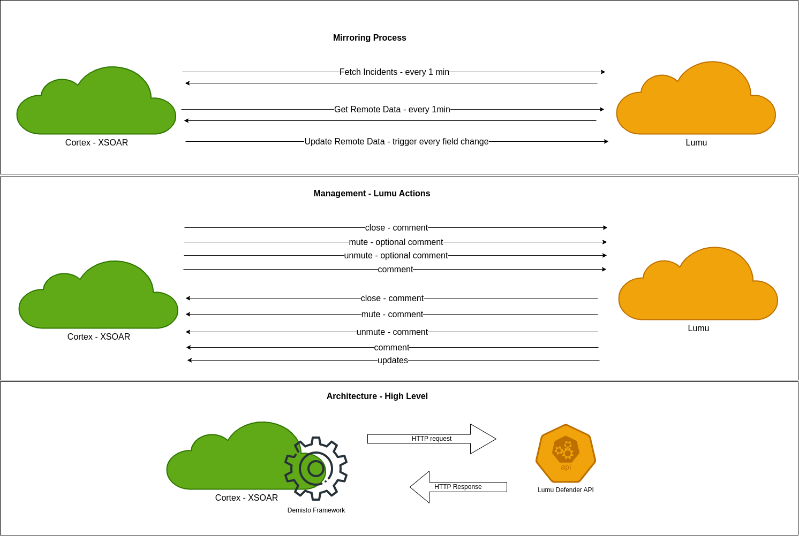

#### Lumu API Specifications

Core Lumu API operations used by this integration:

- [Get all incidents](https://docs.lumu.io/portal/en/kb/articles/core-concepts-api#heading-ee15950c-6781-bc30)
- [Get open incidents](https://docs.lumu.io/portal/en/kb/articles/core-concepts-api#heading-e122950f-869e-86e5)
- [Get muted incidents](https://docs.lumu.io/portal/en/kb/articles/core-concepts-api#Get_muted_incidents_Available_for_Insights)
- [Get closed incidents](https://docs.lumu.io/portal/en/kb/articles/core-concepts-api#Get_closed_incidents_Available_for_Insights)
- [Get incident events groupings](https://docs.lumu.io/portal/en/kb/articles/core-concepts-api#Get_incident_events_groupings_Available_for_Insights)
- [Get incident details](https://docs.lumu.io/portal/en/kb/articles/core-concepts-api#Get_incident_details_Available_for_Insights)
- [Mark incident as read](https://docs.lumu.io/portal/en/kb/articles/core-concepts-api#Mark_incident_as_read_Available_for_Insights)
- [Begin incident work](https://docs.lumu.io/portal/en/kb/articles/core-concepts-api#Begin_incident_work_Available_for_Insights)
- [Comment incident](https://docs.lumu.io/portal/en/kb/articles/core-concepts-api#heading-51187ea8-bf25-4327)
- [Mute incident](https://docs.lumu.io/portal/en/kb/articles/core-concepts-api#heading-2bdab078-aa36-ebe2)
- [Unmute incident](https://docs.lumu.io/portal/en/kb/articles/core-concepts-api#Unmute_incident_Available_for_Insights)
- [Close incident](https://docs.lumu.io/portal/en/kb/articles/core-concepts-api#Close_incident_Available_for_Insights)
- [Consult incidents updates](https://docs.lumu.io/portal/en/kb/articles/core-concepts-api#Consult_incidents_updates_Available_for_Insights)
- [Get security event details](https://docs.lumu.io/portal/en/kb/articles/core-concepts-api#Get_security_event_details_Available_for_Insights)
- [Get incident security events details](https://docs.lumu.io/portal/en/kb/articles/core-concepts-api#Get_incident_security_events_details_Available_for_Insights)

#### Operation

##### Marketplace

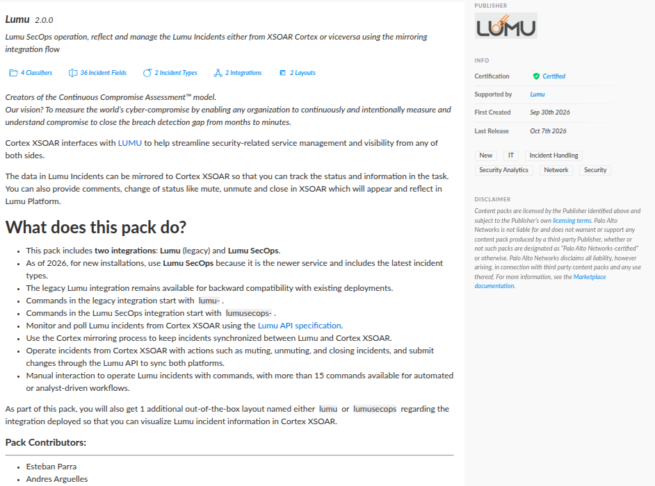

##### Configure the integration instance

Prerequisites:

- A Lumu Defender API key.
- Access to the Lumu Defender API endpoints.

Recommended for API key configuration:

- In Cortex XSOAR, set the API key by using a credential object in `Integrations -> Credentials`, then reference that credential in the integration instance.

After installing the Lumu pack from Marketplace:

- Go to `Settings -> Integrations -> Instances`.
- Search for `Lumu Secops` and add a new instance.

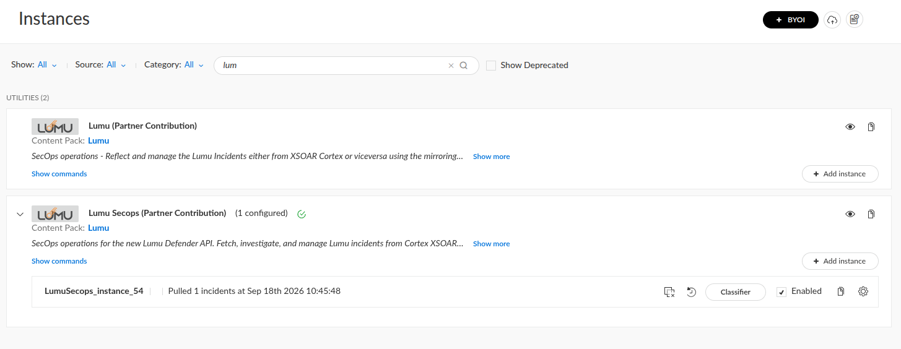

Instance parameters:

- _Name_ (required)
- _Server URL_ (required, default: `https://defender.lumu.io`)
- _Use system proxy settings_ (optional)
- _Trust any certificate (not secure)_ (optional)
- _API Key_ (required)
- _Fetch incidents_ (optional, default enabled)
- _Incident type_ (optional, default: `LumuSecops`)
- _Lumu incident fetch offset_ (optional, default: `0`)
- _Size of Lumu incident records per Lumu fetch_ (optional, default: `30`)
- _Max Seconds waiting for fetching Lumu incidents_ (optional, default: `4`)
- _Incidents Fetch Interval_ (optional, default: `1` minute)
- _Incident Mirroring Direction_ (optional, default: `Incoming And Outgoing`)
- _Mirror tags_ (optional, default: `mirror`)

Submit:

- Click `Test` and verify a successful result.
- Click `Save & Exit`.

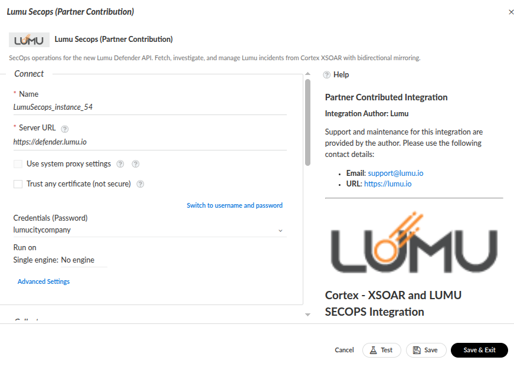
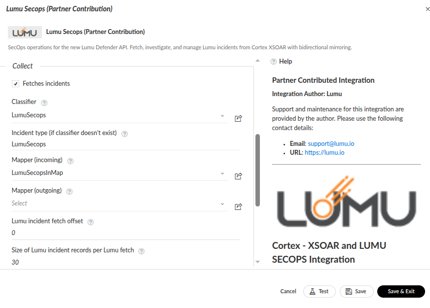

##### Supported commands

Label commands:

- `!lumusecops-retrieve-labels`
- `!lumusecops-retrieve-a-specific-label`

Incident retrieval commands:

- `!lumusecops-get-all-incidents`
- `!lumusecops-get-open-incidents`
- `!lumusecops-get-muted-incidents`
- `!lumusecops-get-closed-incidents`
- `!lumusecops-get-incident-events-groupings`
- `!lumusecops-get-incident-details`

Incident action commands:

- `!lumusecops-mark-incident-as-read`
- `!lumusecops-begin-incident-work`
- `!lumusecops-comment-incident`
- `!lumusecops-mute-incident`
- `!lumusecops-unmute-incident`
- `!lumusecops-close-incident`

Update and event commands:

- `!lumusecops-consult-incidents-updates`
- `!lumusecops-get-security-event-details`
- `!lumusecops-get-incident-security-events-details`

Mirroring commands (internal use by XSOAR mirroring flow):

- `!get-modified-remote-data`
- `!get-remote-data`
- `!get-mapping-fields`
- `!update-remote-system`

##### Dashboard: Incident list

- Use the Lumu portal and Cortex XSOAR incidents view to monitor mirrored incidents.

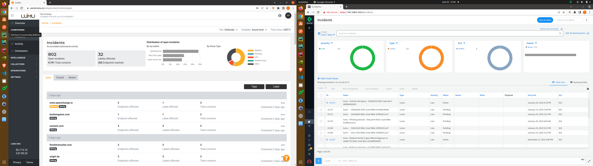

##### Incident creation and updates

- The mirroring process runs in the background and synchronizes incident creation and updates between both platforms.

Creation (Cortex on the left, Lumu on the right):

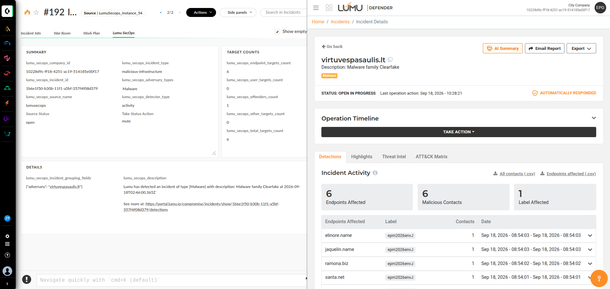

Updates (Cortex on the left, Lumu on the right):

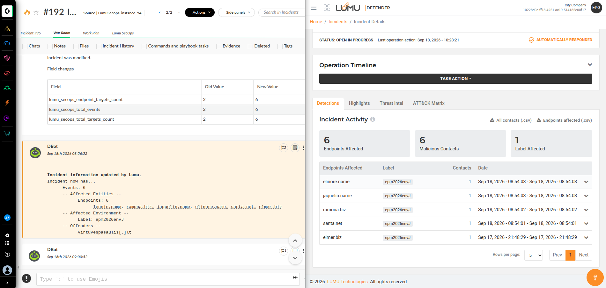

##### Mute and unmute incidents

- You can mute/unmute from Cortex XSOAR or from Lumu Portal.
- Changes are mirrored between both systems (typically within about one minute).

From Cortex to Lumu:

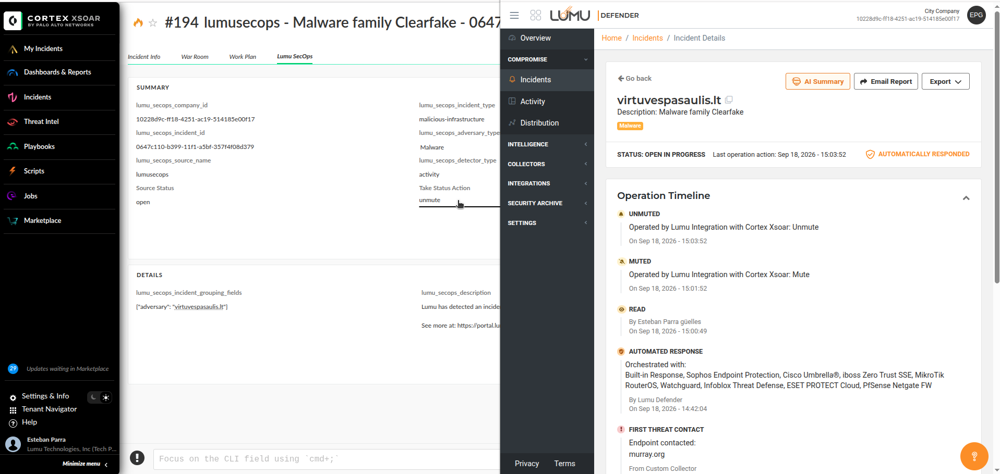

From Lumu to Cortex:

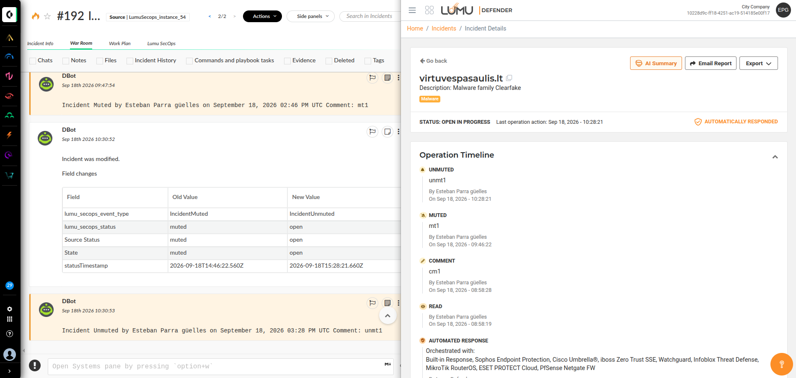

##### Close incidents

- You can close incidents from Cortex XSOAR or from Lumu Portal.
- Closing status is mirrored between both systems (typically within about one minute).

From Cortex to Lumu:

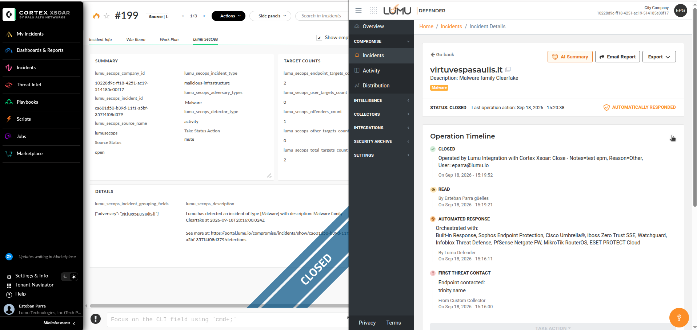

From Lumu to Cortex:

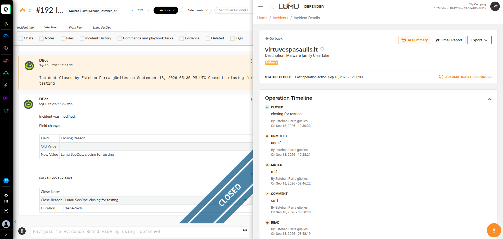

##### Logs and troubleshooting

- War Room: run commands and inspect integration responses.

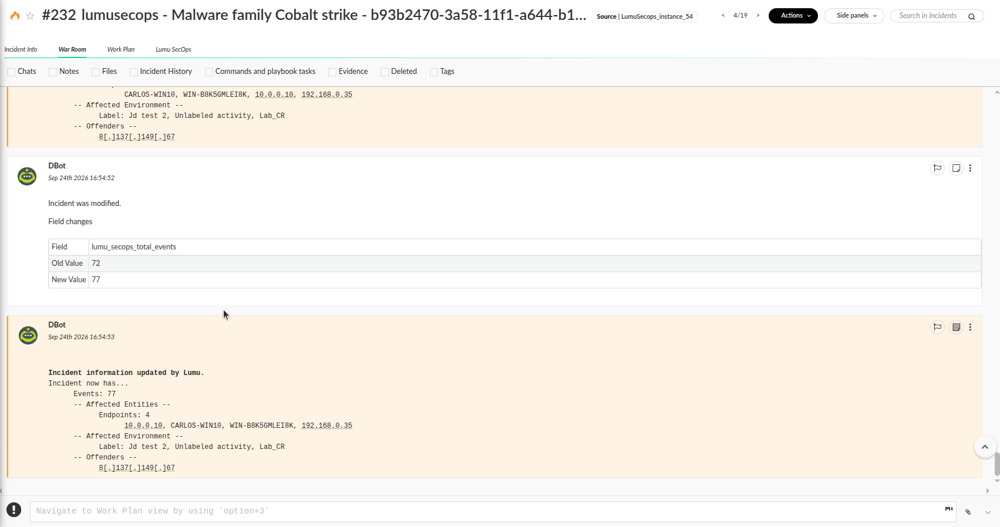

- Fetch history: review periodic `fetch-incidents` executions.

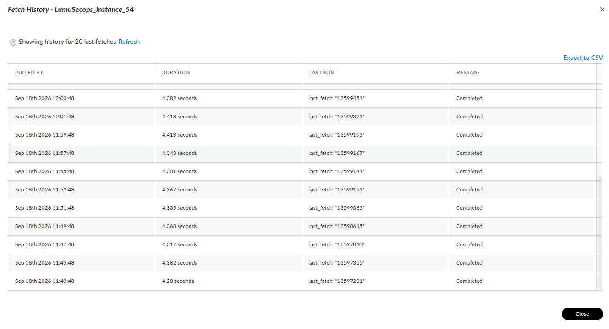

- Integration instance logs (Cortex XSOAR web console):

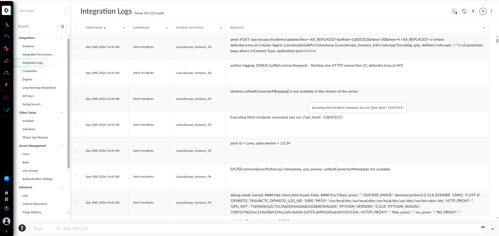

- `integration-instance.log` (SSH):

```bash
tail -f /var/log/demisto/integration-instance.log
```

---
[View Integration Documentation](https://xsoar.pan.dev/docs/reference/integrations/lumu)