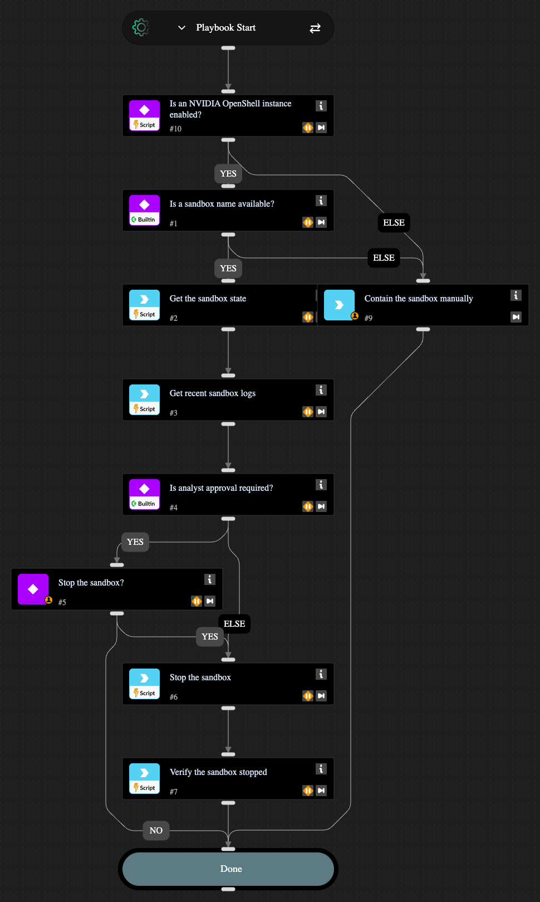

Contains an AI agent running in an NVIDIA OpenShell sandbox. Gets the sandbox state and recent logs, optionally waits for analyst approval, stops the sandbox and verifies that it stopped.

## Dependencies

This playbook uses the following sub-playbooks, integrations, and scripts.

### Sub-playbooks

This playbook does not use any sub-playbooks.

### Integrations

* NVIDIA OpenShell

### Scripts

* IsIntegrationAvailable

### Commands

* openshell-sandbox-get
* openshell-sandbox-logs
* openshell-sandbox-stop

## Playbook Inputs

---

| **Name** | **Description** | **Default Value** | **Required** |
| --- | --- | --- | --- |
| SandboxName | The name of the OpenShell sandbox to contain. Map it from the incident or alert field that holds the sandbox name. |  | Optional |
| RequireApproval | Whether an analyst must approve before the sandbox is stopped. Set to false to stop the sandbox automatically. | true | Optional |

## Playbook Outputs

---

| **Path** | **Description** | **Type** |
| --- | --- | --- |
| OpenShell.Sandbox.Phase | The sandbox phase after the playbook ran. | string |
| OpenShell.Sandbox.Action | The action that was performed on the sandbox. | string |

## Playbook Image

---

