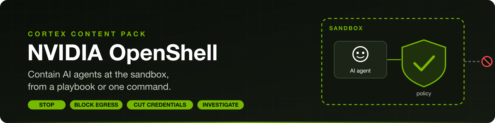
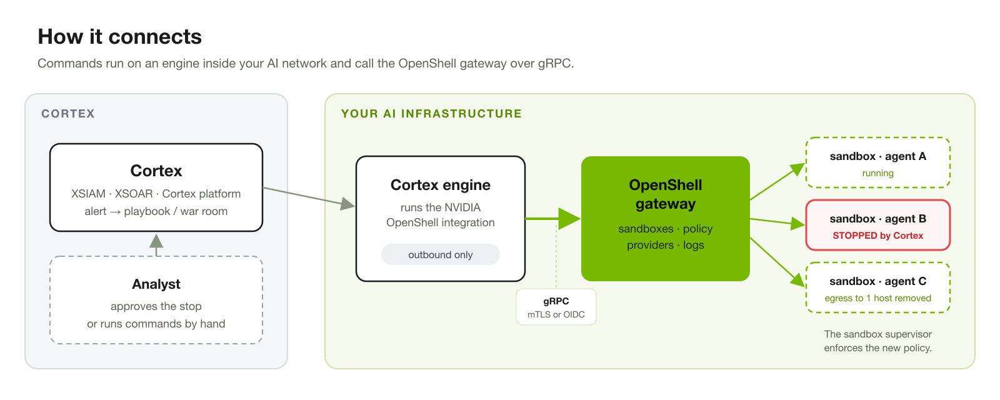
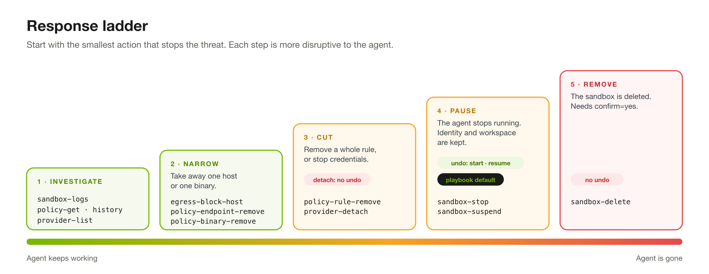
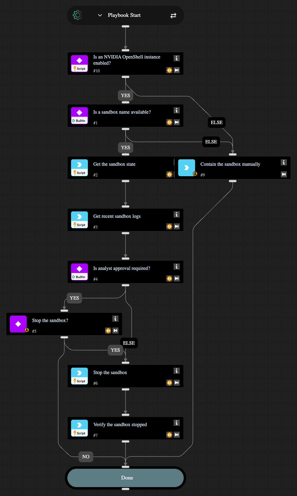

<p align="center">

</p>

<p align="center">
<b>Stop</b> an agent &nbsp;·&nbsp; <b>Block</b> one host &nbsp;·&nbsp; <b>Cut</b> its credentials &nbsp;·&nbsp; <b>Investigate</b> what it did
</p>

---

## Why this pack

[NVIDIA OpenShell](https://github.com/NVIDIA/OpenShell) runs autonomous AI agents inside sandboxes. Each sandbox has a network policy (which hosts, ports and binaries the agent may use) and credential providers (which secrets the agent receives).

When an agent misbehaves, for example it is prompt-injected, exfiltrates data or calls an unexpected host, the fastest control point is the sandbox itself. This pack gives Cortex that control point. A playbook or an analyst can stop the agent, take away one destination, or detach its credentials through the OpenShell gateway, and every policy change is recorded as a new revision with the reason.

| | |
| --- | --- |
| **Contain in seconds** | Stop or suspend a sandbox from a playbook, with or without analyst approval. |
| **Contain precisely** | Remove a single host, endpoint or binary while the agent keeps running. |
| **Contain safely** | Egress changes are applied in one atomic policy update and recorded with a reason. Destructive actions need `confirm=yes`. |
| **Investigate first** | Pull recent network and policy decisions, the active policy and its history into the war room. |

## How it connects



The integration runs on a Cortex engine that can reach the OpenShell gateway, and talks to it over gRPC with mutual TLS or an OIDC bearer token. The engine only opens outbound connections. Nothing in the AI network has to be exposed to the internet.

## Response ladder



Start with the smallest action that stops the threat, and move up only if you need to.

| Step | Goal | Commands | Agent keeps running | Reversible |
| :---: | --- | --- | :---: | :---: |
| 1 | Investigate | `openshell-sandbox-logs`, `openshell-policy-get`, `openshell-policy-history`, `openshell-provider-list` | Yes | n/a |
| 2 | Narrow | `openshell-egress-block-host`, `openshell-policy-endpoint-remove`, `openshell-policy-binary-remove` | Yes | Yes <sup>1</sup> |
| 3 | Cut | `openshell-policy-rule-remove`, `openshell-provider-detach` | Yes | Rule: yes <sup>1</sup><br/>Provider: **no** |
| 4 | Pause | `openshell-sandbox-stop`, `openshell-sandbox-suspend` | No | Yes, with `start` / `resume` |
| 5 | Remove | `openshell-sandbox-delete` | No | **No** |

<sup>1</sup> Policy changes create a new revision. Restore access by adding the entry back in OpenShell. `openshell-policy-history` shows what changed and why.

## What's in the pack

| Type | Name | What it does |
| --- | --- | --- |
| Integration | **NVIDIA OpenShell** | 17 commands for sandbox lifecycle, network policy, credential providers and logs. |
| Playbook | **NVIDIA OpenShell - Contain AI Agent Sandbox** | Collects the sandbox state and recent logs, asks an analyst to approve, stops the sandbox and verifies that it stopped. Falls back to a manual task if the stop fails. |

<details>
<summary><b>All 17 integration commands</b></summary>

| Area | Command | What it does |
| --- | --- | --- |
| Gateway | `openshell-gateway-info-get` | Returns the gateway version. |
| Sandbox | `openshell-sandbox-list` | Lists sandboxes and their phase, filtered by workspace or label. |
| Sandbox | `openshell-sandbox-get` | Returns one sandbox and its phase. |
| Sandbox | `openshell-sandbox-stop` | Stops a sandbox and waits until it reports STOPPED. |
| Sandbox | `openshell-sandbox-start` | Starts a stopped sandbox. |
| Sandbox | `openshell-sandbox-suspend` | Suspends a sandbox and keeps its state. |
| Sandbox | `openshell-sandbox-resume` | Resumes a suspended sandbox. |
| Sandbox | `openshell-sandbox-delete` | Deletes a sandbox. Needs `confirm=yes`. |
| Sandbox | `openshell-sandbox-logs` | Returns recent network decisions, process and policy events. |
| Policy | `openshell-policy-get` | Returns the active network policy: rules, hosts, ports and binaries. |
| Policy | `openshell-policy-history` | Returns policy revisions, newest first. |
| Policy | `openshell-egress-block-host` | Removes every exact allow entry for a host in one atomic update, and lists wildcard entries that still match. |
| Policy | `openshell-policy-rule-remove` | Removes a whole network rule. |
| Policy | `openshell-policy-endpoint-remove` | Removes one host and port from a rule. |
| Policy | `openshell-policy-binary-remove` | Removes one binary from a rule. |
| Credentials | `openshell-provider-list` | Lists the credential providers attached to a sandbox. |
| Credentials | `openshell-provider-detach` | Detaches a credential provider. Needs `confirm=yes`. |

</details>

## Playbook: Contain AI Agent Sandbox



1. Checks that an NVIDIA OpenShell instance is enabled and that a sandbox name was provided.
2. Gets the sandbox state and its last 50 log lines, so the analyst sees what the agent was doing.
3. If `RequireApproval` is `true` (the default), asks the analyst whether to stop the sandbox.
4. Stops the sandbox and waits up to 120 seconds for it to report STOPPED.
5. Reads the sandbox state back, so the incident records the result.
6. If there is no instance or sandbox name, or the stop fails, a manual task lists the fallback steps.

| Input | Default | Description |
| --- | --- | --- |
| `SandboxName` | | The sandbox to contain. Map it from the alert field that holds the sandbox name. |
| `RequireApproval` | `true` | Set to `false` to stop the sandbox without waiting for an analyst. |

## Try it in the war room

Narrow first. This removes one destination and leaves the agent running:

```
!openshell-egress-block-host name=research-agent-7 host=paste.example.com reason="Exfiltration alert 4512"
```

If the agent keeps misbehaving, stop it. Its identity and workspace are kept for the investigation:

```
!openshell-sandbox-stop name=research-agent-7
```

> [!NOTE]
> `openshell-egress-block-host` removes exact entries only. If a wildcard entry such as `*.example.com` still allows the host, the command lists it under `OpenShell.EgressBlock.WildcardMatches`. Remove that rule with `openshell-policy-rule-remove`, or stop the sandbox.

## Before you start

| Requirement | Details |
| --- | --- |
| OpenShell gateway | Version 0.1.6 or later. |
| Cortex engine | An engine that can reach the gateway host and port. The gateway is usually private, so the integration cannot run without an engine. |
| Credentials | Mutual TLS files (`ca.crt`, `tls.crt`, `tls.key`) from the OpenShell CLI configuration, usually `~/.config/openshell/gateways/<gateway>/mtls/`, **or** an OIDC bearer token. |

<details>
<summary><b>Gateway listens on localhost only?</b></summary>

Install the engine on the gateway host and run integration containers with host networking, then use `127.0.0.1:<port>` as the endpoint. Inside a Cortex container, `localhost` otherwise points at the container itself.

</details>

<details>
<summary><b>Using OIDC instead of mutual TLS</b></summary>

Paste the access token in **OIDC bearer token**. The integration does not refresh it, so use a long-lived token and update the instance before the token expires. If the gateway certificate is signed by a public CA, leave **Gateway CA certificate** empty and the system trust store is used.

</details>

> [!WARNING]
> `openshell-sandbox-delete` and `openshell-provider-detach` cannot be undone. Both require `confirm=yes`. Prefer `openshell-sandbox-stop` during an investigation, so the sandbox can be examined and started again.

## Known limitations

- The integration does not run commands inside a sandbox.
- `openshell-sandbox-suspend` needs a sandbox driver that supports suspend.
- OIDC tokens are not refreshed automatically.

## Additional information

- [NVIDIA OpenShell on GitHub](https://github.com/NVIDIA/OpenShell)
- The integration README in this pack documents every command, its arguments and context outputs.
