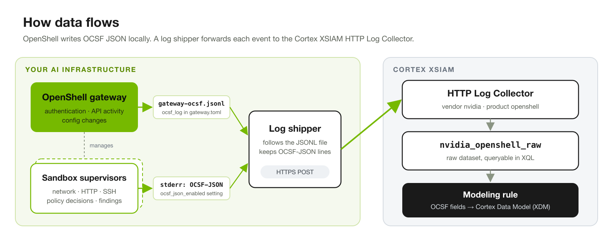

<~XSIAM>

## Overview

NVIDIA OpenShell runs AI agents in isolated sandboxes. The OpenShell gateway manages sandboxes and authenticates callers, and a supervisor in each sandbox enforces network and process policy. Both emit security events in the Open Cybersecurity Schema Framework (OCSF v1.8.0) as JSON.

## This pack includes

Data normalization capabilities:

- A modeling rule that maps NVIDIA OpenShell OCSF events, ingested via the HTTP Log Collector, to the Cortex Data Model (XDM).
  - The ingested NVIDIA OpenShell logs can be queried in XQL Search using the *`nvidia_openshell_raw`* dataset.

## Supported event classes

| OCSF class | Class name | Emitted by |
|:-----------|:-----------|:-----------|
| 4001 | Network Activity | Sandbox supervisor |
| 4002 | HTTP Activity | Sandbox supervisor |
| 4007 | SSH Activity | Sandbox supervisor |
| 2004 | Detection Finding | Sandbox supervisor |
| 5019 | Device Config State Change | Sandbox supervisor, gateway |
| 3002 | Authentication | Gateway |
| 6003 | API Activity | Gateway |
| 0 | Base Event | Sandbox supervisor |

***

## Data Collection

OpenShell writes OCSF JSON locally and does not send it over HTTP itself. Use a log shipper to forward each JSON event to the Cortex XSIAM HTTP Log Collector. Collect both sources below for full coverage. Gateway events and sandbox supervisor events are separate outputs, and enabling one does not enable the other.



### Cortex XSIAM side - Custom - HTTP based Collector

1. Navigate to **Settings** > **Data Sources** > **Add Data Source**.
2. If you have already configured a **Custom - HTTP based Collector**, select the **3 dots**, and then select **+ Add New Instance**. If not, select **+ Add Data Source**, search for "http" and then select **Connect**.
3. Set the following values:

    | Parameter     | Value                           |
    |:--------------|:--------------------------------|
    | `Name`        | NVIDIA OpenShell Logs           |
    | `Compression` | Select the desired compression. |
    | `Log Format`  | Select JSON.                    |
    | `Vendor`      | Enter nvidia.                   |
    | `Product`     | Enter openshell.                |

4. Save the generated token.
5. Select the **3 dots** next to the new instance and copy the API URL.

Configure the log shipper to send each event as one JSON object per line, with an HTTP POST to the API URL and these headers:

- `Authorization: <token>`
- `Content-Type: text/plain`

For more information, see [Set up an HTTP Log Collector to Receive Logs](https://docs-cortex.paloaltonetworks.com/r/Cortex-XSIAM/Cortex-XSIAM-Administrator-Guide/Set-up-an-HTTP-Log-Collector-to-Receive-Logs).

### NVIDIA OpenShell side - Gateway events

Gateway events include authentication results, API authorization denials and gateway configuration changes.

1. In `gateway.toml`, give the gateway a unique name and enable the OCSF JSONL output:

    ```toml
    [openshell.gateway]
    name = "<unique-gateway-name>"

    [openshell.gateway.ocsf_log]
    path = "/var/log/openshell/gateway-ocsf.jsonl"
    rotation = "daily"
    max_files = 7
    ```

2. Restart the gateway to apply the change.
3. Configure the log shipper to read the JSONL file and forward each line to the HTTP Log Collector. The gateway creates the file with owner-only permissions, so grant the shipper read access to it. The shipper must follow rotated files. Give each gateway replica its own file path.

The gateway name appears as `device.name` on every gateway event. Use a distinct name for each installation you collect from.

### NVIDIA OpenShell side - Sandbox supervisor events

Supervisor events include network, HTTP and SSH activity, policy enforcement decisions and detection findings for each sandbox.

1. Enable OCSF JSON output for all sandboxes:

    ```shell
    openshell settings set --global --key ocsf_json_enabled --value true --yes
    ```

    To enable it for a single sandbox instead, run `openshell settings set <sandbox-name> --key ocsf_json_enabled --value true`. A per-sandbox value is rejected while a global value is set. The setting applies on the next poll cycle and does not require a sandbox restart.

2. Each supervisor now writes lines in this format to stderr:

    ```text
    2026-10-07T23:21:19.000Z OCSF-JSON {"class_uid":4001,...}
    ```

3. Configure your container log collector (Docker, Podman or Kubernetes) to keep only lines that contain the `OCSF-JSON` token, and forward the JSON object that follows the token to the HTTP Log Collector. Drop the other lines, which are shorthand copies of the same events.

For more information, see the NVIDIA OpenShell [OCSF JSON Export](https://github.com/ai-openshell/openshell/blob/main/docs/observability/ocsf-json-export.mdx) documentation.

</~XSIAM>
