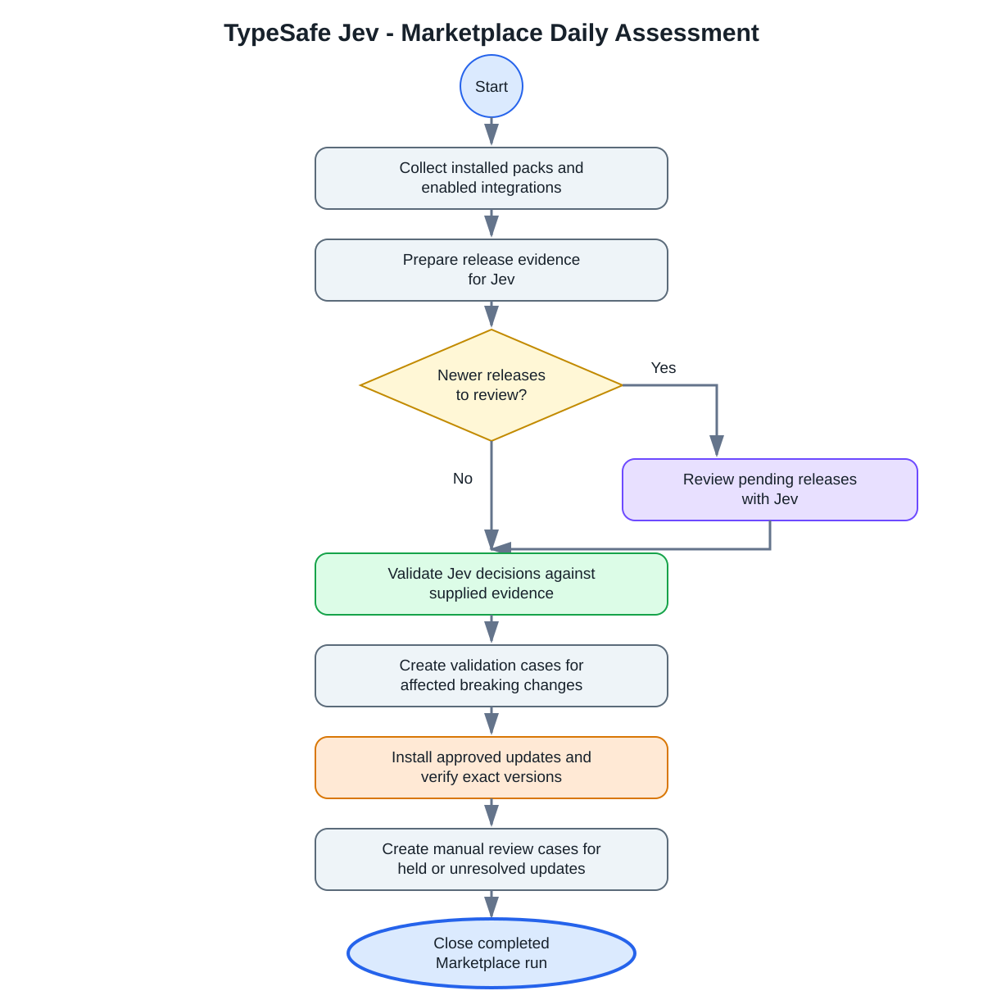

# TypeSafe Jev - Marketplace Daily Assessment

Reviews available Cortex Marketplace pack updates against the integrations
enabled in the current XSIAM tenant. TypeSafe Jev evaluates the release notes
and observed environment state. Deterministic automation validates the Jev
response, resolves mandatory dependencies, verifies installation results, and
creates deduplicated review cases for updates that are held, uncertain, or
failed.



## Prerequisites

- Configure and enable a **TypeSafe Jev** integration instance.
- Configure and enable a **Core REST API** integration instance with permission
  to read Marketplace and integration metadata. Non-dry-run operation also
  requires permission to install content packs and manage the generated cases.
- Test the workflow with `DryRun=true` before enabling changes.

## Inputs

| Input | Description | Required | Default |
|---|---|---|---|
| `DryRun` | When `true`, evaluates and reports without installing packs or changing cases. Set to `false` only after validating the results. | No | `true` |
| `CoreInstance` | Core REST API instance name. An explicit instance prevents calls from being sent to multiple instances. | Yes | None |
| `JevModel` | TypeSafe Jev model alias expected in each response. | No | `jev-1.13.0` |

## Dependencies

### Sub-playbooks

- TypeSafe Jev - Marketplace Release Analysis

### Integrations

- TypeSafe Jev
- Core REST API

### Scripts

- TypeSafeJevMarketplaceAssessment

### Commands

- `jev-evaluate`
- `closeInvestigation`

## Workflow

1. Collect installed pack versions and enabled integration instances.
2. Resolve newer releases and recursive mandatory dependencies.
3. Send release evidence to Jev in bounded batches.
4. Validate that each Jev judgment maps to the supplied release evidence.
5. Hold uncertain, unsupported, or potentially affected updates for review.
6. In non-dry-run mode, install approved updates and verify exact versions.
7. Create or update one review case per held or failed pack version.

The playbook does not treat a Jev answer as direct authorization. Installation
and case handling are controlled by deterministic checks in the
`TypeSafeJevMarketplaceAssessment` automation.

## Test commands

Collect a read-only tenant snapshot:

```text
!TypeSafeJevMarketplaceAssessment action=collect core_instance="Core REST API instance name"
```

Use a specific Core REST API instance:

```text
!TypeSafeJevMarketplaceAssessment action=collect core_instance="Core REST API instance name"
```

Inspect one pack without changing it:

```text
!TypeSafeJevMarketplaceAssessment action=pack_detail pack=TypeSafeJev core_instance="Core REST API instance name"
```

Run the full playbook from the playbook editor with `DryRun=true`. Review
`TypeSafeJevMarketplace.Assessment`, `TypeSafeJevMarketplace.Installation`, and
`TypeSafeJevMarketplace.Review` before running with `DryRun=false`.

## Outputs

The workflow writes its data below `TypeSafeJevMarketplace`, including:

- `Snapshot`: installed packs, newer releases, dependencies, and enabled integrations.
- `ReviewPlan`: immutable evidence batches sent to Jev.
- `Assessment`: validated release decisions and hold reasons.
- `Installation`: installed, held, failed, and already-current packs.
- `Review`: review cases created, retained, or resolved.
- `PackDetail`: read-only details returned by the `pack_detail` action.
