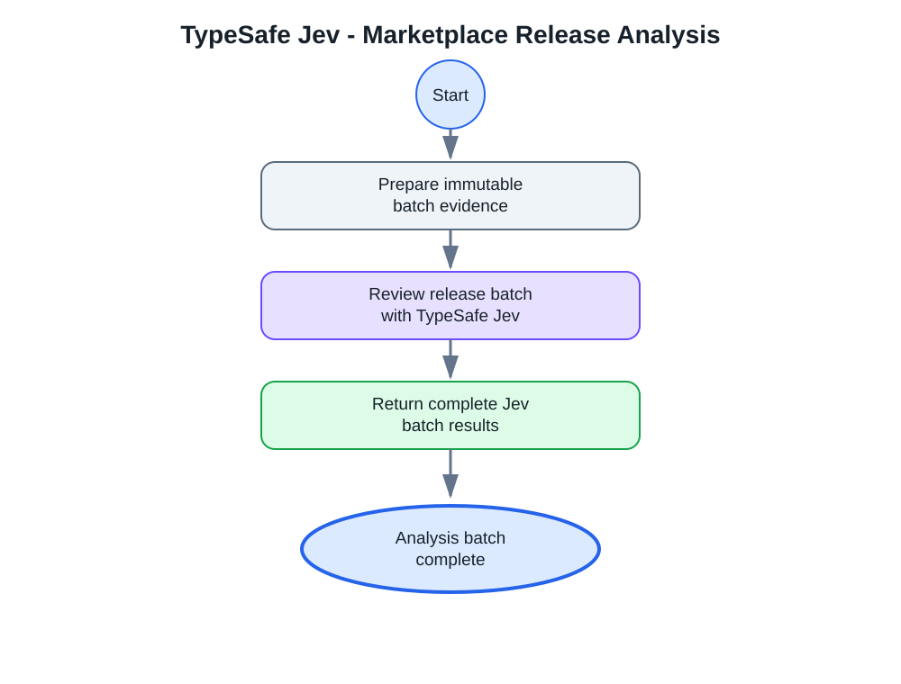

# TypeSafe Jev - Marketplace Release Analysis

Reviews one immutable batch of Marketplace release evidence with the selected
TypeSafe Jev instance and model. This internal sub-playbook returns the complete
Jev response to the parent playbook, where deterministic validation and policy
enforcement take place.

## Dependencies

### Integrations

- TypeSafe Jev

### Scripts

- TypeSafeJevMarketplaceAssessment

### Commands

- `jev-evaluate`

## Inputs

| Input | Description | Required |
|---|---|---|
| `BatchJSON` | Serialized release evidence, state, and questions produced by the parent playbook. | Yes |
| `JevModel` | TypeSafe Jev model alias expected in the response. | Yes |

## Outputs

| Context path | Description | Type |
|---|---|---|
| `TypeSafeJevMarketplace.AnalystBatch` | Wrapped Jev answers returned to the parent validator. | Unknown |

## Safety

This sub-playbook does not install packs or manage cases. It treats release
notes and tenant inventory as untrusted evidence and delegates all response
validation and tenant changes to the parent workflow.
