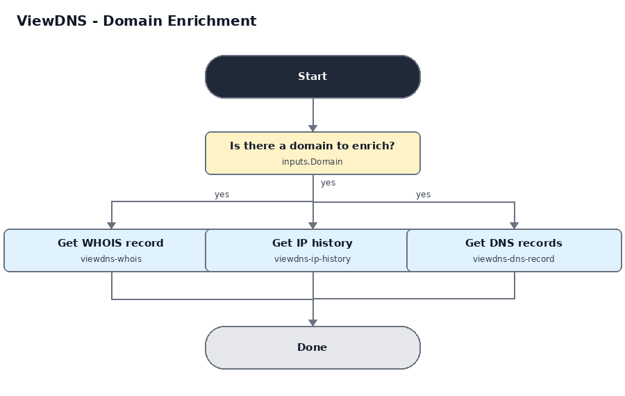

Enriches a domain with ViewDNS.info data: the WHOIS record, the historical IP addresses the domain was hosted on, and its current DNS records. The results are written to the context. The playbook consumes three ViewDNS API queries for every domain provided, and the WHOIS lookup requires a paid ViewDNS API key. A failed lookup does not stop the other lookups.

## Dependencies

This playbook uses the following sub-playbooks, integrations, and scripts.

### Sub-playbooks

This playbook does not use any sub-playbooks.

### Integrations

* ViewDNS

### Scripts

This playbook does not use any scripts.

### Commands

* viewdns-dns-record
* viewdns-ip-history
* viewdns-whois

## Playbook Inputs

---

| **Name** | **Description** | **Default Value** | **Required** |
| --- | --- | --- | --- |
| Domain | The domain to enrich, for example example.com. IP history is only available for registered domains, not subdomains. | ${Domain.Name} | Optional |
| DNSRecordType | The type of DNS record to retrieve, for example A, MX, TXT, or ANY for all record types. | ANY | Optional |
| IPHistoryLimit | The maximum number of IP history records to return, starting from the most recent. | 50 | Optional |

## Playbook Outputs

---

| **Path** | **Description** | **Type** |
| --- | --- | --- |
| ViewDNS.Whois | The WHOIS record of the domain. | unknown |
| ViewDNS.Whois.DomainName | The domain name. | string |
| ViewDNS.Whois.RegistrarName | The name of the registrar. | string |
| ViewDNS.Whois.CreatedDate | The date the domain was registered. | date |
| ViewDNS.Whois.ExpiresDate | The date the domain registration expires. | date |
| ViewDNS.Whois.Registrant.Email | The email address of the registrant. | string |
| ViewDNS.Whois.NameServers | The name servers of the domain. | string |
| ViewDNS.IPHistory | The IP history of the domain. | unknown |
| ViewDNS.IPHistory.Domain | The domain that was searched for. | string |
| ViewDNS.IPHistory.RecordCount | The total number of historical records available for the domain. | number |
| ViewDNS.IPHistory.Records.IP | An IP address the domain was hosted on. | string |
| ViewDNS.IPHistory.Records.Owner | The owner of the IP address. | string |
| ViewDNS.IPHistory.Records.LastSeen | The date the domain was last seen on the IP address. | date |
| ViewDNS.DNSRecord | The DNS records of the domain. | unknown |
| ViewDNS.DNSRecord.Records.Type | The type of the record. | string |
| ViewDNS.DNSRecord.Records.Data | The data of the record. | string |

## Playbook Image

---

