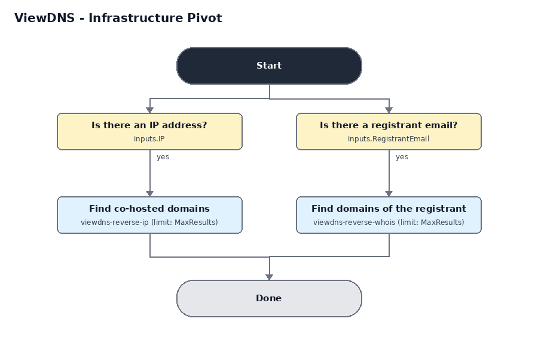

Pivots from a known piece of attacker infrastructure to related domains with ViewDNS.info. Given an IP address, the playbook lists the domains hosted on the same server (reverse IP). Given a registrant email address, it lists the domains registered with that address (reverse WHOIS, which requires a paid ViewDNS API key). To keep API usage predictable, the playbook retrieves only the first page of results for each input, so it consumes exactly one ViewDNS API query per IP address and one per email address. The MaxResults input caps how many domains are written to the context for each lookup; the total number of matches is always reported.

## Dependencies

This playbook uses the following sub-playbooks, integrations, and scripts.

### Sub-playbooks

This playbook does not use any sub-playbooks.

### Integrations

* ViewDNS

### Scripts

This playbook does not use any scripts.

### Commands

* viewdns-reverse-ip
* viewdns-reverse-whois

## Playbook Inputs

---

| **Name** | **Description** | **Default Value** | **Required** |
| --- | --- | --- | --- |
| IP | The IP address to find co-hosted domains for. | ${IP.Address} | Optional |
| RegistrantEmail | The registrant email address to find registered domains for. |  | Optional |
| MaxResults | The maximum number of domains to return for each lookup. Only the first page of API results is retrieved, so each IP address and each email address consumes one API query regardless of this value. | 50 | Optional |

## Playbook Outputs

---

| **Path** | **Description** | **Type** |
| --- | --- | --- |
| ViewDNS.ReverseIP | The reverse IP lookup results. | unknown |
| ViewDNS.ReverseIP.Host | The IP address that was searched for. | string |
| ViewDNS.ReverseIP.DomainCount | The total number of domains hosted on the server. | number |
| ViewDNS.ReverseIP.Domains.Name | A domain hosted on the server. | string |
| ViewDNS.ReverseIP.Domains.LastResolved | The date the domain was last seen resolving to the server. | date |
| ViewDNS.ReverseWhois | The reverse WHOIS lookup results. | unknown |
| ViewDNS.ReverseWhois.Query | The email address that was searched for. | string |
| ViewDNS.ReverseWhois.ResultCount | The total number of matching domains. | number |
| ViewDNS.ReverseWhois.Matches.Domain | A domain registered with the email address. | string |
| ViewDNS.ReverseWhois.Matches.CreatedDate | The date the domain was registered. | date |
| ViewDNS.ReverseWhois.Matches.Registrar | The registrar of the domain. | string |

## Playbook Image

---

